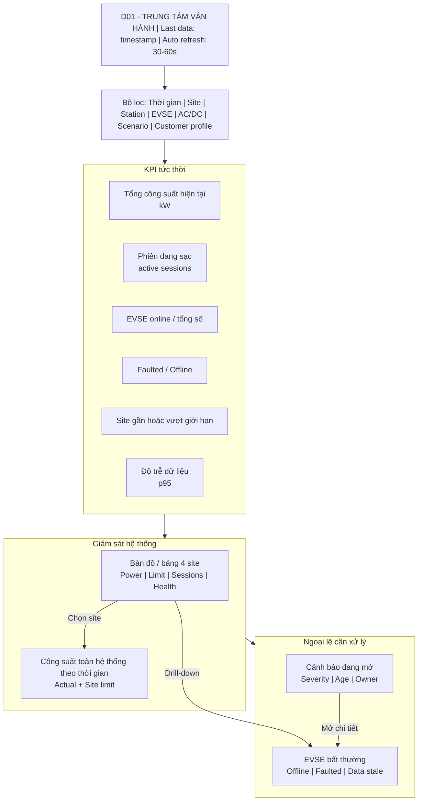
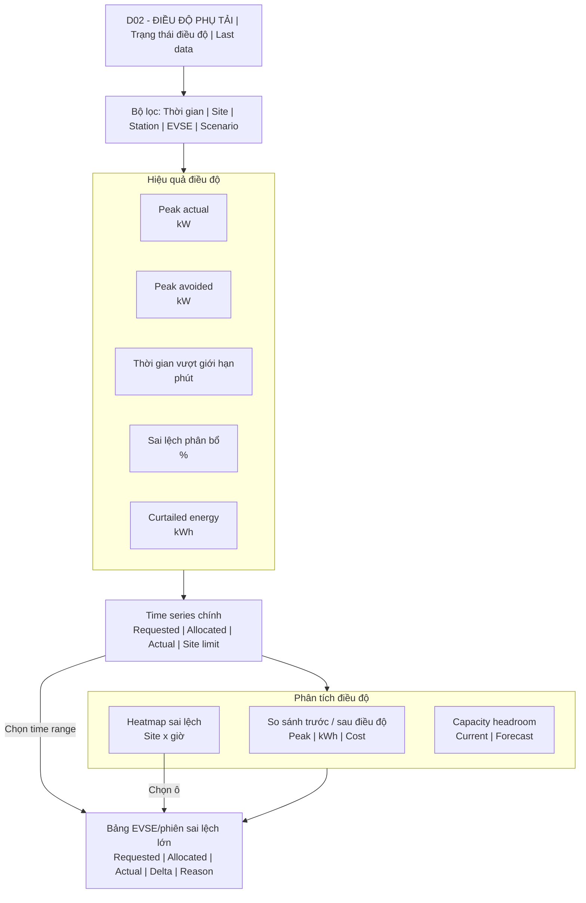
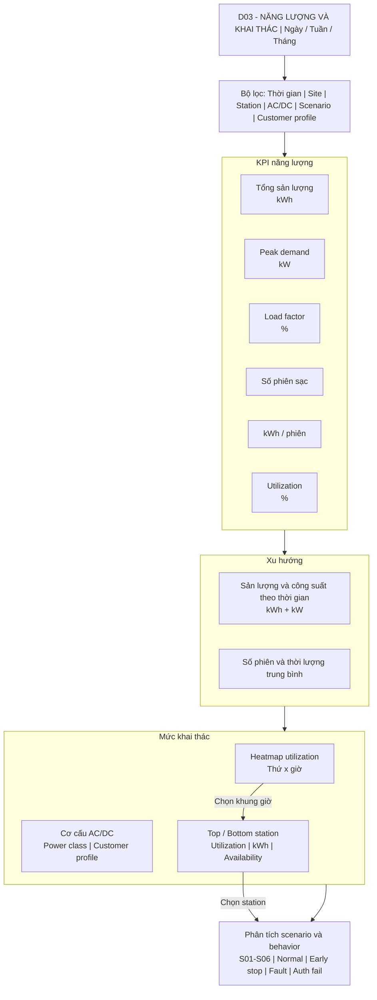
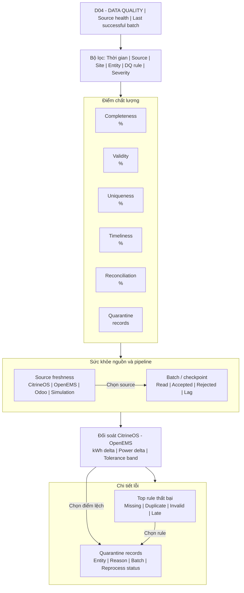
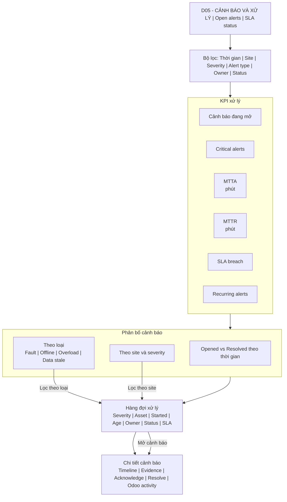
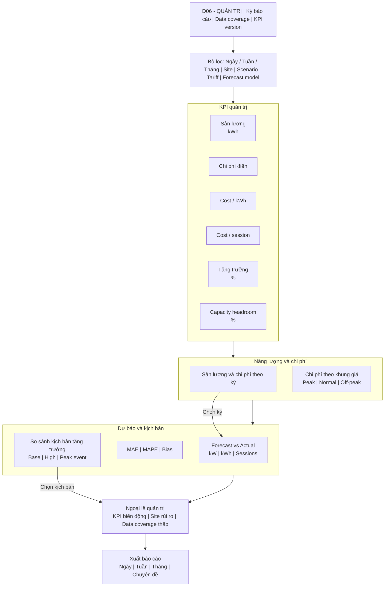
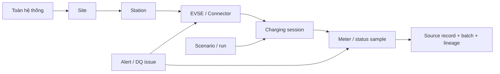

# Backlog 007: Tích hợp dữ liệu đa nguồn và Dashboard Điều độ Năng lượng

## Trạng thái

`Đã lập kế hoạch - Chưa triển khai`

## Căn cứ nghiệp vụ

Kế hoạch này chuyển các yêu cầu trong bản mô tả công việc **Chuyên viên Điều độ Năng lượng** thành một hệ thống dữ liệu và dashboard có thể nghiệm thu. Năm nhóm trách nhiệm cần được chứng minh bằng dữ liệu là:

1. Quản trị dữ liệu vận hành: thu thập, đối soát, phát hiện thiếu/trùng/sai lệch và truy vết nguồn.
2. Điều độ và kiểm soát phụ tải: theo dõi tải, công suất sử dụng, công suất cực đại, nhu cầu sạc và phương án phân bổ công suất.
3. Phân tích và tối ưu năng lượng: sản lượng, mức khai thác, chi phí điện, xu hướng, dự báo và kịch bản tăng trưởng.
4. KPI, dashboard và báo cáo: dashboard vận hành, báo cáo ngày/tuần/tháng, ngoại lệ và cảnh báo sớm.
5. Nghiệp vụ CSMS/EMS: đối soát công suất yêu cầu - công suất phân bổ - công suất thực tế và đánh giá hiệu quả điều độ.

## Mục tiêu

Xây dựng một luồng dữ liệu có thể tái lập từ các nguồn CSMS, EMS, mô phỏng và nghiệp vụ vào một kho phân tích thống nhất; tính KPI theo định nghĩa có version; cung cấp dashboard Grafana gần thời gian thực và báo cáo định kỳ phục vụ vận hành, phân tích và nghiên cứu.

Kết quả phải cho phép người dùng đi từ một KPI tổng hợp về site, station, EVSE/connector, phiên sạc và bản ghi nguồn đã tạo ra KPI đó.

## Phạm vi

### Trong phạm vi

- Kết nối dữ liệu CitrineOS, OpenEMS/InfluxDB, Odoo và metadata của bộ mô phỏng.
- Chuẩn hóa định danh, timestamp, đơn vị đo, trạng thái và nguồn gốc dữ liệu.
- Kho dữ liệu phân tích riêng, tách khỏi database vận hành.
- Pipeline incremental, backfill, retry, idempotency và quan sát độ tươi dữ liệu.
- Mô hình dữ liệu phiên sạc, telemetry, trạng thái thiết bị, công suất điều độ, cảnh báo và chất lượng dữ liệu.
- KPI theo JD và dashboard Grafana cho vận hành, điều độ, phân tích, quản trị dữ liệu và quản trị cấp cao.
- Báo cáo ngày/tuần/tháng có cùng công thức với dashboard.
- Bộ test và quy trình nghiệm thu từ nguồn đến dashboard.

### Ngoài phạm vi giai đoạn đầu

- Điều khiển thiết bị điện thật.
- Thay thế Operator UI của CitrineOS hoặc UI của OpenEMS.
- Data lake phân tán, Kafka hoặc nền tảng Big Data khi tải hiện tại chưa chứng minh nhu cầu.
- Machine learning production. Giai đoạn đầu dùng dự báo baseline có thể giải thích và đo sai số.
- Billing/hóa đơn chính thức. Chi phí điện trên dashboard là chi phí phân tích theo biểu giá đã cấu hình.

## Hiện trạng đã xác minh

| Thành phần | Dữ liệu hiện có | Cách truy cập đề xuất | Vai trò |
|---|---|---|---|
| CitrineOS CSMS | location, station, transaction, MeterValue, trạng thái và sự kiện OCPP | Hasura GraphQL; PostgreSQL chỉ để kiểm tra/đối soát read-only | Nguồn gốc phiên sạc và trạng thái OCPP |
| OpenEMS Edge/Backend | công suất site, năng lượng, channel và trạng thái EMS | InfluxDB Flux API và API OpenEMS | Nguồn gốc telemetry năng lượng/EMS |
| Odoo 18/OpenEMS addon | khách hàng, đối tác, thiết bị, metadata và quy trình nghiệp vụ | API Odoo có service account; không đọc database trực tiếp | Nguồn gốc metadata nghiệp vụ |
| Simulation Orchestrator | scenario, customer profile, behavior, run/job correlation và báo cáo nghiệm thu | File/report versioned và state API chỉ dùng trong môi trường mô phỏng | Nhãn nghiên cứu và bằng chứng chạy kịch bản |
| SAP/EVerest simulator | dữ liệu thiết bị và phiên sạc | Đi qua OCPP vào CitrineOS | Không dùng làm nguồn BI song song với CSMS |
| Biểu giá/giới hạn site | Chưa có nguồn nghiệp vụ hoàn chỉnh | Bảng cấu hình có hiệu lực theo thời gian; chuyển về Odoo khi sẵn sàng | Đầu vào tính chi phí và cảnh báo quá tải |

Baseline mô phỏng hiện có 200 EVSE tại 4 site, gồm AC 7 kW, AC 22 kW, DC 60 kW và DC 120 kW. Baseline này là bộ dữ liệu nghiệm thu đầu tiên cho pipeline.

## Quyết định kiến trúc đề xuất

### 1. Kho phân tích trung tâm

Bổ sung PostgreSQL riêng, tên logic `analytics-db`, làm hệ thống truy vấn thống nhất cho dashboard. Không tạo bảng BI trong `ocpp-db` của CitrineOS và không ghi ngược vào database nguồn.

InfluxDB tiếp tục lưu telemetry gốc của OpenEMS. Pipeline đưa telemetry theo độ hạt một phút và các aggregate cần thiết vào `analytics-db`; dữ liệu tần suất cao vẫn được giữ tại InfluxDB để drill-down kỹ thuật.

### 2. Dịch vụ tích hợp

Tạo một service có version trong repository, tên logic `analytics-ingestor`, thay cho nhiều script thủ công. Service chạy các connector theo checkpoint:

- CitrineOS GraphQL: incremental theo `updatedAt/createdAt` cộng khóa nguồn.
- OpenEMS InfluxDB: incremental theo cửa sổ thời gian và channel allowlist.
- Odoo API: incremental theo `write_date` và external ID.
- Simulation metadata: nạp theo `run_id/scenario_id`, không thay thế dữ liệu CSMS/EMS.

Mỗi batch ghi `source_system`, `source_record_id`, `source_updated_at`, `ingested_at`, `batch_id` và trạng thái validation. Upsert phải idempotent; checkpoint chỉ tăng sau khi transaction kho dữ liệu commit.

### 3. Các lớp dữ liệu

```text
Simulator/EVSE --> CitrineOS ----\
                                 \
OpenEMS -------> InfluxDB --------> analytics-ingestor
                                   --> raw/staging
Odoo ----------------------------/    --> canonical/core
Simulation metadata ------------/     --> marts/KPI
                                             |
                                             v
                                          Grafana
```

- `raw`: bản sao tối thiểu của payload nguồn, append-only hoặc upsert có lịch sử.
- `staging`: parse kiểu dữ liệu, UTC, đơn vị chuẩn và loại bản ghi lỗi sang quarantine.
- `core`: định danh canonical và fact/dimension có quan hệ rõ ràng.
- `mart`: bảng/ materialized view phục vụ KPI, dashboard và báo cáo.
- `audit`: batch, checkpoint, lỗi, lineage và kết quả data quality.

### 4. Nguyên tắc nguồn dữ liệu gốc

- Phiên sạc, transaction ID và MeterValue OCPP: CitrineOS.
- Công suất tổng tại site và channel EMS: OpenEMS/InfluxDB.
- Metadata khách hàng/tài sản/quy trình: Odoo.
- Scenario và hành vi mô phỏng: Simulation Orchestrator.
- Khi hai nguồn cùng đo một đại lượng, giữ cả hai và tạo phép đối soát; không âm thầm ghi đè.

## Mô hình dữ liệu mục tiêu

### Dimension

| Bảng | Nội dung chính |
|---|---|
| `dim_time` | phút, giờ, ngày, tuần, tháng, giờ cao/thấp điểm, timezone hiển thị |
| `dim_site` | site canonical, giới hạn công suất, vùng và hiệu lực metadata |
| `dim_station` | station, protocol/version, model, vendor, site |
| `dim_evse_connector` | EVSE/connector, loại AC/DC, công suất định mức |
| `dim_customer_profile` | nhóm khách hàng/nghiệp vụ; dữ liệu mô phỏng không chứa PII |
| `dim_scenario` | S01-S06, run ID, seed, phiên bản cấu hình |
| `dim_tariff` | biểu giá và khung giờ có hiệu lực |
| `dim_source_system` | nguồn, endpoint logic và mức tin cậy |

### Fact

| Bảng | Độ hạt | Nội dung chính |
|---|---|---|
| `fact_charging_session` | một phiên | start/end, trạng thái, kWh, duration, stop reason, customer/scenario |
| `fact_meter_1m` | EVSE/site/phút | W, Wh, V, A, SoC, sample count, completeness |
| `fact_asset_status_interval` | một khoảng trạng thái | Available/Occupied/Faulted/Offline và thời lượng |
| `fact_power_dispatch_1m` | site/EVSE/phút | requested, allocated, actual, limit và sai lệch |
| `fact_alarm_event` | một sự kiện | loại, mức độ, mở/đóng, acknowledgement và thời gian xử lý |
| `fact_data_quality` | rule/entity/window | pass/fail, số bản ghi ảnh hưởng, nguyên nhân và owner |
| `fact_energy_cost` | site/khung giờ | kWh, đơn giá và chi phí phân tích |
| `fact_forecast` | site/time bucket/model run | forecast, actual, sai số và version mô hình |

### Aggregate/Mart

- `mart_ops_realtime_site`
- `mart_energy_hourly`
- `mart_station_daily`
- `mart_dispatch_effectiveness`
- `mart_data_quality_daily`
- `mart_management_daily`
- `mart_forecast_accuracy`

## Chuẩn hóa bắt buộc

- Trao đổi và lưu trữ timestamp bằng UTC; dashboard mặc định `Asia/Ho_Chi_Minh`.
- Công suất chuẩn là W, năng lượng chuẩn là Wh; mart có thể trình bày kW/kWh.
- Mỗi measurement có event timestamp, ingestion timestamp, source, asset ID và quality flag.
- Canonical ID không dùng database sequence của hệ thống nguồn.
- Khóa phiên tối thiểu gồm source system và source transaction ID; station/EVSE/connector được ánh xạ bằng bảng crosswalk có hiệu lực.
- Dữ liệu đến trễ được cập nhật trong watermark window; bản ghi quá cửa sổ vào hàng đợi backfill.
- Duplicate được phát hiện bằng source key và fingerprint payload.
- Bản ghi sai schema/đơn vị/range đi vào quarantine, không bị bỏ im lặng.
- Quy tắc và công thức KPI có `version`, `effective_from` và owner.

Backlog 004 phải được hoàn thành hoặc cập nhật song song để trở thành data contract chính thức.

## KPI đáp ứng JD

| Nhóm | KPI/công thức tối thiểu | Nguồn |
|---|---|---|
| Sản lượng | Tổng Wh/kWh theo site/station/EVSE/thời gian | CitrineOS MeterValue, đối soát OpenEMS |
| Phụ tải | Actual power, peak demand, load factor = average/peak | OpenEMS + CitrineOS |
| Khai thác | Occupancy, utilization theo thời gian và theo công suất | Session + asset status + rated power |
| Phiên sạc | số phiên, success rate, failure/interruption rate, duration, kWh/session | CitrineOS |
| Sẵn sàng | available time / planned service time | OCPP status interval |
| Điều độ | requested/allocated/actual, curtailment, deviation và peak avoided | CSMS/EMS power facts |
| Chất lượng dữ liệu | completeness, validity, uniqueness, timeliness, reconciliation rate | audit/DQ |
| Cảnh báo | số mở/đóng, MTTA, MTTR, quá hạn | alarm/event + Odoo workflow khi có |
| Chi phí | energy cost, cost/kWh, cost/session, peak-window cost | energy + tariff |
| Dự báo | demand forecast, actual, MAE/MAPE và bias | mart forecast |

Các KPI chưa có nguồn thật, đặc biệt `requested/allocated` và workflow cảnh báo, phải hiển thị `N/A - source pending`; không sinh số giả ngoài scenario mô phỏng đã gắn nhãn.

## Bộ dashboard mục tiêu

### D01 - Trung tâm vận hành gần thời gian thực

- Tổng công suất hiện tại, active sessions, online/offline/faulted EVSE.
- Site gần/vượt giới hạn, dữ liệu quá hạn và cảnh báo đang mở.
- Bản đồ/bảng 4 site với drill-down site -> station -> EVSE -> session.
- Auto-refresh 30-60 giây; hiển thị `last data at` và độ trễ nguồn.

### D02 - Điều độ và kiểm soát phụ tải

- Đồ thị requested - allocated - actual - site limit.
- Peak load, peak avoided, thời gian vượt ngưỡng và sai lệch điều độ.
- So sánh trước/sau điều độ theo site, khung giờ và scenario.
- Danh sách phiên/EVSE tạo sai lệch lớn để truy vết.

### D03 - Năng lượng và mức khai thác

- kWh, peak, load factor, sessions, kWh/session và duration.
- Utilization theo trụ, công suất định mức, AC/DC, site và heatmap giờ/ngày.
- Phân tích customer profile, behavior và S01-S06 trong môi trường mô phỏng.
- Top/bottom station và nguyên nhân biến động.

### D04 - Chất lượng dữ liệu và đối soát

- Completeness, duplicate, invalid, late arrival và source freshness.
- Sai lệch kWh/công suất giữa CitrineOS và OpenEMS theo ngưỡng.
- Quarantine records, rule bị lỗi, batch/checkpoint và owner xử lý.
- Drill-down đến source record/payload đã che thông tin nhạy cảm.

### D05 - Cảnh báo và hiệu quả xử lý

- Fault/offline/overload/data stale, severity, thời gian mở.
- MTTA, MTTR, SLA breach, trạng thái acknowledgement và người/đơn vị phụ trách.
- Liên kết sang Odoo activity/ticket khi tích hợp workflow hoàn tất.

### D06 - Quản trị, chi phí và dự báo

- KPI ngày/tuần/tháng, xu hướng tăng trưởng, chi phí điện và cost/kWh.
- Forecast vs actual, MAE/MAPE, kịch bản tăng trưởng và capacity headroom.
- Bảng ngoại lệ và phần giải thích công thức/nguồn dữ liệu.

## Dashboard mockup bằng Mermaid

Các sơ đồ dưới đây là wireframe chức năng cho Grafana. Mỗi khối biểu diễn một hàng hoặc panel; mũi tên biểu diễn thao tác drill-down hoặc filter chéo. Tất cả dashboard dùng chung thanh filter `Thời gian | Site | Station | EVSE | AC/DC | Scenario | Customer profile` và luôn hiển thị thời điểm dữ liệu mới nhất.

Quy ước hiển thị khi triển khai:

- Xanh lá: bình thường hoặc đạt mục tiêu.
- Vàng: gần ngưỡng, dữ liệu trễ hoặc cần chú ý.
- Đỏ: fault, quá tải, SLA breach hoặc pipeline lỗi.
- Xám và `N/A`: chưa có nguồn hoặc không áp dụng; không thay bằng số 0.
- Mọi KPI card phải có tooltip chứa công thức, đơn vị, nguồn và phiên bản KPI.

### Mockup D01 - Trung tâm vận hành gần thời gian thực



### Mockup D02 - Điều độ và kiểm soát phụ tải



### Mockup D03 - Năng lượng và mức khai thác



### Mockup D04 - Chất lượng dữ liệu và đối soát



### Mockup D05 - Cảnh báo và hiệu quả xử lý



### Mockup D06 - Quản trị, chi phí và dự báo



### Luồng drill-down thống nhất



Mockup được xem là hợp đồng bố cục ban đầu. Trong P5, dashboard JSON được provision từ repository phải giữ đủ các nhóm thông tin này; thay đổi bố cục được phép nếu không làm mất KPI, filter, freshness, ngoại lệ hoặc đường drill-down.

## Kế hoạch triển khai

### P0 - Khóa baseline và tiêu chí (1 ngày)

- [ ] Lưu kết quả nghiệm thu simulation 200 EVSE/4 site làm baseline.
- [ ] Chốt độ tươi dashboard: đề xuất 60 giây cho vận hành, 5 phút cho aggregate.
- [ ] Chốt retention: đề xuất raw telemetry 30 ngày, 1 phút 12 tháng, aggregate dài hạn.
- [ ] Chốt owner dữ liệu và ngưỡng cảnh báo ban đầu.

**Đầu ra:** baseline manifest, phạm vi UAT, SLO dữ liệu và danh sách quyết định.

### P1 - Data contract và source inventory (2-3 ngày)

- [ ] Hoàn thiện Backlog 004 cho identifier, measurement, event/status và mapping.
- [ ] Inventory field/query thực tế của CitrineOS GraphQL, InfluxDB và Odoo API.
- [ ] Lập crosswalk site/station/EVSE/connector/Edge/Odoo asset.
- [ ] Định nghĩa schema versioned và fixture valid/invalid.
- [ ] Tạo catalog KPI: tên, công thức, độ hạt, filter, nguồn, owner và giới hạn.

**Gate P1:** truy vết được một phiên từ scenario đến CitrineOS transaction, MeterValue, OpenEMS time window và asset metadata.

### P2 - Nền tảng kho dữ liệu (2-3 ngày)

- [ ] Thêm `analytics-db` và `analytics-ingestor` bằng Compose overlay riêng.
- [ ] Tạo migration cho `raw`, `staging`, `core`, `mart`, `audit`.
- [ ] Tạo service account read-only cho từng nguồn và quản lý secret ngoài Git.
- [ ] Tạo batch/checkpoint, retry, quarantine và health/metrics.
- [ ] Backup/restore và retention job có tài liệu.

**Gate P2:** recreate service không mất dữ liệu; migration chạy lặp an toàn; database nguồn không nhận write từ pipeline.

### P3 - Connector và đồng bộ incremental (4-6 ngày)

- [ ] CitrineOS: locations, stations, EVSE/connectors, transactions, MeterValues và status.
- [ ] OpenEMS: channel inventory, power/energy/status theo allowlist và aggregate một phút.
- [ ] Simulation: scenario/run/customer/behavior correlation.
- [ ] Odoo: asset/customer metadata và workflow; nếu Odoo chưa chạy thì hoàn thành interface contract và fixture, đánh dấu runtime pending.
- [ ] Backfill theo time range, resume sau lỗi và chống duplicate.

**Gate P3:** một run 100 phiên xuất hiện đủ trong raw/core, rerun không tăng duplicate, restart ingestor tiếp tục từ checkpoint.

### P4 - Transform, đối soát và chất lượng dữ liệu (3-4 ngày)

- [ ] Xây dựng dimensions/facts và Slowly Changing Dimension cho metadata có hiệu lực.
- [ ] Session hóa status/transaction và tính energy delta an toàn khi meter reset.
- [ ] Đối soát CitrineOS với OpenEMS theo site/time window.
- [ ] Tính completeness, uniqueness, validity, timeliness và consistency.
- [ ] Tạo quarantine/reprocess workflow và daily DQ score.
- [ ] Tạo mart KPI có test công thức bằng fixture nhỏ biết trước kết quả.

**Gate P4:** KPI mẫu tính lại độc lập cho kết quả trong tolerance; mọi bản ghi lỗi có reason và lineage.

### P5 - Dashboard Grafana (4-5 ngày)

- [ ] Provision datasource, folder, dashboard JSON và alert rule từ file trong repository.
- [ ] Xây D01-D06 theo thứ tự D01, D04, D02, D03, D05, D06.
- [ ] Thêm filter chung: time, site, station, EVSE, AC/DC, scenario, customer profile.
- [ ] Thêm data freshness, đơn vị, timezone, định nghĩa KPI và link drill-down.
- [ ] Kiểm tra query plan và response time với baseline 200 EVSE.

**Gate P5:** dashboard phục hồi sau recreate Grafana; không cấu hình chỉ bằng tay trong UI; các panel không che lỗi bằng giá trị 0.

### P6 - Cảnh báo và báo cáo định kỳ (2-3 ngày)

- [ ] Alert cho offline/fault, overload, deviation, missing/stale data và pipeline failure.
- [ ] Deduplicate, severity, cooldown và escalation policy.
- [ ] Báo cáo ngày/tuần/tháng dùng cùng mart và công thức với dashboard.
- [ ] Gắn snapshot timestamp, data coverage, source version và danh sách ngoại lệ.

**Gate P6:** cùng một kỳ báo cáo cho ra số khớp dashboard; alert test có open, acknowledge và resolve evidence.

### P7 - Nghiệm thu end-to-end và bàn giao (2-3 ngày)

- [ ] Chạy S01 baseline và tối thiểu một scenario peak/fault.
- [ ] So sánh nguồn -> raw -> core -> mart -> panel cho mẫu phiên được chọn.
- [ ] Test late, duplicate, invalid unit, meter reset, source offline và recovery.
- [ ] Test quyền đọc Grafana, che secret/PII và backup/restore.
- [ ] Ghi runbook vận hành, troubleshooting, backfill và thay đổi KPI.
- [ ] Chụp/export dashboard và lưu báo cáo nghiệm thu không chứa secret.

**Gate P7:** tất cả tiêu chí nghiệm thu bên dưới đạt hoặc có waiver được người dùng quyết định.

## Ma trận nghiệm thu

| ID | Kiểm tra | Điều kiện đạt |
|---|---|---|
| A01 | Coverage nguồn | CitrineOS và OpenEMS có runtime proof; Odoo có runtime proof hoặc được ghi rõ pending |
| A02 | Truy vết | KPI drill-down được tới source key, timestamp và batch |
| A03 | Idempotency | Nạp lại cùng time range không tạo fact trùng |
| A04 | Recovery | Dừng/khởi động ingestor không mất checkpoint hoặc bỏ lỡ dữ liệu |
| A05 | Time/unit | UTC và W/Wh chuẩn; hiển thị UTC+7 đúng; conversion có test |
| A06 | Session reconciliation | Session count và tổng kWh khớp CitrineOS trong tolerance đã chốt |
| A07 | EMS reconciliation | Công suất/kWh site khớp OpenEMS theo time window và tolerance |
| A08 | DQ | Thiếu/trùng/sai/late được phát hiện, quarantine và reprocess được |
| A09 | KPI | Fixture biết trước cho kết quả đúng với công thức versioned |
| A10 | Dashboard freshness | Panel vận hành đạt SLO và hiển thị độ trễ nguồn |
| A11 | Dashboard recovery | Provision lại Grafana tái tạo datasource/dashboard/alerts |
| A12 | Performance | Dashboard chính tải trong <= 5 giây trên baseline 200 EVSE |
| A13 | Alert lifecycle | Trigger, deduplicate, acknowledge, resolve có bằng chứng |
| A14 | Reporting | Báo cáo định kỳ khớp dashboard cùng kỳ và nêu data coverage |
| A15 | Security | Read-only source accounts, secret ngoài Git, không lộ PII/credential |

## Test dữ liệu tối thiểu

- Một phiên thành công có MeterValue tăng hợp lý.
- Authorization failed và cancel before start không bị tính là phiên thành công.
- Early stop/time limit/fault có stop reason đúng.
- Bản ghi MeterValue trùng không làm tăng kWh.
- Meter reset/giảm không tạo energy delta âm hoặc spike.
- Sample thiếu tạo completeness failure.
- Dữ liệu đến trễ cập nhật đúng aggregate.
- Station offline tạo status interval và alert đúng thời gian.
- Site vượt limit tạo overload event; requested/allocated thiếu phải là N/A.
- Restart pipeline giữa batch không tạo duplicate hoặc bỏ checkpoint sai.

## Vận hành và quan sát pipeline

Dashboard nội bộ của pipeline phải có:

- last successful batch và watermark từng source;
- records read/accepted/rejected/updated;
- ingestion lag p50/p95/max;
- quarantine count và top rule lỗi;
- retry/dead-letter count;
- mart refresh duration và dashboard query latency;
- dung lượng database và retention status.

## Bảo mật và quản trị

- Tài khoản nguồn chỉ có quyền đọc đúng endpoint/schema cần thiết.
- Secret dùng environment/secret file bị ignore; dashboard JSON không chứa token/password.
- Không đưa PII vào telemetry mart; customer profile mô phỏng chỉ là nhãn phân tích.
- Raw payload nhạy cảm có retention ngắn và quyền hạn chế hơn mart.
- Mọi thay đổi schema/KPI/dashboard được review bằng file và migration trong Git.
- Dashboard quản trị và dashboard vận hành có role/folder permission riêng.

## Rủi ro và biện pháp

| Rủi ro | Biện pháp |
|---|---|
| Khác định nghĩa station/EVSE/connector giữa OCPP 1.6 và 2.0.1 | Canonical ID + crosswalk có version/effective time |
| Sai dấu hoặc sai W/kW/Wh/kWh | Contract đơn vị, range check và fixture conversion |
| Dữ liệu OCPP và EMS lệch timestamp | UTC, ingestion timestamp và reconciliation window |
| Query trực tiếp làm ảnh hưởng CSMS | GraphQL pagination, rate limit, incremental watermark; không dashboard trực tiếp lên nguồn |
| Telemetry tăng nhanh | Aggregate 1 phút, partition, retention và chỉ backfill theo range |
| Dashboard cho số hợp lệ giả khi source mất | Freshness panel, N/A thay cho 0 và alert stale data |
| KPI thay đổi nhưng báo cáo cũ mất khả năng giải thích | KPI version và effective date |
| Odoo chưa có trong Compose hiện tại | Interface contract + fixture trước; runtime gate riêng |
| Chưa có closed-loop requested/allocated | Không tự suy diễn; triển khai fact/schema trước và hiển thị pending |

## Phụ thuộc và thứ tự backlog

1. Backlog 004 - data contract: bắt buộc cho P1/P4.
2. Backlog 005 - connection matrix: cập nhật bằng runtime proof của từng connector.
3. Backlog 006 - runbook end-to-end: mở rộng để chứng minh đường dữ liệu đến dashboard.
4. Simulation Orchestrator: cung cấp baseline, scenario label và negative cases.
5. Closed-loop CSMS/EMS: cần backlog riêng để có dữ liệu requested/allocated thật.

## Ước lượng

Tổng effort đề xuất: **16-24 ngày công**, chưa tính thời gian chờ quyết định nghiệp vụ, cấp tài khoản Odoo hoặc thay đổi closed-loop CSMS/EMS. Có thể chia thành ba mốc bàn giao:

1. **MVP dữ liệu (P0-P3):** dữ liệu CitrineOS/OpenEMS vào kho, truy vết và incremental.
2. **MVP dashboard (P4-P5):** KPI được kiểm thử và D01-D04 hoạt động.
3. **Hoàn thiện JD (P6-P7):** D05-D06, cảnh báo, báo cáo và nghiệm thu.

## Các quyết định cần người dùng phê duyệt trước khi triển khai tương ứng

Không cần quyết định thêm để bắt đầu P0-P1. Trước các phase sau cần chốt:

1. P2: dùng PostgreSQL riêng theo đề xuất hay một nền tảng kho dữ liệu khác.
2. P3: endpoint và tài khoản Odoo nào được phép đọc.
3. P4: tolerance đối soát kWh/công suất và retention chính thức.
4. P5: nhóm người dùng/role và ưu tiên D01-D06.
5. P6: kênh nhận cảnh báo và SLA/giờ trực vận hành.
6. P7: kỳ dữ liệu và người ký nghiệm thu nghiệp vụ.

## Định nghĩa hoàn thành

Backlog hoàn thành khi dữ liệu từ nguồn đã chọn được nạp tự động, có lineage và kiểm soát chất lượng; KPI trong JD có công thức và nguồn rõ ràng; dashboard được provision từ repository; một run mô phỏng được truy vết xuyên suốt; báo cáo/alert khớp dashboard; và bộ bằng chứng nghiệm thu phân biệt rõ phần đã chạy với phần còn pending.
