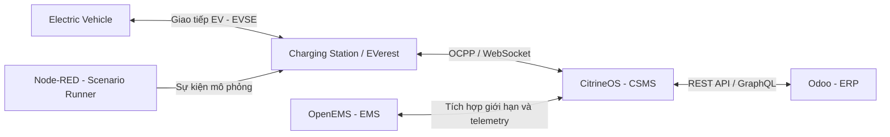
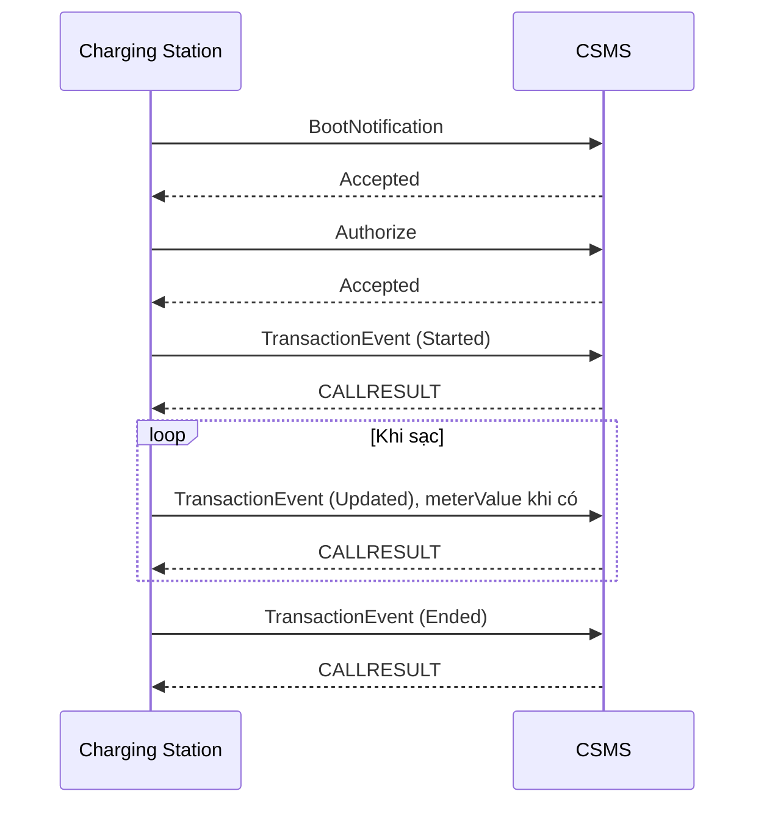
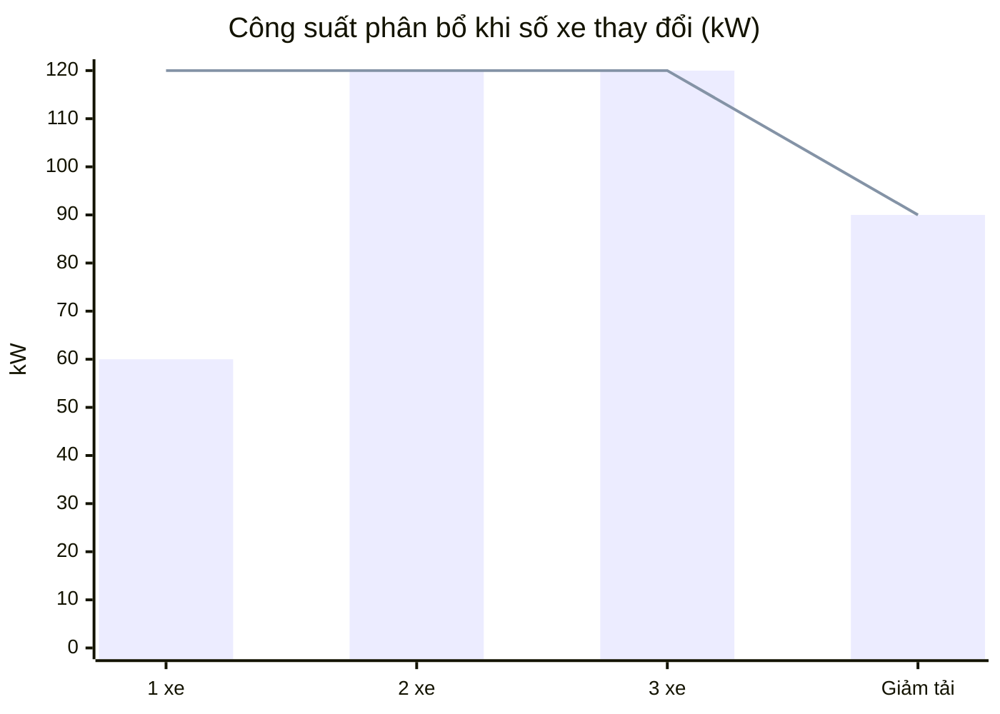

# OCPP Learning Roadmap

> Lộ trình học Open Charge Point Protocol dành cho Chuyên viên Điều độ Năng lượng, Technical BA và người vận hành EMS/CSMS.
>
> Trọng tâm: OCPP 2.0.1; đối chiếu OCPP 1.6J; tìm hiểu tổng quan OCPP 2.1. Cập nhật tài liệu tham khảo: 26/11/2026.

## 1. Mục tiêu và phạm vi

Mục tiêu không phải tự viết lại OCPP Client, OCPP Server hay firmware trạm sạc, mà là hiểu giao thức đủ sâu để xây dựng yêu cầu nghiệp vụ, vận hành, kiểm thử, phân tích sai lệch và phối hợp với IT/nhà cung cấp.

Sau khi hoàn thành, cần có khả năng:

- Giải thích luồng giao tiếp giữa trạm sạc và CSMS.
- Đọc OCPP JSON, đối chiếu request/response và truy vết phiên sạc.
- Phân biệt trạng thái kết nối, trạng thái đầu sạc và trạng thái giao dịch.
- Xây dựng quy tắc Smart Charging, Load Balancing và Power Limitation.
- Đối chiếu công suất yêu cầu, lịch sạc hiệu lực và công suất đo thực tế.
- Kiểm thử nghiệp vụ bằng CitrineOS, EVerest và OpenEMS, không cần thiết bị vật lý.
- Viết yêu cầu nghiệp vụ, test case và báo cáo sự cố có bằng chứng.

Quy ước ưu tiên: **P1** = cần thành thạo; **P2** = nên thực hành; **P3** = biết tổng quan, đào sâu khi công việc yêu cầu. Đây là mức ưu tiên đề xuất, không phải tiêu chuẩn tuyển dụng chính thức.

## 2. Bản đồ kiến thức

| Nhóm | Nội dung | Ưu tiên |
|---|---|---|
| 01 | Kiến thức điện và hạ tầng sạc | P1 |
| 02 | Kiến trúc OCPP, EMS và CSMS | P1 |
| 03 | WebSocket, JSON, request/response | P1 |
| 04 | Kết nối, đăng ký và trạng thái | P1 |
| 05 | Xác thực và vòng đời giao dịch | P1 |
| 06 | Metering, công suất và điện năng | P1 |
| 07 | Smart Charging và Charging Profile | P1 |
| 08 | Load Balancing, điều độ theo thời gian | P1 |
| 09 | Device Management, cảnh báo, sự cố | P1/P2 |
| 10 | Bảo mật, offline, đồng bộ và phục hồi | P2 |
| 11 | Kiểm thử, log, KPI và báo cáo | P1 |
| 12 | Tích hợp API, EMS, ERP, simulator | P2 |
| 13 | OCPP 2.1 và chủ đề nâng cao | P3 |

## 3. Kiến thức nền về điện và trạm sạc — P1

- [ ] Phân biệt công suất kW, điện năng kWh, điện áp V, dòng điện A.
- [ ] Hiểu điện AC/DC, một pha/ba pha, hệ số công suất (PF), hiệu suất chuyển đổi.
- [ ] Phân biệt công suất định mức, công suất yêu cầu, công suất được cấp và công suất thực tế.
- [ ] Hiểu SoC (State of Charge), dung lượng pin, giới hạn tiếp nhận công suất của xe, charging curve và tapering.
- [ ] Hiểu giới hạn máy biến áp, công suất đấu nối, phụ tải nền, dự phòng, Solar PV và BESS.
- [ ] Phân biệt địa điểm sạc (site/location), Charging Station, EVSE và Connector. Site là khái niệm nghiệp vụ, không đồng nhất với một Charging Station OCPP.
- [ ] Hiểu CPO (Charge Point Operator), eMSP, EV driver, CSMS, EMS và ERP.

Công thức cơ bản (điều kiện đơn giản hóa):

```text
Điện năng (kWh) = công suất trung bình (kW) × thời gian (h)
P_DC (kW)       = U × I / 1000
P_AC 1 pha (kW) = U × I × PF / 1000
P_AC 3 pha (kW) = √3 × U_dây × I_dây × PF / 1000
```

Không quy đổi A sang W khi chưa biết điện áp, số pha, PF và điểm đo. Công suất phía lưới AC và công suất DC cấp vào xe có thể khác nhau do tổn hao.

## 4. Kiến trúc và phiên bản OCPP — P1



Sơ đồ là kiến trúc lab đề xuất, không khẳng định có sẵn connector OpenEMS–CitrineOS hoặc Odoo–CitrineOS. Node-RED điều phối kịch bản, còn EVerest thực hiện hành vi thiết bị và giao tiếp OCPP. Cần chọn duy nhất một đầu mối chịu trách nhiệm phát lệnh điều độ cho mỗi trạm.

| Phiên bản | Nội dung cần biết |
|---|---|
| OCPP 1.6J | JSON/WebSocket, StartTransaction/StopTransaction, Smart Charging cơ bản; cần biết để đọc hệ thống cũ. |
| OCPP 2.0.1 | Device Model, TransactionEvent, bảo mật và Smart Charging nâng cao; phiên bản học chính. |
| OCPP 2.1 | Sạc hai chiều, DER, ISO 15118-20 và các mở rộng; học tổng quan trước. |

- [ ] Hiểu OCPP 1.6 không tương thích trực tiếp với 2.0.1; không trộn payload giữa hai phiên bản.
- [ ] Hiểu 2.1 kế thừa 2.0.1 nhưng vẫn cần xác minh phiên bản, khả năng tương thích và feature thực tế của từng thiết bị.
- [ ] Phân biệt OCPP (trạm–CSMS), ISO 15118 (xe–trạm), OCPI (tích hợp/roaming giữa các bên) và Modbus (giao tiếp thiết bị công nghiệp).
- [ ] Kiểm tra các chức năng mà trạm và CSMS thực sự hỗ trợ; không suy ra Smart Charging đầy đủ chỉ từ số phiên bản OCPP.

## 5. WebSocket và cấu trúc message — P1

- [ ] WebSocket handshake, `ws://`, `wss://`, subprotocol `ocpp1.6` / `ocpp2.0.1`.
- [ ] Station identity, endpoint, xác thực kết nối, ping/pong, reconnect và timeout.
- [ ] Phân biệt WebSocket ping/pong với OCPP `Heartbeat`.
- [ ] Hiểu `CALL` (2), `CALLRESULT` (3), `CALLERROR` (4), `UniqueId`, `Action`, `Payload`.
- [ ] Kiểm tra JSON Schema: kiểu dữ liệu, required field, enum, giới hạn độ dài và semantic validation.
- [ ] Phân biệt lỗi giao thức với phản hồi nghiệp vụ `Rejected` trong một CALLRESULT hợp lệ.
- [ ] Hiểu UTC, ISO 8601 và chuyển đổi giờ địa phương UTC+07:00 khi làm báo cáo.

Ví dụ OCPP 2.0.1:

```json
[2, "hb-001", "Heartbeat", {}]
```

```json
[3, "hb-001", {"currentTime": "2026-11-26T03:00:00Z"}]
```

```json
[4, "req-002", "NotImplemented", "Action not implemented", {}]
```

Bài tập: ghép các request/response theo kết nối, chiều giao tiếp và UniqueId; phát hiện request timeout, phản hồi lỗi hoặc payload không đúng schema.

## 6. Danh sách message OCPP 2.0.1 cần học

Ký hiệu: **CS** = Charging Station; **CSMS** = hệ thống quản lý trạm sạc. Chiều trong bảng là chiều gửi CALL, response đi ngược lại.

### 6.1. Kết nối và trạng thái — P1

| Message | Chiều | Nội dung cần nắm |
|---|---|---|
| `BootNotification` | CS → CSMS | Đăng ký khi khởi động; reason, vendor/model, Accepted/Pending/Rejected, interval. |
| `Heartbeat` | CS → CSMS | Duy trì thông tin liên lạc và đồng bộ giờ. |
| `StatusNotification` | CS → CSMS | EVSE ID, Connector ID, trạng thái đầu sạc, timestamp. |
| `ChangeAvailability` | CSMS → CS | Đưa trạm/EVSE/connector vào hoặc ra khỏi phục vụ. |
| `Reset` | CSMS → CS | Khởi động lại có kiểm soát, phân biệt Immediate/OnIdle. |
| `TriggerMessage` | CSMS → CS | Yêu cầu trạm gửi một loại message được hỗ trợ. |

Checklist:

- [ ] Phân biệt `Available`, `Occupied`, `Reserved`, `Unavailable`, `Faulted` của `connectorStatus`.
- [ ] Không sử dụng `Charging` như một giá trị `connectorStatus` của 2.0.1; trạng thái sạc nằm ở thông tin giao dịch.
- [ ] Phân biệt online/offline với trạng thái connector; online không có nghĩa là mọi đầu sạc hoạt động tốt.
- [ ] Theo dõi cold boot, reconnect và mất kết nối đột ngột.

### 6.2. Xác thực và giao dịch sạc — P1

| Message | Chiều | Nội dung cần nắm |
|---|---|---|
| `Authorize` | CS → CSMS | Kiểm tra idToken và quyền sạc. |
| `TransactionEvent` | CS → CSMS | Started/Updated/Ended; transactionId, seqNo, triggerReason, chargingState, meterValue. |
| `RequestStartTransaction` | CSMS → CS | Yêu cầu sạc từ xa; idToken, remoteStartId, EVSE nếu có. |
| `RequestStopTransaction` | CSMS → CS | Yêu cầu kết thúc giao dịch theo transactionId. |
| `GetTransactionStatus` | CSMS → CS | Kiểm tra giao dịch đang diễn ra và message còn chờ gửi. |
| `UnlockConnector` | CSMS → CS | Yêu cầu mở khóa đầu nối, khi được hỗ trợ. |



Đây là một luồng minh họa, không phải thứ tự bắt buộc cho mọi phiên sạc; điểm bắt đầu/kết thúc giao dịch có thể được cấu hình, và cơ chế xác thực có thể thay đổi.

- [ ] Phân biệt plug-in, xác thực, bắt đầu transaction và thời điểm bắt đầu truyền điện.
- [ ] Phân biệt kết thúc truyền điện, kết thúc transaction và unplug.
- [ ] Theo dõi trạng thái `Charging`, `EVConnected`, `SuspendedEV`, `SuspendedEVSE`, `Idle` khi có trong `chargingState`.
- [ ] Hiểu `seqNo`, `offline`, `triggerReason` và sự kiện đến muộn/trùng lặp.
- [ ] Không coi remote start/stop `Accepted` là bằng chứng giao dịch đã bắt đầu/kết thúc; cần đối chiếu TransactionEvent.

### 6.3. Metering — P1

| Message / cấu trúc | Nội dung |
|---|---|
| `MeterValues` | Dữ liệu đo theo EVSE; tìm hiểu báo cáo định kỳ ngoài giao dịch theo cấu hình. |
| `TransactionEvent.meterValue` | Dữ liệu đo liên quan trực tiếp đến giao dịch trong 2.0.1. |
| `sampledValue` | value, measurand, context, phase, location, unitOfMeasure. |

Các measurand cần đọc được:

| Measurand | Ý nghĩa |
|---|---|
| `Energy.Active.Import.Register` | Chỉ số điện năng tích lũy |
| `Power.Active.Import` | Công suất tác dụng nhập tại điểm đo |
| `Current.Import` | Dòng điện nhập |
| `Voltage` | Điện áp |
| `SoC` | Phần trăm dung lượng pin nếu được thiết bị báo cáo |
| `Power.Offered` | Công suất được chào/cấp khả dụng theo thiết bị |

- [ ] Đọc đơn vị và multiplier, quy đổi W/kW, Wh/kWh đúng.
- [ ] Phân biệt chỉ số công tơ tích lũy với số liệu tiêu thụ trong khoảng thời gian.
- [ ] Tính điện năng phiên sạc từ chênh lệch công tơ cùng điểm đo, đơn vị và điều kiện hợp lệ.
- [ ] Phát hiện missing samples, outlier, reset công tơ, timestamp bất thường và trùng dữ liệu.
- [ ] Phân biệt dữ liệu đo phía lưới, phía EVSE và phía xe; không cộng trùng số liệu tổng và thành phần.

Ví dụ: công tơ đầu phiên 125.000 Wh, cuối phiên 147.500 Wh → 22,5 kWh. Nếu thời gian truyền điện là 45 phút thì công suất trung bình là 30 kW, với giả định số đo hợp lệ và cùng phạm vi đo.

## 7. Smart Charging — trọng tâm P1

### 7.1. Khái niệm nghiệp vụ

- [ ] Static/Dynamic Load Balancing; giới hạn toàn site, toàn station, từng EVSE và từng giao dịch.
- [ ] Giới hạn theo W hoặc A, thời gian hiệu lực, ưu tiên sạc, công suất tối thiểu và khả năng tiếp nhận của xe.
- [ ] Time-of-use, peak shaving, solar surplus charging, demand response.
- [ ] Phân biệt lịch sạc dự kiến, giới hạn hiệu lực và công suất đo thực tế.
- [ ] Hiểu chiến lược fallback khi CSMS mất kết nối hoặc EMS mất telemetry.

### 7.2. Message điều độ

| Message | Chiều | Nghiệp vụ |
|---|---|---|
| `SetChargingProfile` | CSMS → CS | Cài giới hạn hoặc lịch sạc. |
| `GetCompositeSchedule` | CSMS → CS | Lấy lịch tổng hợp theo giới hạn/profile đang áp dụng và thông tin trạm biết. |
| `ClearChargingProfile` | CSMS → CS | Xóa profile theo ID/tiêu chí. |
| `GetChargingProfiles` | CSMS → CS | Yêu cầu báo cáo các profile theo tiêu chí. |
| `ReportChargingProfiles` | CS → CSMS | Báo cáo profile phù hợp yêu cầu. |
| `NotifyChargingLimit` | CS → CSMS | Thông báo giới hạn sạc từ nguồn bên ngoài khi được hỗ trợ. |
| `ClearedChargingLimit` | CS → CSMS | Thông báo giới hạn bên ngoài đã được gỡ. |
| `NotifyEVChargingNeeds` | CS → CSMS | Báo nhu cầu sạc từ xe, phụ thuộc tính năng được hỗ trợ. |
| `NotifyEVChargingSchedule` | CS → CSMS | Báo lịch sạc từ xe khi áp dụng cơ chế tương ứng. |

### 7.3. Charging Profile và Charging Schedule

| Field | Ý nghĩa |
|---|---|
| `evseId` | Phạm vi profile; 0 có ý nghĩa tùy loại profile. |
| `id` | ID profile. |
| `stackLevel` | Mức ưu tiên khi xử lý các profile phù hợp cùng mục đích; không vượt giới hạn cấp cao hơn. |
| `chargingProfilePurpose` | Mục đích profile. |
| `chargingProfileKind` | `Absolute`, `Recurring`, `Relative`. |
| `recurrencyKind` | `Daily` hoặc `Weekly` đối với lịch lặp. |
| `validFrom`, `validTo` | Khoảng hiệu lực của profile. |
| `transactionId` | Liên kết giao dịch đối với TxProfile khi phù hợp. |
| `chargingSchedule` | Danh sách lịch sạc. |
| `chargingRateUnit` | `W` hoặc `A`. |
| `startSchedule`, `duration` | Mốc lịch và thời lượng tính bằng giây. |
| `chargingSchedulePeriod` | Các đoạn giới hạn gồm startPeriod, limit và thông tin pha khi phù hợp. |

| Purpose (2.0.1) | Ý nghĩa |
|---|---|
| `ChargingStationMaxProfile` | Trần cho toàn Charging Station; evseId=0. |
| `TxDefaultProfile` | Lịch mặc định cho giao dịch ở EVSE hoặc từng EVSE khi evseId=0. |
| `TxProfile` | Lịch cho một giao dịch cụ thể. |
| `ChargingStationExternalConstraints` | Ràng buộc từ nguồn bên ngoài; học cách nhận/báo cáo và kết hợp giới hạn, không coi đây là profile CSMS tùy ý cài bằng SetChargingProfile. |

Bài tập: phân tích xung đột giữa profile mặc định, profile giao dịch và trần station. Không dùng stackLevel cao để vượt trần an toàn. Đọc quy tắc hợp nhất profile trong Part 2, Functional Block K; không giản lược mọi trường hợp thành phép min đơn thuần.

### 7.4. Ví dụ JSON SetChargingProfile

Ví dụ minh họa OCPP 2.0.1: giới hạn toàn một Charging Station ở 60 kW trong một giờ, sau 30 phút giảm xuống 40 kW.

```json
[2, "profile-001", "SetChargingProfile", {
  "evseId": 0,
  "chargingProfile": {
    "id": 101,
    "stackLevel": 0,
    "chargingProfilePurpose": "ChargingStationMaxProfile",
    "chargingProfileKind": "Absolute",
    "chargingSchedule": [{
      "id": 1,
      "startSchedule": "2026-11-26T03:00:00Z",
      "duration": 3600,
      "chargingRateUnit": "W",
      "chargingSchedulePeriod": [
        {"startPeriod": 0, "limit": 60000},
        {"startPeriod": 1800, "limit": 40000}
      ]
    }]
  }
}]
```

```json
[3, "profile-001", {"status": "Accepted"}]
```

Ví dụ là OCPP frame, không phải HTTP request body dùng trực tiếp cho CitrineOS REST API. Khi thực hành, sửa timestamp theo thời gian lab và kiểm tra khả năng thiết bị. Sau 3600 giây, giới hạn tiếp theo phụ thuộc các profile khác và cấu hình thiết bị; không mặc định về 0 W.

Quy trình kiểm chứng: gửi profile → kiểm tra response → truy vấn composite schedule → thu telemetry → so sánh giới hạn với số đo → kiểm tra lại khi hết hạn/xóa profile. `Accepted` chỉ xác nhận trạm chấp nhận yêu cầu, không chứng minh công suất đã giảm.

## 8. Load Balancing và bài toán điều độ — P1

Ví dụ lab: site có 3 trạm độc lập, mỗi trạm tối đa 60 kW; phụ tải sạc tổng bị giới hạn 120 kW. Giả định cùng điểm quy chiếu công suất, mỗi trạm có một EVSE, xe cần đủ công suất và bỏ qua tổn hao.

| Kịch bản | Trạm A | Trạm B | Trạm C | Tổng |
|---|---:|---:|---:|---:|
| Một xe sạc | 60 | 0 | 0 | 60 kW |
| Hai xe sạc | 60 | 60 | 0 | 120 kW |
| Ba xe sạc | 40 | 40 | 40 | 120 kW |
| Trạm A chỉ cần 20 kW, phân phối lại | 20 | 50 | 50 | 120 kW |
| Ngân sách giảm còn 90 kW, nhu cầu bằng nhau | 30 | 30 | 30 | 90 kW |



Cột: tổng công suất phân bổ; đường: giới hạn công suất. Biểu đồ có thể cần Markdown viewer hỗ trợ Mermaid.

Ngân sách cấp cho trạm sạc có thể được tính theo mô hình giản lược:

```text
P_EV_budget = max(0, P_grid_limit + P_PV + P_BESS_discharge
                     - P_base_load - P_BESS_charge - P_reserve)
```

Tất cả số liệu phải cùng điểm quy chiếu, cùng thời điểm; cần thêm giới hạn thiết bị, hiệu suất, giới hạn dòng từng pha và giới hạn vận hành BESS khi triển khai thực tế. Không dùng công thức này thay thế thiết kế bảo vệ điện hoặc cấu hình an toàn của thiết bị.

- [ ] Phân bổ đều, theo trọng số, theo mức ưu tiên và theo nhu cầu thực tế.
- [ ] Phân phối lại công suất khi xe đến/rời trạm hoặc giảm nhu cầu.
- [ ] Duy trì tổng công suất trong giới hạn site; xử lý ngân sách thấp hơn công suất sạc tối thiểu.
- [ ] Xác định tần suất tính lại, deadband, ramp rate, hysteresis và thời gian đáp ứng.
- [ ] Hiểu OCPP điều khiển từng Charging Station; thuật toán phân bổ liên trạm do CSMS/EMS hoặc thành phần điều độ thực hiện.
- [ ] Xây dựng tiêu chí nghiệm thu: mức vượt trần cho phép, thời gian đáp ứng, dữ liệu tin cậy và khả năng fallback theo yêu cầu thiết kế.

## 9. Device Management, cảnh báo và vận hành — P1/P2

| Message | Chiều | Mức | Nội dung |
|---|---|---|---|
| `GetVariables` | CSMS → CS | P1 | Đọc cấu hình/trạng thái qua Component/Variable. |
| `SetVariables` | CSMS → CS | P1 | Đổi cấu hình, kiểm tra kết quả từng biến và yêu cầu reboot. |
| `GetBaseReport` | CSMS → CS | P2 | Yêu cầu báo cáo Device Model. |
| `NotifyReport` | CS → CSMS | P2 | Trả báo cáo Device Model. |
| `SetVariableMonitoring` | CSMS → CS | P2 | Cài ngưỡng/cơ chế theo dõi. |
| `NotifyEvent` | CS → CSMS | P1 | Cảnh báo/sự kiện từ thiết bị. |
| `GetLog` | CSMS → CS | P2 | Yêu cầu log phục vụ chẩn đoán. |
| `LogStatusNotification` | CS → CSMS | P2 | Trạng thái quá trình gửi log. |
| `UpdateFirmware` / `FirmwareStatusNotification` | Hai chiều theo message | P3 | Hiểu quy trình cập nhật và trạng thái firmware. |
| `ReserveNow` / `CancelReservation` | CSMS → CS | P3 | Đặt/hủy giữ chỗ. |
| `SendLocalList` / `GetLocalListVersion` | CSMS → CS | P3 | Quản lý danh sách xác thực cục bộ. |

- [ ] Hiểu Component, Variable, AttributeType, Instance, EVSE/Connector scope và khả năng đọc/ghi.
- [ ] Phân biệt lỗi kết nối, lỗi nghiệp vụ, lỗi điều độ và lỗi phần cứng.
- [ ] Phân loại mức độ sự cố, lập ticket, theo dõi SLA và phối hợp nhà cung cấp.
- [ ] Đọc báo cáo capability của thiết bị; xác định tính năng không hỗ trợ thay vì coi mọi `Rejected` là bug.

## 10. OCPP 1.6J đối chiếu với 2.0.1 — P2

| Nghiệp vụ | 1.6J | 2.0.1 |
|---|---|---|
| Đăng ký | BootNotification | BootNotification (schema khác) |
| Bắt đầu/kết thúc giao dịch | StartTransaction, StopTransaction | TransactionEvent Started/Ended |
| Cập nhật giao dịch | MeterValues và các message liên quan | TransactionEvent Updated, meterValue |
| Điều khiển từ xa | RemoteStartTransaction, RemoteStopTransaction | RequestStartTransaction, RequestStopTransaction |
| Cấu hình | GetConfiguration, ChangeConfiguration | GetVariables, SetVariables |
| Trạng thái sạc | StatusNotification có Charging, SuspendedEV... | ConnectorStatus và chargingState tách biệt |
| Profile toàn trạm | ChargePointMaxProfile | ChargingStationMaxProfile |
| Phạm vi profile | connectorId | evseId |

Bài tập: đọc cùng một kịch bản sạc trên hai phiên bản, lập bảng mapping theo ý nghĩa nghiệp vụ, không chuyển payload bằng cách đổi tên message đơn thuần.

## 11. Bảo mật, offline và tính toàn vẹn dữ liệu — P2

- [ ] Security Profile 1/2/3 ở mức khái niệm: Basic Auth không TLS, TLS + Basic Auth, TLS xác thực bằng chứng chỉ client (theo phiên bản áp dụng).
- [ ] TLS, certificate chain, thời hạn chứng chỉ, xác thực station identity; không để lộ idToken, credentials hoặc khóa riêng trong log.
- [ ] Offline authorization, local list/cache, giao dịch offline, reconnect và gửi bù dữ liệu.
- [ ] Hiểu retry, idempotency, trùng message, sai thứ tự, timeout và backfill.
- [ ] Không bật bỏ qua xác thực trong môi trường sản xuất; lab cũng nên giới hạn mạng truy cập.
- [ ] Kiểm tra quy tắc fallback khi profile hết hạn, mất kết nối, thiếu dữ liệu hoặc lệnh bị từ chối.

## 12. Phân tích log và KPI — P1

### 12.1. Checklist khi có sai lệch công suất

1. Kiểm tra station/EVSE/connector/transaction ID và phiên bản OCPP.
2. Kiểm tra timestamp, múi giờ, độ mới của dữ liệu và đơn vị đo.
3. Tìm SetChargingProfile: phạm vi, purpose, stackLevel, validFrom/To, startSchedule, limit.
4. Ghép CALLRESULT/CALLERROR theo UniqueId; kiểm tra status và statusInfo nếu có.
5. Kiểm tra các profile cạnh tranh và GetCompositeSchedule.
6. Đối chiếu meterValue, nhu cầu xe, SoC (nếu có), trạng thái charging và giới hạn thiết bị.
7. Kiểm tra giới hạn EMS, kết nối, fallback và thời gian điều chỉnh.
8. Ghi bằng chứng, giả thuyết nguyên nhân, phạm vi ảnh hưởng, người phụ trách và tiêu chí kiểm thử lại.

| Triệu chứng | Hướng kiểm tra |
|---|---|
| Trạm offline | WebSocket, xác thực, heartbeat, reconnect, mạng |
| Boot bị từ chối | Station identity, provisioning, BootConfig, chính sách đăng ký |
| Profile bị Rejected | Schema, phạm vi, capability, thời gian, đơn vị, transactionId |
| Accepted nhưng vượt giới hạn | Schedule hiệu lực, telemetry, profile conflict, điểm đo, thiết bị |
| Công suất thấp hơn giới hạn | Nhu cầu xe, SoC cao, tapering, giới hạn cục bộ, suspended state |
| Phiên sạc thiếu điện năng | Meter data, timestamp, công tơ, dữ liệu gửi bù |
| Giao dịch bị treo | TransactionEvent, seqNo, remote stop, reconnect, sự kiện kết thúc |

### 12.2. KPI cần xây dựng

| KPI | Cách hiểu/cách tính đề xuất |
|---|---|
| Station connectivity | Thời gian kết nối / thời gian quan sát hợp lệ |
| Connector service availability | Thời gian có khả năng cung cấp dịch vụ / thời gian quan sát; không đồng nhất với Available status |
| Charging utilization | Thời gian truyền điện / thời gian quan sát của các EVSE |
| Session success rate | Phiên thành công theo định nghĩa nghiệp vụ / số phiên thử đủ điều kiện |
| Energy delivered | Tổng kWh giao dịch hợp lệ, tránh trùng |
| Peak power | Công suất tổng lớn nhất theo cửa sổ lấy mẫu xác định |
| Limit violation | Số lần/thời lượng vượt trần theo tolerance và quy tắc gộp sự kiện |
| Dispatch response time | Từ lúc gửi yêu cầu đến khi telemetry xác nhận đạt điều kiện |
| Data completeness | Số mẫu hợp lệ / số mẫu kỳ vọng trong khoảng có cấu hình lấy mẫu xác định |
| Fault resolution time | Thời gian từ phát hiện đến khôi phục xác nhận |

Cần định nghĩa mẫu số, thời gian bảo trì, cách xử lý missing data và SLA trước khi tính KPI. Không đánh đồng offline với fault hoặc coi thiếu dữ liệu là 0 kW.

## 13. Thực hành trên hệ thống giả lập — P1/P2

### 13.1. Stack sử dụng

| Thành phần | Trách nhiệm |
|---|---|
| CitrineOS Core + Operator UI | Quản lý trạm, nhận OCPP, gửi lệnh qua UI/API tùy feature. |
| EVerest | Mô phỏng một Charging Station/EVSE và hành vi xe theo khả năng cấu hình. |
| Node-RED | Điều phối sự kiện theo kịch bản JSON, gọi interface simulator đã xác minh. |
| OpenEMS Edge/Simulator | Mô phỏng PV, BESS, lưới điện và phụ tải nền. |
| Odoo (tùy chọn) | Quản lý sự cố, yêu cầu điều độ, báo cáo và quy trình nghiệp vụ. |

Tích hợp Node-RED → EVerest qua interface mà bản EVerest đang chạy cung cấp (ví dụ flow/MQTT nếu có). Không giả định có endpoint JSON chung cho mọi phiên bản. Với CitrineOS, kiểm tra Swagger và phiên bản API cài đặt thực tế. Odoo không cần tham gia sinh sự kiện giả lập.

### 13.2. Bộ test case tối thiểu

| ID | Kịch bản | Message / dữ liệu chính | Tiêu chí kiểm thử |
|---|---|---|---|
| TC01 | Trạm kết nối | BootNotification, Heartbeat | Boot hợp lệ, xác nhận trạng thái kết nối. |
| TC02 | Khởi động lại | Reset, BootNotification | Khôi phục kết nối, trạng thái nhất quán theo cấu hình. |
| TC03 | Plug/unplug | StatusNotification | EVSE/connector và trạng thái đúng. |
| TC04 | Xác thực hợp lệ/không hợp lệ | Authorize | Phản hồi đúng chính sách. |
| TC05 | Một phiên sạc hoàn chỉnh | TransactionEvent | Truy vết ID, Started/Updated/Ended, kWh. |
| TC06 | Sạc từ xa | RequestStart/StopTransaction | Xác nhận kết quả bằng sự kiện giao dịch. |
| TC07 | Giới hạn station 40 kW | SetChargingProfile | Trần hiệu lực và telemetry phù hợp trong tolerance lab. |
| TC08 | Ba trạm, ngân sách 120 kW | SetChargingProfile, meter data | Tổng công suất trong giới hạn, phân bổ theo policy. |
| TC09 | Phụ tải nền tăng | EMS budget, profile mới | Giảm ngân sách EV và xác nhận thời gian đáp ứng. |
| TC10 | Xe rời trạm / giảm nhu cầu | TransactionEvent, meter data | Phân phối lại phần công suất khả dụng. |
| TC11 | Profile hết hạn/xóa | ClearChargingProfile, composite schedule | Chuyển về profile/giới hạn tiếp theo đúng thiết kế. |
| TC12 | Profile không hợp lệ | CALLRESULT/CALLERROR | Xác định lý do và không thay đổi sai lịch hiện hành. |
| TC13 | Mất kết nối trong phiên | Reconnect, TransactionEvent | Fallback đúng policy, gửi bù và không đếm trùng. |
| TC14 | Dữ liệu trùng/đến muộn | seqNo, timestamp | Báo cáo không đếm trùng; kiểm tra completeness. |
| TC15 | Sự cố thiết bị | NotifyEvent, StatusNotification | Cảnh báo và workflow xử lý có bằng chứng. |
| TC16 | Sai đơn vị / thiếu telemetry | sampledValue | Phát hiện sai lệch và đánh dấu dữ liệu không tin cậy. |
| TC17 | Hai profile cạnh tranh | Set/Get/ClearChargingProfile | Xác nhận lịch hợp nhất theo quy tắc chuẩn. |
| TC18 | Giới hạn thấp hơn nhu cầu tối thiểu | Profile, chargingState | Tạm dừng/tiếp tục theo policy và capability thiết bị. |

### 13.3. Kịch bản điều độ theo ngày (dữ liệu giả định)

| Giờ địa phương UTC+7 | Sự kiện | Mục đích |
|---|---|---|
| 06:00 | 1 xe đến | Kiểm thử phiên sạc đầu tiên |
| 08:00 | 2 xe đến thêm | Phân bổ động khi nhu cầu tăng |
| 10:00 | PV tăng | Tăng ngân sách sạc nếu còn nhu cầu |
| 12:00 | Phụ tải nền tăng | Giảm giới hạn sạc |
| 14:00 | Một xe giảm nhu cầu | Phân bổ lại công suất |
| 17:00 | PV giảm, giờ cao điểm | Peak shaving, áp dụng giới hạn mới |
| 18:00 | Một trạm mất kết nối | Fallback và cảnh báo |
| 18:15 | Trạm kết nối lại | Đồng bộ, gửi bù, xác nhận lịch |
| 22:00 | Kết thúc sạc còn lại | Tổng hợp KPI ngày |

Dùng số lượng xe phù hợp với số EVSE thực tế; nếu nhiều xe hơn số chỗ sạc thì cần mô hình hàng đợi. Thời gian có thể được nén trong lab nhưng timestamp và lịch OCPP phải nhất quán với đồng hồ mô phỏng.

## 14. Lộ trình 4 tuần (khoảng 40 giờ đề xuất)

| Tuần | Giờ | Học | Đầu ra |
|---|---:|---|---|
| 1 | 8 | Điện cơ bản, kiến trúc, WebSocket, boot/status | Một trạm giả lập kết nối thành công, log có chú thích. |
| 2 | 10 | Authorize, TransactionEvent, meter data | Báo cáo một phiên sạc; truy vết ID, công suất, kWh. |
| 3 | 14 | Smart Charging, profile, load balancing, điều độ EMS | Demo 3 trạm, giới hạn thay đổi, biểu đồ kế hoạch/thực tế. |
| 4 | 8 | Device Model, offline, troubleshooting, API, KPI | Bộ test case, báo cáo sự cố, tài liệu yêu cầu nghiệp vụ. |

Ưu tiên tuần 3; nếu thiếu thời gian, chỉ học OCPP 1.6J ở mức đọc và mapping, hoãn firmware, roaming, V2G, Plug & Charge và lập trình protocol stack.

## 15. Tiêu chí hoàn thành và chuẩn bị phỏng vấn

- [ ] Giải thích sự khác nhau giữa EMS, CSMS, OCPP và Odoo.
- [ ] Từ log xác định trạm offline hay connector faulted, hoặc xe đang suspended.
- [ ] Đọc một phiên sạc từ Started đến Ended và tính kWh đúng.
- [ ] Đọc được SetChargingProfile, xác định giới hạn theo từng khoảng thời gian.
- [ ] Giải thích vì sao profile Accepted nhưng thực tế chưa giảm công suất.
- [ ] Mô phỏng 3 trạm 60 kW bị giới hạn tổng 120 kW và khi ngân sách giảm xuống 90 kW.
- [ ] Giải thích cách tránh điều khiển xung đột giữa EMS và CSMS.
- [ ] Viết một yêu cầu nghiệp vụ Smart Charging có điều kiện kích hoạt, input, output, ngoại lệ và tiêu chí nghiệm thu.
- [ ] Viết báo cáo sự cố kèm timestamp, IDs, message, telemetry, phạm vi ảnh hưởng và cách kiểm thử lại.

### Những nội dung chưa cần custom sâu

- Tự triển khai OCPP Client/Server, WebSocket framework, serializer hoặc JSON Schema validator.
- Sửa protocol stack trong CitrineOS/EVerest; custom message riêng làm giảm khả năng tương tác chuẩn.
- Firmware, điều khiển điện công suất mức thấp, thiết kế mạch bảo vệ và triển khai chứng chỉ PKI chuyên sâu.
- Thuật toán tối ưu phức tạp, V2G/DER nâng cao nếu chưa có yêu cầu công việc.

Đọc source khi cần truy vết handler/API hoặc xác minh hành vi không rõ. Ưu tiên cấu hình, sử dụng API chuẩn và xây dựng kịch bản kiểm thử trước khi sửa mã nguồn.

## 16. Tài liệu tham khảo và thứ tự đọc

1. [Open Charge Alliance — OCPP overview](https://openchargealliance.org/protocols/open-charge-point-protocol/): tổng quan phiên bản và tính năng.
2. [OCA — Download OCPP](https://openchargealliance.org/my-oca/ocpp/): tải OCPP 2.0.1 Edition 4 và errata tương ứng (trang tải tại thời điểm biên soạn liệt kê errata 2026-09); chọn đúng edition mà thiết bị/CSMS dùng. Đọc Part 0 (tổng quan), Part 2 (functional blocks, ưu tiên B Provisioning, E Transactions, J Metering, K Smart Charging; tra mục lục bản tải để xác nhận), Part 4 (JSON/WebSocket) và Part 6 (test cases).
3. [OCPP 2.0.1 JSON Schemas](https://ocpp-spec.org/schemas/v2.0.1/): tra nhanh cấu trúc message; đối chiếu schema chính thức từ OCA khi nghiệm thu.
4. [OCA — OCPP 2.0.1 Certification](https://openchargealliance.org/certificationocpp/certification-ocpp-2-0-1/): hiểu phạm vi chứng nhận và các tính năng tùy chọn.
5. [CitrineOS — Architecture](https://citrineos.github.io/latest/core-concepts/architecture/) và [Core REST API](https://citrineos.github.io/latest/apis/core-api/): kiến trúc và API quản lý trạm/điều độ.
6. [CitrineOS — Connecting a Charger](https://citrineos.github.io/latest/guides/connecting-a-charger/) và [Testing with EVerest](https://citrineos.github.io/latest/getting-started/testing-with-everest/): cấu hình lab và kiểm thử trạm giả lập.
7. [OpenEMS Documentation](https://docs.openems.io/): tìm hiểu simulator, điều khiển phụ tải và giao diện năng lượng.
8. [OCA — OCPP 2.1](https://openchargealliance.org/ocpp-2-1-is-now-available/): đọc mở rộng sau khi vững 2.0.1.

**Lưu ý:** Tài liệu là lộ trình học và đặc tả bài tập, không phải chứng nhận tuân thủ OCPP hay cấu hình đã chạy thử. Các JSON, số liệu, tiêu chí và kiến trúc lab minh họa do tài liệu đề xuất; cần xác minh trên phiên bản CitrineOS, EVerest và OpenEMS thực tế. Tiêu chuẩn OCA và errata tương ứng là nguồn ưu tiên khi có khác biệt.
