# EV Charging Daily Behavior Simulation

> Tài liệu kịch bản giả lập hành vi sạc xe điện trong 24 giờ — bản đề xuất để tinh chỉnh dữ liệu và triển khai bằng Node-RED, EVerest, SAP Charging Stations Simulator, CitrineOS và OpenEMS.

**Phạm vi:** mô phỏng nhu cầu sạc, hành vi khách hàng, phiên sạc, giới hạn thiết bị, thiếu hụt công suất và các sự cố vận hành. Toàn bộ số liệu là giả định phục vụ học tập, chưa được hiệu chỉnh theo dữ liệu thực tế.

**Cách xem:** các biểu đồ và sơ đồ sử dụng Mermaid, được nhúng trực tiếp trong file Markdown. Cần trình xem Markdown hỗ trợ Mermaid (ví dụ GitHub hoặc extension phù hợp trong VS Code). Bảng số liệu vẫn đọc được khi trình xem không hỗ trợ biểu đồ. Các biểu đồ là tĩnh; ví dụ tính công suất thay thế cho thanh trượt tương tác trong nội dung gốc.

## Mục lục

1. [Cấu hình môi trường giả lập](#1-cấu-hình-môi-trường-giả-lập)
2. [S01 — Ngày làm việc bình thường](#2-s01--ngày-làm-việc-bình-thường)
3. [Phân loại hành vi người dùng](#3-phân-loại-hành-vi-người-dùng)
4. [Các kịch bản ngày nâng cao](#4-các-kịch-bản-ngày-nâng-cao)
5. [Hành vi trong từng phiên sạc](#5-hành-vi-trong-từng-phiên-sạc)
6. [Thiếu hụt công suất trong ngày](#6-thiếu-hụt-công-suất-trong-ngày)
7. [Cấu hình kịch bản JSON](#7-cấu-hình-kịch-bản-json)
8. [Tổ chức thư mục](#8-tổ-chức-thư-mục)
9. [Quy trình thực thi](#9-quy-trình-thực-thi)
10. [Nguyên tắc đảm bảo tính nhất quán](#10-nguyên-tắc-đảm-bảo-tính-nhất-quán)

## 1. Cấu hình môi trường giả lập

| Thông số | Giá trị đề xuất |
|---|---:|
| Số địa điểm sạc | 4 |
| Tổng số EVSE | 200 |
| EVSE AC 7 kW | 40 |
| EVSE AC 22 kW | 40 |
| EVSE DC 60 kW | 80 |
| EVSE DC 120 kW | 40 |
| Tổng công suất định mức EVSE | 10.760 kW |
| Múi giờ | Asia/Ho_Chi_Minh (UTC+7) |
| Chu kỳ kịch bản | 24 giờ |
| Tự động lặp lại mỗi ngày | Có |

Công suất định mức không đồng nghĩa với công suất điện thực sự khả dụng. Mỗi địa điểm có thể có giới hạn lưới, phụ tải nền, nguồn điện mặt trời và pin lưu trữ riêng. Việc phân bổ 200 EVSE theo từng địa điểm chưa được xác định.

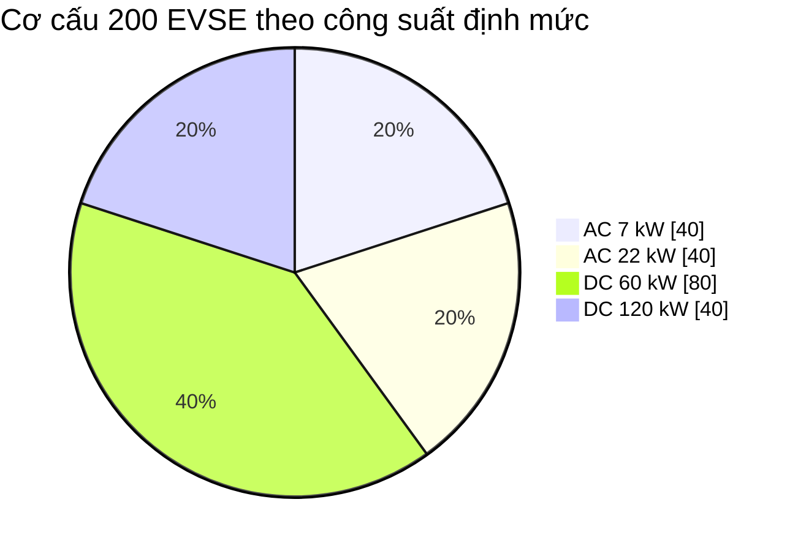

## 2. S01 — Ngày làm việc bình thường

**Normal Working Day** — mô phỏng nhu cầu sạc theo từng giờ. Đội xe dịch vụ hoạt động sớm, người đi làm tạo cao điểm buổi sáng, xe cá nhân và xe dịch vụ tạo cao điểm cuối ngày.

### 2.1. Biểu đồ nhu cầu sạc

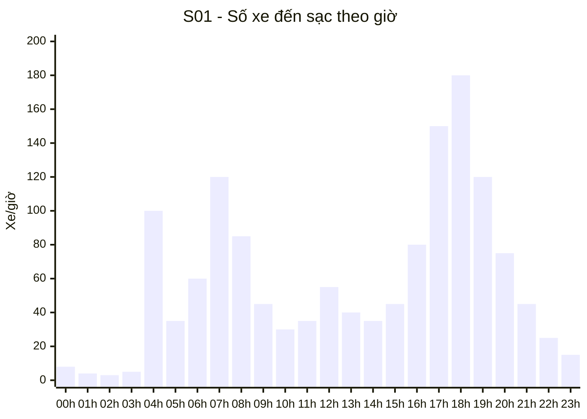

| Chỉ tiêu | Giá trị |
|---|---:|
| Tổng lượt xe đến | 1.395 xe/ngày |
| Nhu cầu cao nhất | 180 xe/giờ |
| Giờ cao điểm | 18:00–18:59 |

### 2.2. Dữ liệu chi tiết theo giờ

| Khung giờ | Xe đến sạc | Thời lượng dự kiến | Hành vi giả định |
|---|---:|---|---|
| 00:00 | 8 | 60–180 phút | Sạc ban đêm |
| 01:00 | 4 | 60–180 phút | Nhu cầu thấp |
| 02:00 | 3 | 60–180 phút | Nhu cầu thấp |
| 03:00 | 5 | 45–120 phút | Chuẩn bị đầu ngày |
| 04:00 | 100 | 30–60 phút | Đội xe dịch vụ chuẩn bị hoạt động |
| 05:00 | 35 | 30–60 phút | Taxi, xe dịch vụ |
| 06:00 | 60 | 25–60 phút | Di chuyển đi làm |
| 07:00 | 120 | 30–180 phút | Cao điểm buổi sáng |
| 08:00 | 85 | 30–180 phút | Đến nơi làm việc |
| 09:00 | 45 | 30–120 phút | Nhu cầu giảm |
| 10:00 | 30 | 25–60 phút | Sạc bổ sung |
| 11:00 | 35 | 25–60 phút | Trước giờ nghỉ trưa |
| 12:00 | 55 | 30–60 phút | Sạc trong giờ nghỉ trưa |
| 13:00 | 40 | 30–60 phút | Tiếp tục hành trình |
| 14:00 | 35 | 30–60 phút | Nhu cầu ổn định |
| 15:00 | 45 | 30–60 phút | Xe dịch vụ sạc bổ sung |
| 16:00 | 80 | 30–60 phút | Bắt đầu tăng nhu cầu |
| 17:00 | 150 | 30–90 phút | Tan giờ làm việc |
| 18:00 | 180 | 30–90 phút | Cao điểm buổi tối |
| 19:00 | 120 | 30–90 phút | Sạc sau giờ làm |
| 20:00 | 75 | 45–120 phút | Nhu cầu giảm |
| 21:00 | 45 | 60–180 phút | Sạc cuối ngày |
| 22:00 | 25 | 60–180 phút | Sạc ban đêm |
| 23:00 | 15 | 60–180 phút | Chuẩn bị cho ngày tiếp theo |
| **Tổng** | **1.395** | | |

**Quy ước:** 100 xe lúc 04:00 nghĩa là 100 lượt xe đến trong khoảng 04:00–04:59, không phải 100 xe bắt đầu sạc đồng thời. Xe đến có thể phải chờ, xác thực thất bại hoặc rời đi; vì vậy lượt đến không đồng nghĩa với số giao dịch sạc thành công. Thời lượng trong bảng là dự kiến, không bảo đảm đạt SoC mục tiêu.

## 3. Phân loại hành vi người dùng

### 3.1. Customer profiles

| Mã | Nhóm khách hàng | SoC ban đầu | SoC mục tiêu | Loại sạc ưu tiên |
|---|---|---|---|---|
| `FLEET` | Đội xe doanh nghiệp | 15–35% | 80–95% | DC |
| `TAXI` | Taxi, xe dịch vụ | 10–30% | 70–90% | DC |
| `COMMUTER` | Người đi làm | 30–60% | 80–90% | AC |
| `PRIVATE` | Xe cá nhân | 20–50% | 80–100% | AC/DC |
| `LONG_TRIP` | Xe đường dài | 5–20% | 70–90% | DC |
| `OVERNIGHT` | Xe sạc qua đêm | 20–60% | 90–100% | AC |

SoC (State of Charge) là tỷ lệ dung lượng pin còn lại. Xe có thể rời trạm trước khi đạt SoC mục tiêu nếu hết thời gian hoặc giới hạn công suất.

### 3.2. Phân bổ nhóm khách hàng theo giờ

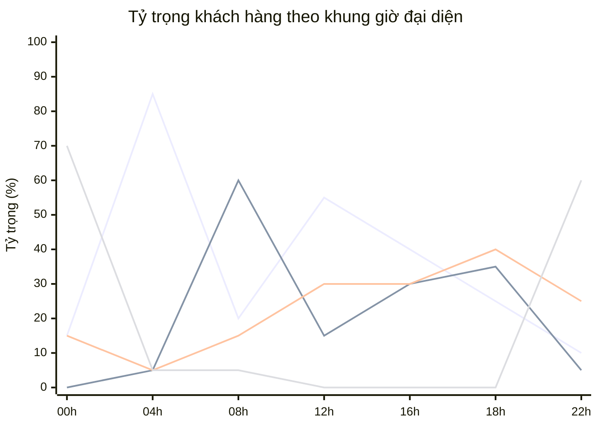

Thứ tự đường biểu đồ: đội xe/taxi, người đi làm, xe cá nhân, sạc qua đêm. Một số trình Mermaid không hiển thị chú giải; đối chiếu bằng bảng dưới đây.

| Giờ | Đội xe / Taxi | Người đi làm | Xe cá nhân | Sạc qua đêm |
|---|---:|---:|---:|---:|
| 00h | 15% | 0% | 15% | 70% |
| 04h | 85% | 5% | 5% | 5% |
| 08h | 20% | 60% | 15% | 5% |
| 12h | 55% | 15% | 30% | 0% |
| 16h | 40% | 30% | 30% | 0% |
| 18h | 25% | 35% | 40% | 0% |
| 22h | 10% | 5% | 25% | 60% |

Bảng chỉ gồm bốn nhóm gộp tại các mốc đại diện. Khi triển khai cần xác định tỷ lệ riêng `FLEET`/`TAXI`, bổ sung `LONG_TRIP` và quy tắc áp dụng cho các giờ còn lại; tổng trọng số mỗi giờ phải bằng 100%.

## 4. Các kịch bản ngày nâng cao

| Mã | Tên | Mô tả | Nghiệp vụ cần học |
|---|---|---|---|
| S01 | Normal Working Day | Ngày làm việc bình thường | Baseline, sử dụng EVSE |
| S02 | Weekend | Cuối tuần, nhu cầu tập trung giữa ngày và tối | Điều chỉnh kế hoạch vận hành |
| S03 | Fleet Charging | Đội xe sạc trước và sau ca làm việc | Phân bổ công suất theo đội xe |
| S04 | Holiday / Travel Peak | Ngày lễ, nhu cầu sạc nhanh đường dài tăng mạnh | Quản lý hàng đợi, quá tải |
| S05 | Low Demand Day | Nhu cầu thấp, thiết bị nhàn rỗi | Hiệu suất sử dụng tài sản |
| S06 | Unexpected Demand Surge | Nhu cầu tăng đột biến lúc 18h | Smart Charging, xử lý thiếu năng lực |

### 4.1. Dữ liệu mốc đại diện để so sánh

Các giá trị dưới đây giữ nguyên các điểm minh họa của đề xuất trước. S02–S06 chưa phải lịch đủ 24 giờ; không dùng tổng các mốc này làm tổng lượt xe/ngày. Cần hoàn thiện các giờ còn thiếu trước khi chạy thực tế.

| Giờ | S01 | S02 | S03 | S04 | S05 | S06 |
|---|---:|---:|---:|---:|---:|---:|
| 00h | 8 | 5 | 5 | 15 | 3 | 8 |
| 02h | 3 | 3 | 10 | 20 | 1 | 3 |
| 04h | 100 | 10 | 180 | 80 | 10 | 100 |
| 07h | 120 | 25 | 100 | 160 | 25 | 120 |
| 10h | 30 | 70 | 15 | 190 | 15 | 30 |
| 12h | 55 | 130 | 35 | 180 | 20 | 55 |
| 14h | 35 | 100 | 20 | 160 | 15 | 35 |
| 16h | 80 | 110 | 70 | 200 | 25 | 80 |
| 18h | 180 | 140 | 200 | 220 | 40 | 400 |
| 20h | 75 | 80 | 30 | 130 | 20 | 120 |
| 23h | 15 | 10 | 5 | 50 | 5 | 15 |

Đơn vị: xe đến trong một giờ.

### 4.2.1. S01 — Normal Working Day

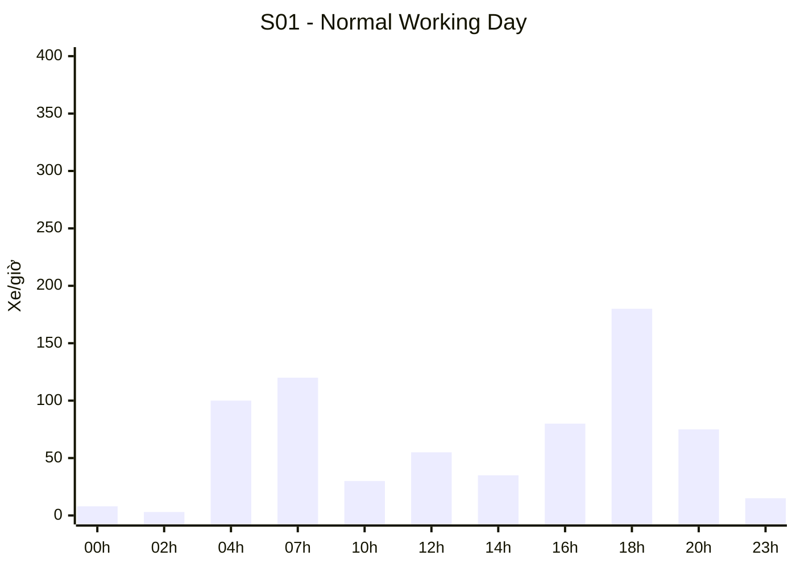

### 4.2.2. S02 — Weekend

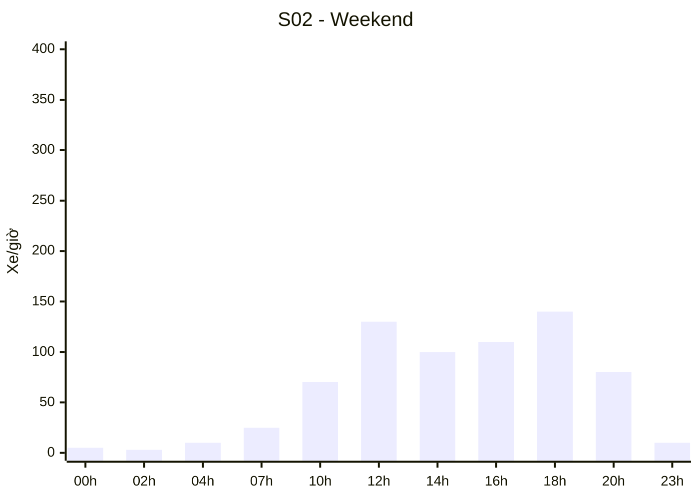

### 4.2.3. S03 — Fleet Charging

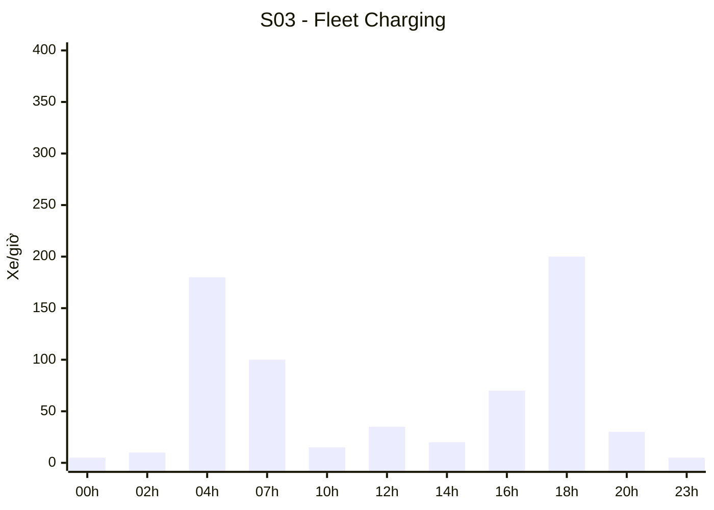

### 4.2.4. S04 — Holiday / Travel Peak

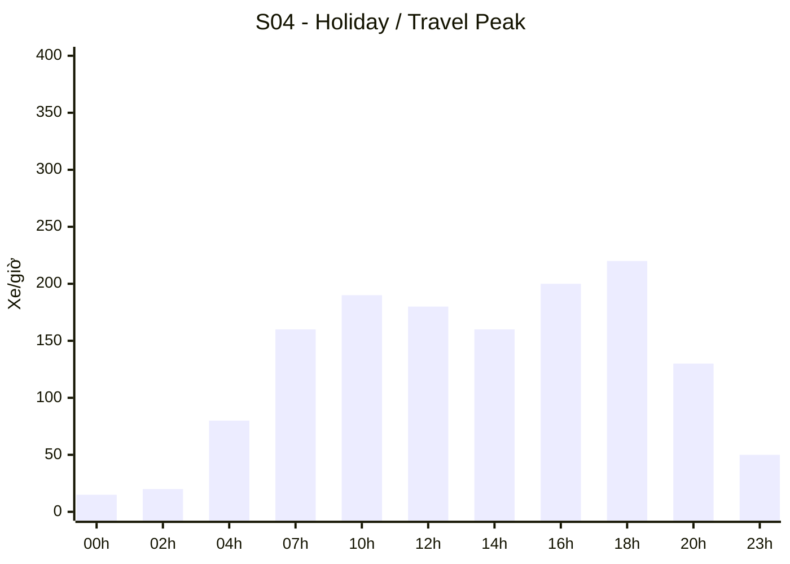

### 4.2.5. S05 — Low Demand Day

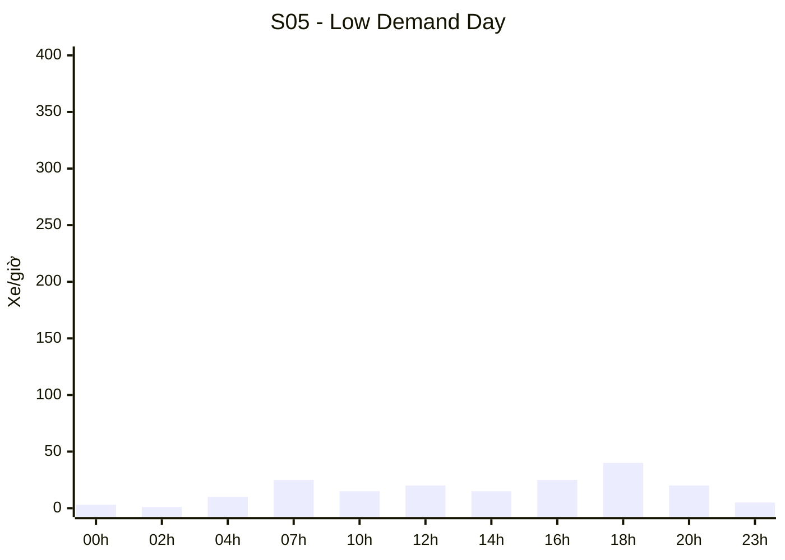

### 4.2.6. S06 — Unexpected Demand Surge

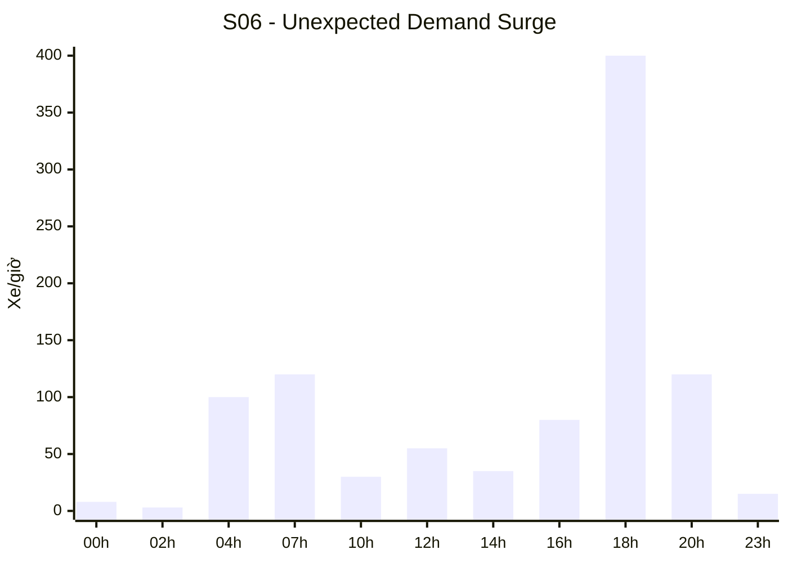

## 5. Hành vi trong từng phiên sạc

### 5.1. Phân bố kết quả/hành vi phiên sạc

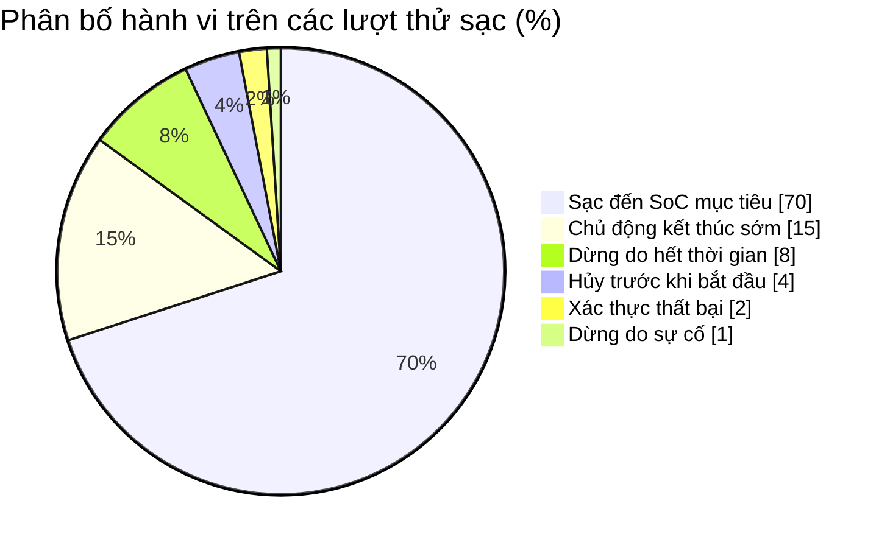

| Mã hành vi | Tỷ lệ giả định | Mô tả | Nghiệp vụ cần học |
|---|---:|---|---|
| `NORMAL_CHARGING` | 70% | Sạc tới SoC mục tiêu | Transaction lifecycle |
| `EARLY_STOP` | 15% | Khách hàng dừng sạc sớm | Kết thúc giao dịch |
| `TIME_LIMIT_REACHED` | 8% | Hết thời gian sạc | Quản lý thời lượng |
| `CANCEL_BEFORE_START` | 4% | Cắm cáp nhưng hủy sạc | Trạng thái EVSE |
| `AUTHORIZATION_FAILED` | 2% | Xác thực thất bại | Authorization |
| `CHARGING_FAULT` | 1% | Sạc gián đoạn do lỗi | Fault management |
| **Tổng** | **100%** | | |

Các tỷ lệ trên là trọng số chọn hành vi giả lập của lượt thử sạc, không phải tỷ lệ thống kê đã đo. Kết quả cuối cùng vẫn phải tuân theo trạng thái thực tế, giới hạn điện năng và thời gian sạc.

### 5.2. Hành vi có thể xảy ra đồng thời

| Mã hành vi | Mô tả | Nghiệp vụ cần học |
|---|---|---|
| `WAITING_FOR_EVSE` | Chờ thiết bị khả dụng | Quản lý hàng đợi |
| `POWER_LIMITED` | Công suất sạc bị giới hạn | Smart Charging |
| `IDLE_AFTER_CHARGING` | Sạc xong nhưng chưa rút cáp | Hiệu suất sử dụng EVSE |

Các hành vi này không cộng vào tổng 100% ở mục 5.1 vì có thể xuất hiện trong cùng một phiên sạc.

### 5.3. Vòng đời giả lập một lượt sạc

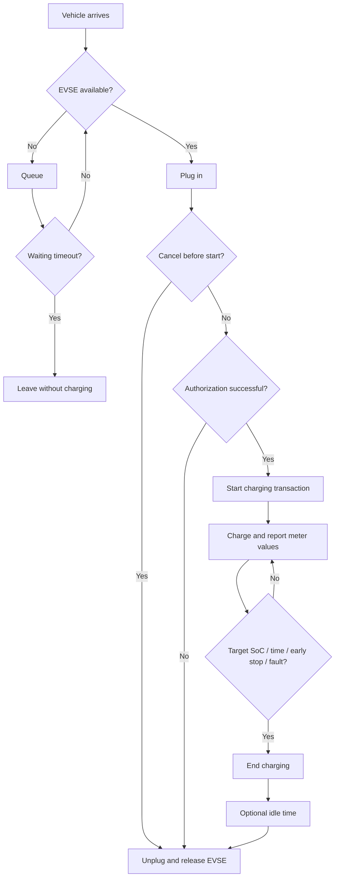

Sơ đồ thể hiện nghiệp vụ logic; thứ tự các thông điệp OCPP cụ thể phụ thuộc phiên bản giao thức và cấu hình transaction start/stop của trạm sạc.

## 6. Thiếu hụt công suất trong ngày

Kết hợp CitrineOS và OpenEMS để học điều độ năng lượng khi nhu cầu sạc và công suất khả dụng thay đổi theo thời gian.

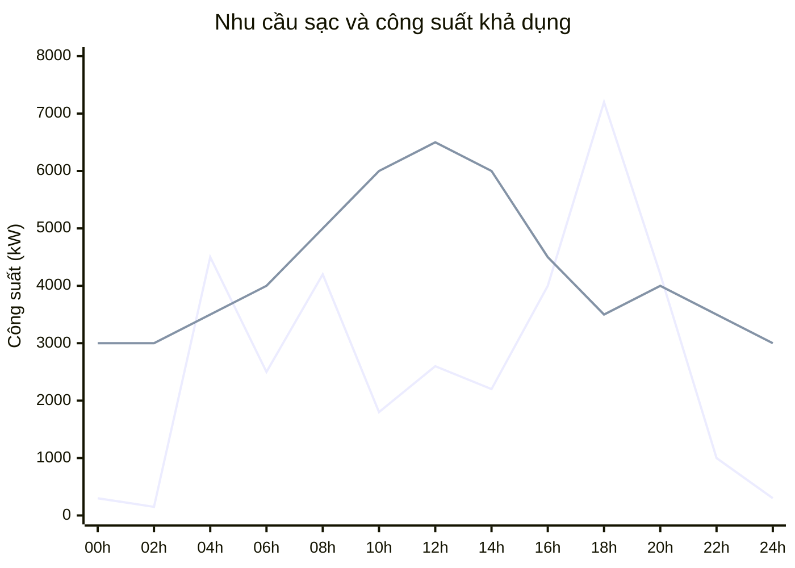

Đường thứ nhất: nhu cầu công suất sạc. Đường thứ hai: công suất khả dụng dành cho sạc. Mốc 24h là 00:00 của ngày tiếp theo.

| Giờ | Nhu cầu (kW) | Khả dụng (kW) | Thiếu hụt (kW) |
|---|---:|---:|---:|
| 00h | 300 | 3.000 | 0 |
| 02h | 150 | 3.000 | 0 |
| 04h | 4.500 | 3.500 | 1.000 |
| 06h | 2.500 | 4.000 | 0 |
| 08h | 4.200 | 5.000 | 0 |
| 10h | 1.800 | 6.000 | 0 |
| 12h | 2.600 | 6.500 | 0 |
| 14h | 2.200 | 6.000 | 0 |
| 16h | 4.000 | 4.500 | 0 |
| 18h | 7.200 | 3.500 | 3.700 |
| 20h | 4.200 | 4.000 | 200 |
| 22h | 1.000 | 3.500 | 0 |
| 24h | 300 | 3.000 | 0 |

**Lưu ý:** đây là đường công suất giả định độc lập với dữ liệu lượt xe ở S01. Khi thực thi, phải tính nhu cầu từ các phiên sạc đang hoạt động và giới hạn nguồn điện tại từng địa điểm. Công suất dư tại một địa điểm không mặc nhiên chuyển được sang địa điểm khác.

### 6.1. Các sự kiện điều độ

| Thời điểm | Sự kiện | Nghiệp vụ cần xử lý |
|---|---|---|
| 04:00 | Đội xe sạc tập trung | Phân bổ công suất |
| 08:00 | Phụ tải buổi sáng tăng | Theo dõi giới hạn, điều chỉnh nếu cần |
| 12:00 | Điện mặt trời đạt mức cao | Tận dụng năng lượng tái tạo |
| 16:00 | Sản lượng điện mặt trời giảm | Điều chỉnh kế hoạch điều độ |
| 18:00 | Nhu cầu vượt công suất khả dụng | Smart Charging |
| 20:00 | Thiếu hụt công suất nhẹ | Cân bằng phụ tải |
| 23:00 | Nhu cầu giảm | Khôi phục giới hạn bình thường nếu đủ điều kiện |

### 6.2. Ví dụ phân bổ công suất (thay cho biểu đồ tương tác)

Giả định 180 xe đang sạc đồng thời, mỗi xe yêu cầu 40 kW, công suất khả dụng là 3.500 kW.

| Chỉ tiêu | Công thức | Kết quả |
|---|---|---:|
| Nhu cầu | 180 × 40 | 7.200 kW |
| Thiếu hụt | max(0, 7.200 − 3.500) | 3.700 kW |
| Phân bổ đều mỗi xe | min(40, 3.500 / 180) | 19,44 kW |
| Tỷ lệ đáp ứng | min(100, 3.500 / 7.200 × 100) | 48,61% |

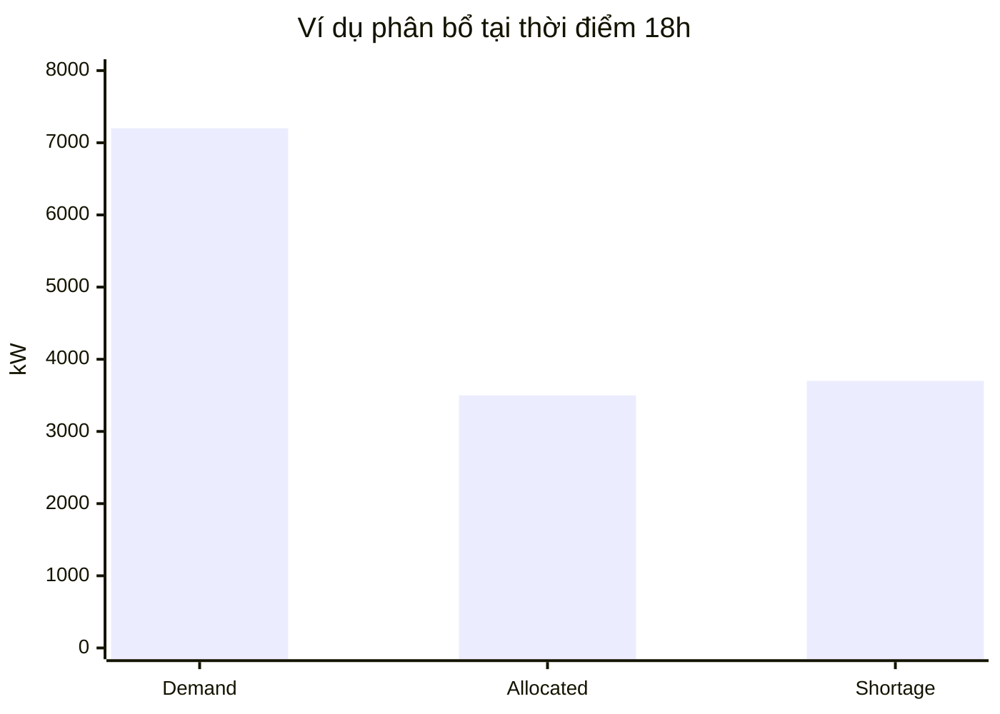

Công thức tổng quát, với `N > 0` và giả định mọi xe có cùng nhu cầu công suất `p`:

```text
P_demand   = N * p
P_shortage = max(0, P_demand - P_available)
P_per_ev   = min(p, P_available / N)
Coverage   = min(100, P_available / P_demand * 100)
```

Nếu không có nhu cầu sạc thì công suất phân bổ bằng 0, không cần tính tỷ lệ đáp ứng bằng phép chia. Ví dụ chia đều chưa xét EVSE 7 kW, 22 kW, giới hạn của xe hoặc đường cong sạc; khi triển khai cần phân bổ lại phần công suất còn dư cho các xe có khả năng nhận thêm.

## 7. Cấu hình kịch bản JSON

### 7.1. `normal_working_day.json`

Schema dưới đây là cấu hình đề xuất dành cho Scenario Orchestrator trên Node-RED, không phải schema native của EVerest hoặc SAP Simulator. Có thể lưu trực tiếp trong một file JSON hoặc field `fields.Json` của Odoo.

```json
{
    "code": "S01",
    "name": "Normal Working Day",
    "enabled": true,
    "timezone": "Asia/Ho_Chi_Minh",
    "repeat": "daily",
    "random_seed": 42,
    "arrival_distribution": "uniform",
    "hourly_arrivals": [
        8, 4, 3, 5,
        100, 35, 60, 120,
        85, 45, 30, 35,
        55, 40, 35, 45,
        80, 150, 180, 120,
        75, 45, 25, 15
    ],
    "default_session": {
        "battery_capacity_kwh": {
            "min": 40,
            "max": 100
        },
        "initial_soc_percent": {
            "min": 10,
            "max": 60
        },
        "target_soc_percent": {
            "min": 80,
            "max": 100
        },
        "max_waiting_minutes": 30,
        "max_idle_after_charging_minutes": 15
    },
    "hourly_overrides": {
        "04": {
            "customer_type": "FLEET",
            "preferred_charger_type": "DC",
            "initial_soc_percent": {
                "min": 15,
                "max": 35
            },
            "max_duration_minutes": 60
        },
        "07": {
            "customer_type": "COMMUTER",
            "preferred_charger_type": "AC",
            "max_duration_minutes": 180
        },
        "18": {
            "customer_type": "MIXED",
            "max_duration_minutes": 90
        },
        "22": {
            "customer_type": "OVERNIGHT",
            "preferred_charger_type": "AC",
            "max_duration_minutes": 180
        }
    },
    "behavior_probability": {
        "normal_charging": 0.70,
        "early_stop": 0.15,
        "time_limit_reached": 0.08,
        "cancel_before_start": 0.04,
        "authorization_failed": 0.02,
        "charging_fault": 0.01
    },
    "capacity_policy": {
        "when_evse_unavailable": "queue",
        "when_waiting_timeout": "leave",
        "when_power_insufficient": "limit_power"
    }
}
```

### 7.2. Ý nghĩa các trường cấu hình

| Trường | Ý nghĩa |
|---|---|
| `code`, `name` | Định danh và tên kịch bản |
| `enabled` | Bật/tắt kịch bản |
| `timezone` | Múi giờ thực thi |
| `repeat` | Chu kỳ lặp |
| `random_seed` | Seed sinh dữ liệu để tái lập khi kiểm thử |
| `arrival_distribution` | Phương pháp phân bố thời điểm xe đến trong từng giờ |
| `hourly_arrivals` | 24 giá trị nguyên không âm, ứng với giờ 00–23 |
| `default_session` | Tham số mặc định của một lượt sạc |
| `hourly_overrides` | Thay đổi cấu hình theo giờ |
| `behavior_probability` | Trọng số chọn hành vi, tổng bằng 1 |
| `capacity_policy` | Chính sách khi thiếu EVSE, thời gian chờ hoặc công suất |

`MIXED` là nhãn nhóm hỗn hợp, không phải mã khách hàng cụ thể. JSON trên chỉ chứa override mẫu cho 4 giờ; chưa mã hóa toàn bộ bảng thời lượng và tỷ trọng khách hàng ở mục 2–3. Trước khi chạy, cần bổ sung các profile và quy tắc mặc định còn thiếu, quy định thứ tự ưu tiên giữa default, customer profile và hourly override, cũng như chính sách cho những phiên chưa hoàn thành vào nửa đêm. Node-RED cần adapter để chuyển các trường trên thành lệnh thực sự của simulator.

## 8. Tổ chức thư mục

Cấu trúc đề xuất khi tách dữ liệu thành các file cấu hình để triển khai (tài liệu hiện tại vẫn chỉ là một file Markdown):

```text
simulation/
├── config/
│   ├── charging_stations.json
│   ├── vehicle_profiles.json
│   └── customer_profiles.json
├── scenarios/
│   ├── daily/
│   │   ├── normal_working_day.json
│   │   ├── weekend.json
│   │   ├── fleet_charging.json
│   │   ├── holiday_travel_peak.json
│   │   ├── low_demand_day.json
│   │   └── unexpected_demand_surge.json
│   ├── behavior/
│   │   ├── early_stop.json
│   │   ├── authorization_failed.json
│   │   ├── waiting_for_evse.json
│   │   └── idle_after_charging.json
│   ├── energy/
│   │   ├── power_shortage.json
│   │   ├── solar_surplus.json
│   │   └── peak_load.json
│   └── incidents/
│       ├── charger_offline.json
│       ├── charging_fault.json
│       └── network_interruption.json
└── node-red/
    └── flows.json
```

Các kịch bản `daily` xác định nhu cầu nền; `behavior`, `energy` và `incidents` bổ sung sự kiện hoặc điều kiện trong ngày. Nên chọn một kịch bản nền cho mỗi lần chạy, thay vì cộng chồng các lịch nhu cầu ngoài ý muốn.

## 9. Quy trình thực thi

### 9.1. Kiến trúc tích hợp đề xuất

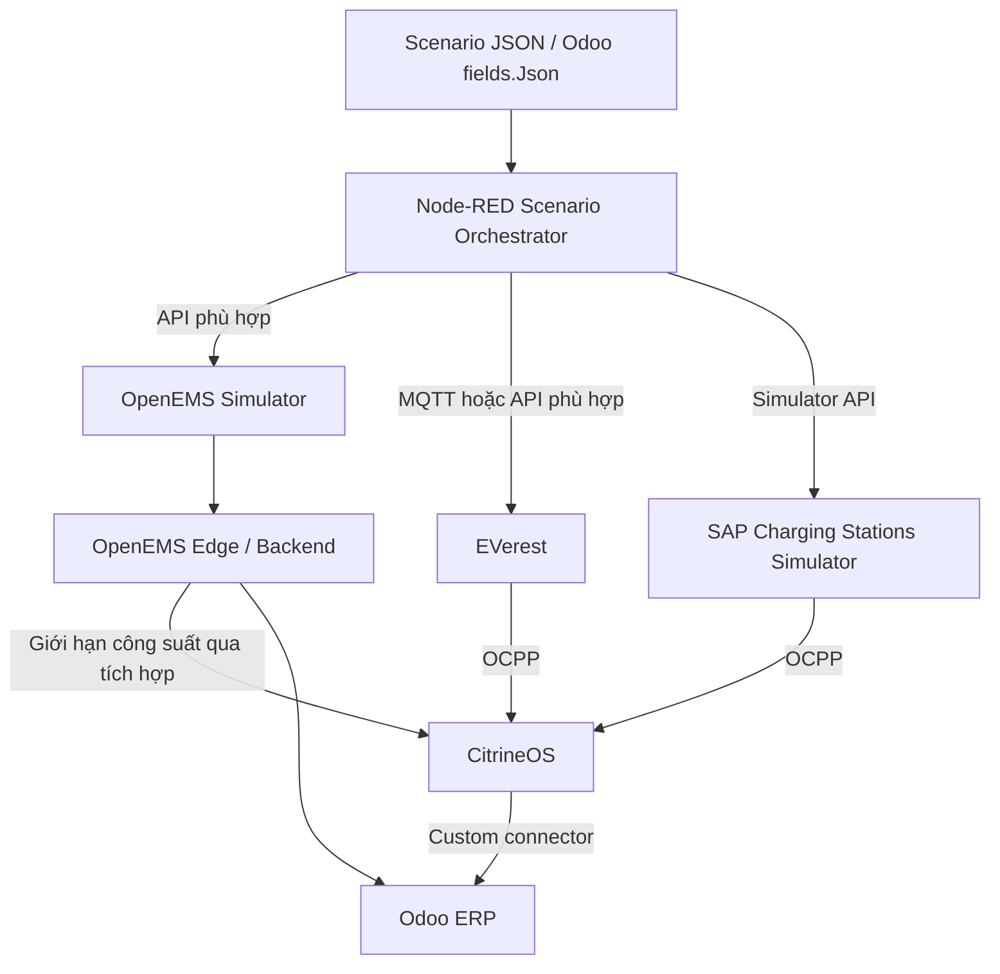

- Node-RED tự lập lịch, đọc cấu hình và điều phối; không cần Odoo `ir.cron`.
- EVerest mô phỏng hoạt động phía thiết bị sạc; SAP Simulator phù hợp cho mô phỏng nhiều thiết bị ở mức OCPP.
- CitrineOS tiếp nhận thông điệp OCPP, quản lý phiên sạc và trạng thái thiết bị.
- OpenEMS quản lý nguồn điện, phụ tải và giới hạn năng lượng.
- Odoo lưu cấu hình, tiếp nhận dữ liệu nghiệp vụ và hỗ trợ dashboard, activity, automation.

Các adapter, kết nối OpenEMS–CitrineOS và connector Odoo là phần cần triển khai, chưa được kiểm thử trong môi trường Docker cụ thể. Chỉ sử dụng một cơ chế điều khiển công suất có thẩm quyền cho mỗi thiết bị để tránh xung đột.

### 9.2. Quy trình điều phối xe đến sạc

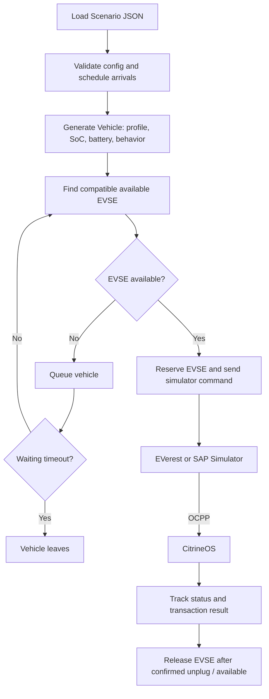

### 9.3. Logic thực thi theo thời gian

1. Đọc và validate JSON khi bắt đầu ngày hoặc khi kích hoạt kịch bản.
2. Sinh số lượt xe đến của từng giờ theo `hourly_arrivals`; phân bố thời điểm trong giờ theo `arrival_distribution`.
3. Chọn profile, dung lượng pin, SoC và hành vi; tìm EVSE tương thích tại địa điểm được chỉ định.
4. Nếu hết EVSE, đưa xe vào hàng đợi hoặc cho rời đi theo chính sách.
5. Gửi lệnh giả lập sang EVerest hoặc SAP Simulator; theo dõi kết quả thực tế qua simulator/CSMS.
6. Quản lý công suất, thời gian chờ, dừng sạc và thời gian chiếm dụng EVSE sau sạc.
7. Ghi nhật ký và duy trì trạng thái các phiên chưa hoàn thành sang giờ/ngày tiếp theo.

## 10. Nguyên tắc đảm bảo tính nhất quán

| Nguyên tắc | Yêu cầu |
|---|---|
| Giới hạn thiết bị | Một EVSE chỉ phục vụ tối đa một xe tại cùng thời điểm |
| Giới hạn dung lượng pin | SoC trong khoảng 0–100%; không tạo năng lượng vượt dung lượng pin |
| Giới hạn công suất | Không vượt giới hạn xe, EVSE và điều độ tại địa điểm |
| Tính liên tục | Phiên sạc có thể kéo dài sang giờ hoặc ngày tiếp theo |
| Tính ngẫu nhiên | Xe có thời điểm đến, dung lượng pin và nhu cầu khác nhau |
| Hàng đợi | Xe phải chờ hoặc rời đi khi hết EVSE phù hợp |
| Tính nhất quán | Điện năng tiêu thụ phù hợp công suất tích phân theo thời gian |
| Tái lập | Sử dụng seed và phương pháp sinh ngẫu nhiên xác định để tái hiện |
| Giao thức | Tạo phiên sạc qua simulator/OCPP, không chèn trực tiếp giao dịch vào DB CitrineOS |
| Trạng thái | Không tái sử dụng EVSE khi xe trước chưa giải phóng thiết bị |
| Lập lịch | Dùng múi giờ thống nhất và tránh thực thi trùng sự kiện sau restart |

Ví dụ tính điện năng (giả định hiệu suất sạc `eta` không đổi):

```text
E_grid_kWh    = sum(P_grid_kW * delta_t_hours)
E_battery_kWh = E_grid_kWh * eta
SoC_end       = SoC_start + 100 * E_battery_kWh / battery_capacity_kWh
```

Cần giới hạn năng lượng cấp vào pin khi đạt SoC mục tiêu và không giả định mọi xe luôn nhận được công suất định mức. Đây là mô hình giản lược; có thể thêm đường cong sạc và tổn hao biến thiên sau.

### Bước tiếp theo: tinh chỉnh dữ liệu

- [ ] Xác định loại địa điểm sạc và số EVSE tại từng địa điểm.
- [ ] Hiệu chỉnh 24 giá trị nhu cầu S01 theo dữ liệu thực tế hoặc giả định nghiệp vụ mới.
- [ ] Hoàn thiện lịch 24 giờ của S02–S06.
- [ ] Xác định tỷ trọng từng nhóm khách hàng, dung lượng pin, SoC, thời lượng và công suất sạc.
- [ ] Xác định phân bố thời điểm đến và tỷ lệ khách hàng rời đi khi phải chờ.
- [ ] Hiệu chỉnh giới hạn công suất, phụ tải, điện mặt trời và BESS theo từng địa điểm.
- [ ] Hoàn thiện schema JSON và validate dữ liệu trước khi kết nối simulator.
- [ ] Kiểm thử S01 với số ít EVSE trước, sau đó mở rộng quy mô và thêm kịch bản sự cố.

**Ưu tiên triển khai:** S01 trước; Node-RED chịu trách nhiệm lập lịch độc lập. Khi quy trình hoạt động ổn định, bổ sung các kịch bản ngày, hành vi và sự cố bằng cấu hình thay vì viết lại toàn bộ logic điều phối.
