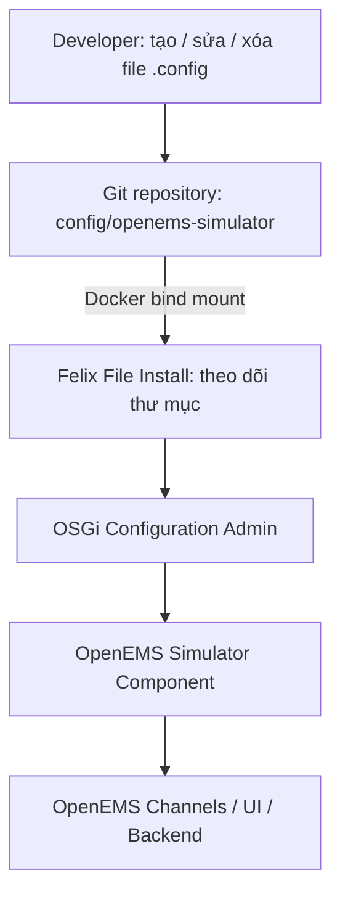

# OpenEMS Simulator — Configuration as Code và Hot Reload

## 1. Mục tiêu

Tạo và quản lý thiết bị giả lập trong OpenEMS Edge bằng các file cấu hình lưu trong Git. Sau khi thiết lập cơ chế theo dõi thư mục một lần, có thể thêm, sửa, vô hiệu hóa hoặc xóa component mà không cần khởi động lại toàn bộ OpenEMS Edge.

- Sử dụng Docker image OpenEMS Edge chính thức, phiên bản tham chiếu `2026.1.0`.
- Sử dụng Simulator Component và Apache Felix File Install / OSGi Configuration Admin tích hợp trong Edge.
- Không tạo thêm container Simulator, không custom Java, không custom Dockerfile, không script import và không gọi API để nạp thiết bị.
- Mỗi Factory Configuration được quản lý bằng một file `.config`.
- Không thay thế toàn bộ cấu hình nền tảng của Edge.

> **Trạng thái:** Hướng dẫn và kế hoạch triển khai, chưa được chạy kiểm thử trên Docker Compose của dự án. Các ví dụ property bên dưới cần đối chiếu với `Config.java` của đúng phiên bản đang chạy trước khi sử dụng. Hot reload không đồng nghĩa với việc component riêng lẻ không bị deactivate/activate lại.

## 2. Kiến trúc



Phân biệt hai thư mục:

| Thư mục | Trách nhiệm |
|---|---|
| `/var/opt/openems/config` | Configuration Admin: nơi lưu cấu hình runtime của Edge |
| `/var/opt/openems/simulator` | File Install: thư mục nguồn khai báo thiết bị do developer quản lý |

`felix.cm.dir` không phải cơ chế theo dõi file hot reload. Không chỉnh sửa trực tiếp file lưu trữ nội bộ của Configuration Admin khi Edge đang chạy để thay thế cho File Install.

OpenEMS Edge `2026.1.0` có khai báo bundle `org.apache.felix.fileinstall` phiên bản 3.7.4 trong `EdgeApp.bndrun`. Cần xác nhận bundle thực sự Active và các tham số theo dõi được áp dụng trong image đang chạy.

## 3. Cấu trúc repository

```text
project/
├── docker-compose.yml
├── docker-compose.simulator.yml
└── config/
    └── openems-simulator/
        ├── Simulator.EssSymmetric.Reacting-battery0.config
        ├── Simulator.Datasource.CSV.Predefined-load0.config
        ├── Simulator.GridMeter.Acting-grid0.config
        └── Simulator.Evcs-charger0.config
```

Giữ các file ở cấp trực tiếp của thư mục theo dõi để tránh giả định File Install tự quét các thư mục con.

## 4. Thiết lập Docker Compose (một lần)

Tạo thư mục:

```bash
mkdir -p config/openems-simulator
```

Tạo `docker-compose.simulator.yml`:

```yaml
services:
  openems-edge:
    environment:
      JAVA_TOOL_OPTIONS: >-
        -Dfelix.fileinstall.dir=/var/opt/openems/simulator
        -Dfelix.fileinstall.poll=2000
        -Dfelix.fileinstall.enableConfigSave=false
        -Dfelix.fileinstall.log.level=3
    volumes:
      - type: bind
        source: ./config/openems-simulator
        target: /var/opt/openems/simulator
        read_only: false
        bind:
          create_host_path: false
```

| Tham số | Ý nghĩa |
|---|---|
| `felix.fileinstall.dir` | Thư mục File Install theo dõi |
| `felix.fileinstall.poll` | Chu kỳ kiểm tra, 2.000 ms |
| `felix.fileinstall.enableConfigSave` | Tắt cơ chế ghi ngược configuration vào file nguồn |
| `felix.fileinstall.log.level` | Mức log 3 (INFO) |

Lưu ý:

- Giữ nguyên volume `/var/opt/openems/config` và volume dữ liệu đã có.
- Nếu `JAVA_TOOL_OPTIONS` đang được khai báo, kết hợp với các giá trị cũ; Compose có thể ghi đè toàn bộ biến môi trường này.
- Kiểm tra các tham số framework có sẵn trong `EdgeApp.bndrun` và entrypoint của image. Nếu chúng ưu tiên một giá trị khác với system property JVM, cần cấu hình File Install bằng cơ chế OSGi tương ứng rồi kiểm chứng thư mục thực sự được theo dõi.
- Chưa bật mount read-only trong lần thử đầu tiên: một số component có thể cần cập nhật configuration nội bộ khi activate.
- Nếu Compose hiện tại vẫn có `build` tùy chỉnh và mục tiêu là dùng image chính thức, cần loại bỏ `build` đó và giữ đúng tag image.

Kiểm tra cấu hình Compose sau khi merge:

```bash
docker compose -f docker-compose.yml -f docker-compose.simulator.yml config
```

Áp dụng:

```bash
docker compose -f docker-compose.yml -f docker-compose.simulator.yml \
  up -d --no-deps openems-edge
```

> Thay đổi mount và tham số JVM có thể cần recreate container **một lần**. Sau khi watcher đã hoạt động, không cần restart/recreate khi thêm thiết bị vào thư mục đã mount.

Các lệnh dưới đây dùng cùng bộ file Compose. Có thể dùng biến `COMPOSE_FILE` để tránh gõ lại:

```bash
export COMPOSE_FILE=docker-compose.yml:docker-compose.simulator.yml
```

## 5. Quy tắc định nghĩa file

Tên file Factory Configuration theo quy ước File Install:

```text
<FactoryPID>-<InstanceName>.config
```

Ví dụ:

```text
Simulator.EssSymmetric.Reacting-battery0.config
```

- Factory PID: `Simulator.EssSymmetric.Reacting`.
- Instance name: `battery0`, dùng để xác định cấu hình factory.
- Component ID: property `id`, là định danh thiết bị trong OpenEMS; phải duy nhất trong Edge.
- Không cần tự sinh `service.pid` hay `service.factoryPid` cho file nguồn File Install.
- Không nhầm quy tắc tên file phẳng của File Install với đường dẫn lưu trữ nội bộ của Configuration Admin.

Kiểu dữ liệu Felix `.config`:

| Kiểu | Ví dụ |
|---|---|
| String | `alias="Battery 01"` |
| Boolean | `enabled=B"true"` |
| Integer | `capacity=I"10000"` |
| Float | `factor=F"10000.0"` |
| Long | `value=L"100000"` |
| String array | `ids=["meter0","meter1"]` |

Nên giữ nguyên tên file và Component ID khi cập nhật để tránh tạo thêm một configuration ngoài ý muốn.

## 6. Ví dụ khai báo Simulator Component

Các ví dụ sau lấy từ hướng dẫn đã thảo luận, là cấu hình dự kiến để thử nghiệm chứ chưa phải bộ cấu hình đã xác nhận chạy thành công. Kiểm tra các dependency, tên property, kiểu dữ liệu và giới hạn giá trị của đúng tag trước khi nạp. Có thể thử từng file theo thứ tự bên dưới.

### 6.1. Battery — Hệ thống lưu trữ năng lượng (ESS)

File `config/openems-simulator/Simulator.EssSymmetric.Reacting-battery0.config`:

```properties
id="essDemo0"
alias="Battery Storage 01"
enabled=B"true"
capacity=I"10000"
initialSoc=I"50"
maxApparentPower=I"5000"
maxChargePower=I"5000"
maxDischargePower=I"5000"
gridMode="ON_GRID"
```

Mục tiêu giả lập: dung lượng 10 kWh, SoC ban đầu 50%, công suất sạc/xả mục tiêu 5 kW. Đặc biệt kiểm tra quy ước dấu của công suất sạc/xả và các component ESS Power cần thiết trong source code. Nếu một property không có trong `Config.java`, bỏ hoặc thay bằng property chính xác; không mặc định rằng một property tùy ý sẽ có hiệu lực.

Nguồn: [ESS Config.java](https://github.com/OpenEMS/openems/blob/2026.1.0/io.openems.edge.simulator/src/io/openems/edge/simulator/ess/symmetric/reacting/Config.java).

### 6.2. DataSource — Nguồn dữ liệu mô phỏng

File `config/openems-simulator/Simulator.Datasource.CSV.Predefined-load0.config`:

```properties
id="datasourceDemo0"
alias="Standard Load Profile"
enabled=B"true"
source="H0_HOUSEHOLD_SUMMER_WEEKDAY_STANDARD_LOAD_PROFILE"
factor=F"10000.0"
timeDelta=I"1"
```

- `source`: bộ dữ liệu CSV tích hợp sẵn.
- `factor`: hệ số nhân dữ liệu.
- `timeDelta`: khoảng thời gian giữa các giá trị dữ liệu; kiểm tra đơn vị theo source code.

Các lựa chọn source cần đối chiếu với enum của tag đang dùng: `ZERO`, `H0_HOUSEHOLD_SUMMER_WEEKDAY_STANDARD_LOAD_PROFILE`, `H0_HOUSEHOLD_SUMMER_WEEKDAY_PV_PRODUCTION`, `H0_HOUSEHOLD_SUMMER_WEEKDAY_NON_REGULATED_CONSUMPTION`, `H0_HOUSEHOLD_SUMMER_WEEKDAY_PV_PRODUCTION2`.

### 6.3. Grid Meter — Đồng hồ điện lưới

File `config/openems-simulator/Simulator.GridMeter.Acting-grid0.config`:

```properties
id="meterDemo0"
alias="Grid Meter 01"
enabled=B"true"
datasource.id="datasourceDemo0"
```

Dependency:


Tạo DataSource trước, xác nhận Active rồi mới thêm Grid Meter. OpenEMS có logic cập nhật reference target từ component ID; cần kiểm tra `datasource.target` nếu component không resolve được dependency. Nếu `Config.java` hoặc logic activation yêu cầu thêm thuộc tính, bổ sung đúng theo source.

### 6.4. EV Charger — Trạm sạc xe điện

File `config/openems-simulator/Simulator.Evcs-charger0.config`:

```properties
id="evcsDemo0"
alias="EV Charging Station 01"
enabled=B"true"
maxHwPower=I"22080"
minHwPower=I"4140"
```

Mục tiêu giả lập: trạm sạc có công suất tối đa khoảng 22 kW. Kiểm tra các property `maxHwPower`, `minHwPower` theo đúng `Config.java` trước khi áp dụng. Nếu cần thực hiện nghiệp vụ điều khiển sạc, cấu hình Controller tương ứng.

`Simulator.Evcs` mô phỏng EVCS ở cấp EMS, không phải một OCPP Charging Station Simulator kết nối trực tiếp với CitrineOS.

Nguồn: [EVCS Config.java](https://github.com/OpenEMS/openems/blob/2026.1.0/io.openems.edge.simulator/src/io/openems/edge/simulator/evcs/Config.java).

## 7. Kiểm tra hot reload

Theo dõi log:

```bash
docker compose logs -f openems-edge
```

Kiểm tra mount:

```bash
docker compose exec openems-edge ls -la /var/opt/openems/simulator
```

Ghi nhận container ID, thời điểm khởi động và restart count trước khi thử:

```bash
EDGE_ID=$(docker compose ps -q openems-edge)
docker inspect --format 'ID={{.Id}} StartedAt={{.State.StartedAt}} RestartCount={{.RestartCount}}' "$EDGE_ID"
```

Tạo một file `.config` trong khi Edge đang chạy. Chờ File Install quét, kiểm tra:

1. File xuất hiện trong container.
2. File Install phát hiện và tạo Factory Configuration.
3. OpenEMS Component activate hoặc ghi log lỗi dependency cụ thể.
4. Component xuất hiện trong OpenEMS UI / Felix Web Console và có channel hoạt động nếu phù hợp.
5. Container ID và `StartedAt` không đổi.

Kiểm tra cổng Felix Web Console nếu đã được bật:

```bash
docker compose port openems-edge 8080
```

Đường dẫn thường dùng: `/system/console/configMgr`. Chỉ sử dụng giao diện để xác minh, không cần tạo component thủ công.

Không dựa duy nhất vào log hoặc việc configuration tồn tại: configuration được tạo chưa đảm bảo component đã Active hoặc sinh dữ liệu hợp lệ.

## 8. Quản lý vòng đời thiết bị bằng code

### Create

Thêm file `Simulator.EssSymmetric.Reacting-battery1.config` bằng cách sao chép file battery đã xác nhận hoạt động, đổi `id="essDemo1"` và `alias="Battery Storage 02"`. Chỉnh dung lượng lên 20.000 Wh nếu property `capacity` được hỗ trợ.

### Update

Sửa property trong file hiện tại, ví dụ `capacity=I"30000"`. File Install cập nhật configuration; component có thể tái kích hoạt. Kiểm tra cả giá trị configuration và hành vi thực tế.

### Disable / Enable

```properties
enabled=B"false"
```

Hoặc:

```properties
enabled=B"true"
```

### Delete

Chỉ xóa file thuộc thiết bị demo đã tạo để kiểm thử:

```bash
rm config/openems-simulator/Simulator.EssSymmetric.Reacting-battery1.config
```

Xác nhận Factory Configuration và component tương ứng đã được gỡ bỏ. Xóa component phụ thuộc trước khi xóa DataSource dùng chung. Không xóa file cấu hình nền tảng của Edge.

| Thao tác | Kết quả mong muốn |
|---|---|
| Thêm file | Tạo component |
| Sửa file | Cập nhật component |
| Xóa file | Xóa configuration/component do File Install quản lý |
| `enabled=false` | Vô hiệu hóa component |
| `enabled=true` | Kích hoạt component |

Nên kiểm thử xóa file cả khi Edge đang chạy và khi Edge đã dừng. Nếu cấu hình runtime cũ còn tồn tại sau khi khởi động, cần xử lý theo cơ chế quản lý configuration của File Install, không giả định rằng Git tự động reconcile mọi trạng thái cũ.

## 9. Quy trình nghiên cứu và định nghĩa thiết bị mới

1. Mở [Simulator source code](https://github.com/OpenEMS/openems/tree/2026.1.0/io.openems.edge.simulator/src/io/openems/edge/simulator).
2. Xác định package của thiết bị cần giả lập.
3. Đọc `*Impl.java`: tìm `@Component(name = ...)`, `@Designate(..., factory = true)`, `@Reference`, logic activate/modified và dependency.
4. Đọc `Config.java`: tìm các property, kiểu dữ liệu, enum, giá trị mặc định và property bắt buộc.
5. Đặt tên `<FactoryPID>-<InstanceName>.config` và khai báo Component ID duy nhất.
6. Chuyển giá trị Java sang kiểu dữ liệu Felix `.config`.
7. Lưu file vào thư mục watcher, kiểm tra log và channel.
8. Commit configuration đã kiểm thử vào Git.

Ví dụ đối chiếu:

```java
@Designate(ocd = Config.class, factory = true)
@Component(
    name = "Simulator.GridMeter.Acting",
    immediate = true,
    configurationPolicy = ConfigurationPolicy.REQUIRE
)
```

| Java property | Felix configuration |
|---|---|
| `String id()` | `id="meter0"` |
| `boolean enabled()` | `enabled=B"true"` |
| `int capacity()` | `capacity=I"10000"` |
| `float factor()` | `factor=F"10000.0"` |
| `String datasource_id()` | `datasource.id="datasource0"` |

Đây là ví dụ quy tắc chuyển đổi; không dùng một property nếu component thực tế không khai báo hoặc không sử dụng property đó.

## 10. Kế hoạch triển khai

### Giai đoạn 1 — Proof of Concept File Install

- [ ] Xác nhận image tag và phiên bản bundle File Install.
- [ ] Xác nhận File Install Active và theo dõi đúng thư mục mount.
- [ ] Thiết lập Compose override, giữ nguyên cấu hình nền tảng.
- [ ] Tạo thử một component đơn giản trong khi Edge chạy.
- [ ] Kiểm tra create / update / disable / enable / delete.
- [ ] Chứng minh container không restart bằng ID và StartedAt.

### Giai đoạn 2 — Simulator Component

- [ ] DataSource và Grid Meter sinh dữ liệu đúng.
- [ ] ESS có dung lượng, SoC và công suất phù hợp với cấu hình đã xác minh.
- [ ] EVCS có channel và trạng thái hoạt động; bổ sung Controller nếu cần.
- [ ] Kiểm tra trùng ID, dependency, lỗi activation và tác động lên các thiết bị có sẵn.

### Giai đoạn 3 — Git và khả năng tái sử dụng

- [ ] Commit các file `.config` đã kiểm thử.
- [ ] Kiểm tra `git diff -- config/openems-simulator/` để phát hiện ghi ngược runtime.
- [ ] Kiểm tra việc restart Edge và tái nạp cấu hình, không tạo component trùng.
- [ ] Không commit API key hoặc mật khẩu thực.
- [ ] Viết README hướng dẫn tạo thiết bị mới.

## 11. Acceptance Criteria

- [ ] Không cần custom Dockerfile hoặc container Simulator riêng.
- [ ] Không cần API hoặc script import để thêm thiết bị.
- [ ] File mới được nạp khi OpenEMS đang chạy, sau khi watcher đã được thiết lập.
- [ ] Sửa/xóa file có hiệu lực và không restart Edge.
- [ ] Configuration và component đã Active được phân biệt khi kiểm tra.
- [ ] Các component nền tảng hiện có không bị xóa hoặc ghi đè ngoài ý muốn.
- [ ] Repository chứa cấu hình có thể tái sử dụng với phiên bản image tương thích.

## 12. Tên issue và commit đề xuất

Issue:

```text
feat(openems): support hot-reload of simulator components using Felix File Install
```

Commit (sau khi triển khai thành công):

```text
feat(openems): manage simulator components as code with hot-reload configuration
```

## 13. Tài liệu tham khảo

- [Apache Felix File Install](https://felix.apache.org/documentation/subprojects/apache-felix-file-install.html)
- [OpenEMS Edge Configuration](https://openems.github.io/openems.io/openems/latest/edge/configuration.html)
- [OpenEMS EdgeApp.bndrun — 2026.1.0](https://github.com/OpenEMS/openems/blob/2026.1.0/io.openems.edge.application/EdgeApp.bndrun)
- [OpenEMS Simulator — 2026.1.0](https://github.com/OpenEMS/openems/tree/2026.1.0/io.openems.edge.simulator)
- [OpenEMS Real-Time Simulation](https://openems.github.io/openems.io/openems/latest/simulation/realtime.html)

---

**Kết luận:** Sau khi thiết lập File Install thành công, thao tác hằng ngày chỉ là xác định Factory PID, đọc Config.java, tạo/sửa/xóa file `.config` và kiểm tra component. Không cần restart toàn bộ Edge cho mỗi lần thay đổi thiết bị.
