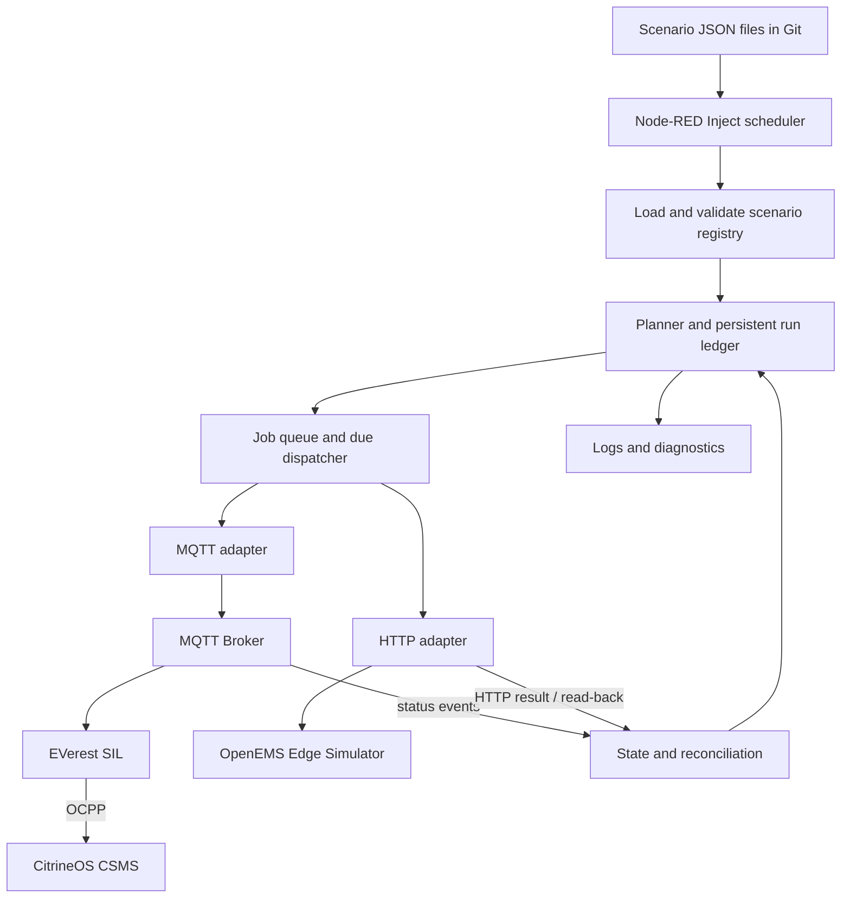
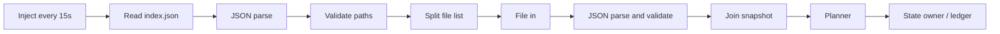
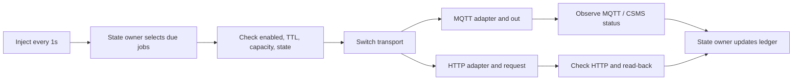
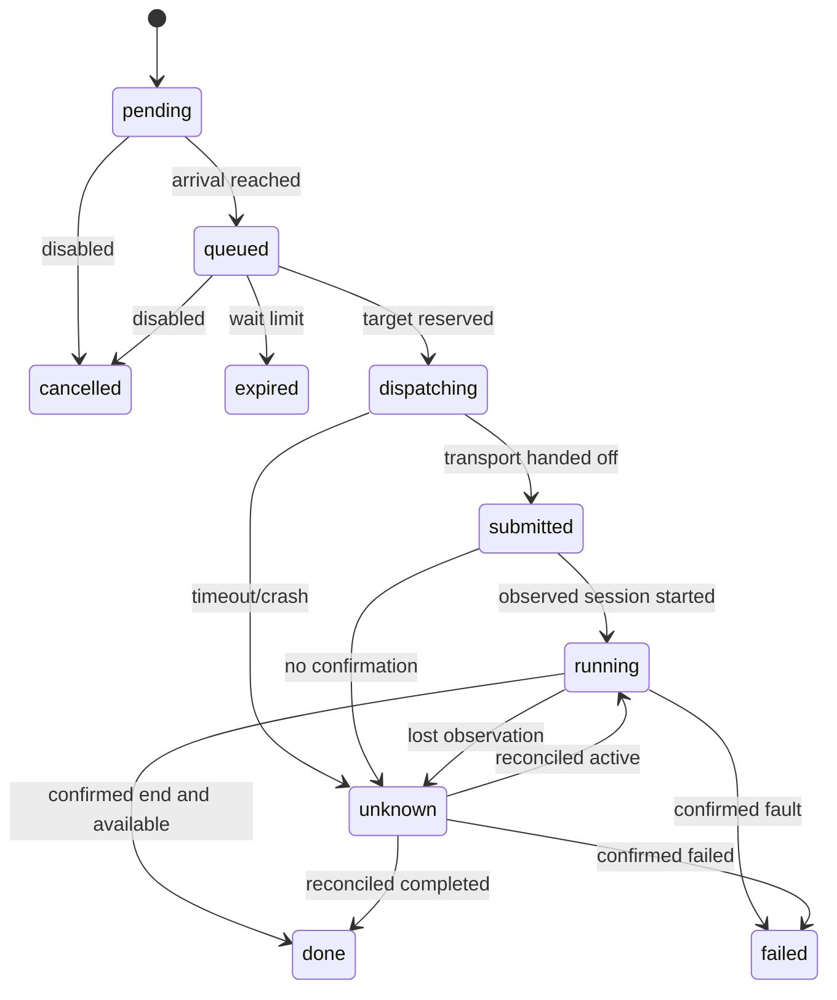

# Node-RED Simulation Orchestrator — Configuration as Code

> Đặc tả kỹ thuật triển khai v2.0 — 26/11/2026. Bản thay thế toàn bộ thiết kế Odoo Simulation Orchestrator trước đó. Tài liệu dành cho Developer / Coding Agent.
>
> Mục tiêu: tận dụng service `everest-nodered` đang có trong project. Node-RED tự đọc kịch bản JSON, tự lập lịch, sinh lượt giả lập và push lệnh native tới các simulator. Không tạo addon, model, cron, connector hoặc dependency Odoo; không sử dụng n8n hay service Gateway mới.

## 1. Bối cảnh và phạm vi

Project có các service phục vụ học nghiệp vụ EMS và CSMS: EVerest SIL, MQTT Broker, Node-RED, CitrineOS và OpenEMS Edge với các component Simulator. Chúng ta muốn hệ thống vận hành tự động cả ngày như một hệ thống có thiết bị thật: 07:00 có 30 xe đến, 10:00 có 100 xe đến trong một giờ, 18:00 phụ tải nhà máy tăng, v.v.

Yêu cầu:

- Mỗi kịch bản là một file JSON độc lập, chứa toàn bộ tham số nghiệp vụ, lịch và target logic.
- Flow Node-RED là code JSON quản lý bằng Git; Function Node dùng JavaScript. Không bắt buộc thao tác kéo thả.
- Node-RED là scheduler duy nhất của lớp giả lập; không cần bất kỳ hệ thống ERP nào đang chạy.
- Dùng các node core (`inject`, `file in`, `json`, `function`, `switch`, `mqtt in/out`, `http request`, `catch`, `status`, `debug`); thêm dependency chỉ khi thật sự cần và có lý do.
- Tận dụng Node-RED, MQTT Broker, EVerest và OpenEMS đang chạy. Không sửa source upstream, không tạo simulator mới chỉ để gửi dữ liệu.
- File scenario đọc lại lúc runtime; thay đổi tham số hoặc lịch không đòi hỏi restart container hoặc redeploy Flow.
- Giữ dashboard và flow mặc định của EVerest. Tách automation thành tab riêng; không ghi đè toàn bộ cấu hình đang chạy một cách mù quáng.
- Phân biệt lệnh được gửi, lệnh được tiếp nhận và phiên sạc thực sự thành công.
- Có giới hạn batch, kiểm tra schema, nhật ký, chống thực thi trùng, chính sách restart và kịch bản kiểm thử.

**Giới hạn của tài liệu:** Đây là đặc tả + code tham chiếu cho Coding Agent, không phải bộ Flow đã được cài và kiểm thử trên project thật. Tên container, Docker network, image tag, đường dẫn mount, topic trạng thái, credential và topology chưa được cung cấp. Agent phải kiểm kê chúng trước khi chỉnh Compose. Tất cả địa chỉ/ID dùng trong ví dụ là giả định lab, không phải cấu hình đã xác nhận của project.

## 2. Kiến trúc hệ thống



| Thành phần | Trách nhiệm | Không đảm nhận |
|---|---|---|
| Node-RED | Lập lịch, đọc JSON, tạo job, điều phối, gửi MQTT/HTTP, thu phản hồi | Không viết lại state machine sạc hoặc OCPP |
| MQTT Broker | Chuyển tiếp MQTT | Không quản lý hàng đợi xe theo nghiệp vụ |
| EVerest SIL | Mô phỏng hành vi EV/EVSE, đo đạc, phát OCPP | Không mặc định hiểu JSON `vehicle_count` |
| CitrineOS | CSMS, tiếp nhận và quản lý dữ liệu vận hành | Không giả lập xe vật lý |
| OpenEMS Edge | Giả lập điện và chạy controller EMS | Không tự liên kết với EVerest nếu chưa tích hợp |

### 2.1. Phạm vi theo phiên bản

- V1 — Native Payload Dispatcher: đọc JSON chứa danh sách MQTT/HTTP request, chạy theo lịch, lưu kết quả. Kiểm thử một trạm EVerest và một datasource OpenEMS. Không tuyên bố V1 đã đáp ứng hàng trăm xe động.
- V1.1 — State & reliability: ledger bền vững, theo dõi trạng thái thiết bị, xử lý restart/deploy, timeout, giới hạn tốc độ và log.
- V2 — Demand Scenario Engine: chuyển nhu cầu xe theo giờ thành lượt đến, hàng đợi, lựa chọn điểm sạc khả dụng và lệnh native. Bắt buộc nếu nghiệm thu yêu cầu 100 xe đến lúc 10h.
- V3 — Cross-system coordination (tùy chọn): mô hình hóa tải sạc của EVerest vào OpenEMS và thử Smart Charging, fault injection, nhiều site.

Các phiên bản dùng cùng Node-RED runtime; không phải bốn service mới. V2 không cần thay đổi interface native V1.

### 2.2. Vì sao không chỉ dùng Delay cho mọi việc?

Delay node hữu ích khi giới hạn tốc độ gửi, nhưng các message đang chờ trong memory không phải hàng đợi bền vững. Nếu lưu 100 message chờ trong một giờ rồi restart/redeploy, có thể mất công việc hoặc tạo lại trùng. Thiết kế ưu tiên danh sách job có `due_at`, một tick dispatcher ngắn và ledger; Delay chỉ dùng như throttle bổ sung nếu cần.

## 3. Kiểm kê project hiện tại (bắt buộc trước khi triển khai)

```bash
docker compose config --services
docker compose ps
docker compose images
# Thay service bằng tên thực tế:
docker compose logs --tail=100 everest-nodered
docker compose exec everest-nodered sh -lc 'id; pwd; ls -la /data /config 2>/dev/null; echo "$FLOWS"; echo "$TZ"'
```

Không dump toàn bộ environment vì có thể lộ mật khẩu. Kiểm tra thêm `docker compose config` ở local nhưng không đưa cấu hình chứa secret vào log/commit. Ghi nhận kết quả trong `docs/runtime_inventory.md`:

| Cần xác minh | Ví dụ (chưa xác nhận) |
|---|---|
| Node-RED service/image | everest-nodered / image EVerest demo |
| Flow file đang active | `/config/config-sil-iso15118-ac-flow.json` hoặc `/data/flows.json` |
| Settings file và userDir | `/data/settings.js`, `/data` |
| Admin API auth, root URL | `localhost:1880`, có thể có prefix |
| Existing flow tabs và config node IDs | export/backup từ Admin API |
| MQTT broker host/port | `everest-mqtt:1883` hoặc `mqtt-server:1883` |
| MQTT external topic prefix | `everest_external/nodered/...` |
| EVerest image/version, config YAML | SIL AC hoặc DC, EvManager enabled |
| Station ID, EVSE ID, connector mapping | mapping thực tế theo mỗi instance |
| OCPP endpoint/version/auth | CitrineOS, OCPP 2.0.1 hoặc phiên bản đang chạy |
| OpenEMS writable datasource | `simulateConsumption/Data` |
| OpenEMS REST controller/auth | `openems-edge:8084` (ví dụ) |
| Docker network dùng chung | tên network thực tế |

Kiểm tra Node-RED Admin API được bật, quyền ghi flow file, quyền đọc JSON mount và quyền ghi state. Nếu image mặc định dùng file Flow read-only trong `/config`, cần chọn cơ chế deployment tương thích (build image mới hoặc tạo writable working copy có volume) thay vì giả định POST /flows sẽ lưu được.

## 4. Cấu trúc source code

Tạo thư mục tùy biến riêng trong repo project; không sửa file trong repo vendor đã tải về.

```text
project/
├── compose.yaml                         # file hiện tại, giữ nguyên nếu có thể
├── compose.simulation.yaml              # compose bổ sung, không bắt buộc tên override
├── node-red/
│   ├── flows/
│   │   ├── simulation-orchestrator.json # flow fragment, tab riêng
│   │   └── simulation-adapters.json     # tùy chọn, nếu tách tab
│   ├── functions/                       # JS nguồn, build vào Function nodes
│   │   ├── validate.js
│   │   ├── planner.js
│   │   ├── dispatcher.js
│   │   ├── state-machine.js
│   │   ├── everest.js
│   │   └── openems.js
│   ├── schemas/
│   │   ├── scenario.schema.json
│   │   └── targets.schema.json
│   ├── scenarios/
│   │   ├── index.json
│   │   ├── everest/
│   │   │   ├── native-ac-smoke.json
│   │   │   └── daily-charging-demand.json
│   │   └── openems/
│   │       └── daily-consumption.json
│   ├── targets/
│   │   └── targets.json
│   ├── scripts/
│   │   ├── build-flows.mjs
│   │   ├── validate-scenarios.mjs
│   │   └── deploy-flows.mjs
│   ├── tests/
│   │   ├── planner.test.mjs
│   │   ├── dispatcher.test.mjs
│   │   └── state-machine.test.mjs
│   └── README.md
└── docs/
    ├── simulation_orchestrator_implementation.md
    └── runtime_inventory.md
```

- `scenarios/`: chỉ dữ liệu và lịch nghiệp vụ.
- `targets/`: định nghĩa kết nối/allowlist/mapping thiết bị, không chứa mật khẩu.
- `functions/`: source JavaScript dễ review/test. Node-RED không tự import các file này vào Function node; script build phải nhúng code vào thuộc tính `func` của node JSON, hoặc đóng gói helper theo cơ chế Function external modules được kiểm tra trên runtime.
- `flows/`: artifact deploy được, dùng ID ổn định, không chứa credential.
- State runtime lưu ở volume (không commit Git). Backup/export flow có thể chứa thông tin nhạy cảm, thêm `.gitignore` cho `.env`, backup, credential files và runtime state.

### 4.1. Registry thay cho quét thư mục

Core `file in` đọc file có tên cụ thể, không phải node liệt kê thư mục. Để tránh cài node bổ sung, dùng `index.json` liệt kê danh sách file scenario. Mỗi tick đọc lại registry và file đã đăng ký. Muốn thêm file thì cập nhật index, hoặc dùng script build tự sinh index từ thư mục khi phát hành. Tùy chọn quét directory trực tiếp cần helper filesystem được cấu hình có chủ đích (không cho phép đường dẫn tùy ý).

`scenarios/index.json`:

```json
{
  "schema_version": 1,
  "files": [
    "everest/native-ac-smoke.json",
    "everest/daily-charging-demand.json",
    "openems/daily-consumption.json"
  ]
}
```

Chỉ cho phép relative path nằm trong thư mục scenarios, không `..`, absolute path, URI hay symlink thoát root. File registry và từng scenario nên được cập nhật atomic (write temp + rename trong cùng filesystem); mount cả thư mục để không bị stale inode khi đổi file.

## 5. Docker Compose và cấu hình Node-RED

### 5.1. Mount cấu hình (ví dụ)

```yaml
# compose.simulation.yaml — fragment, phải merge với Compose project thực tế
services:
  everest-nodered:
    environment:
      TZ: Asia/Ho_Chi_Minh
      SIM_CONFIG_ROOT: /simulation
      SIM_ENABLED: "false"
      SIM_DRY_RUN: "true"
    volumes:
      - ./node-red/scenarios:/simulation/scenarios:ro
      - ./node-red/targets:/simulation/targets:ro
```

Không override `image`, `command`, `entrypoint`, `FLOWS`, `ports`, các mount hoặc credential hiện tại nếu không cần. `SIM_ENABLED` và `SIM_DRY_RUN` là biến custom do Function node đọc, không phải option native của Node-RED. Có thể giữ default an toàn và chuyển trạng thái chạy qua control config runtime riêng đã xác thực; đổi env container thường cần recreate.

```bash
docker compose -f compose.yaml -f compose.simulation.yaml config --services
# Kiểm tra merged config trước khi áp dụng, nhất là volumes/network.
docker compose -f compose.yaml -f compose.simulation.yaml up -d everest-nodered
```

Lần đầu thêm mount, timezone hoặc settings có thể cần recreate service Node-RED. Cam kết không restart chỉ áp dụng cho cập nhật scenario sau khi đã setup xong. Không chạy `down -v` hoặc xóa volume.

### 5.2. Persistent context

Merge cấu hình dưới đây vào `settings.js` đang sử dụng, không thay nguyên file:

```js
contextStorage: {
    default: "memoryOnly",
    memoryOnly: { module: "memory" },
    file: { module: "localfilesystem" }
},
```

Dùng `flow.get("simState", "file")` và `flow.set("simState", state, "file")` cho ledger; `memoryOnly` cho transient lock/snapshot tạm. Nếu state cần dùng giữa các tab, dùng `global` context namespace riêng hoặc đưa tất cả state mutation về một tab. Context `flow` là local theo tab. Không dùng chung với key gốc của EVerest.

`localfilesystem` mặc định cache trong RAM và flush khoảng 30 giây. Không được coi đây là cơ chế transaction/exactly-once; crash có thể mất trạng thái chưa flush. Đảm bảo userDir/context nằm trong persistent writable volume. Nếu yêu cầu chống trùng qua crash nghiêm ngặt, dùng journal bền vững đồng bộ hoặc SQLite với unique key và transaction (in-process Node-RED, không thêm service; chỉ thêm package nếu được duyệt). Không phụ thuộc ERP.

### 5.3. Secrets và mạng

- Broker và HTTP endpoint dùng credential cấu hình sẵn của Node-RED, secret mount hoặc env từ local `.env` được ignore. Không đặt password vào scenario, URL log hoặc `func` code.
- Chỉ cho phép Node-RED truy cập simulator lab. Dùng service DNS trong Docker network, không gọi `localhost` để đến container khác.
- MQTT out thường gắn cố định một MQTT broker config node. Nếu nhiều broker, tạo config node/nhánh riêng theo `broker_alias`; không giả định `msg.hostname` đổi broker động được.
- Dùng prefix MQTT không trùng giữa station, broker riêng hoặc cấu hình prefix đã xác nhận. Nếu hai instance cùng broker dùng chung topic connector 1, không dispatch tới chúng như hai target độc lập.
- Admin API cần auth và chỉ expose trong môi trường quản trị. Bảo vệ MQTT bằng ACL/TLS tùy lab. Không mở HTTP endpoint thực thi tùy ý ra Internet.

## 6. JSON contract — scenario, targets, job

### 6.1. Envelope chung

```json
{
  "schema_version": 1,
  "id": "everest-ac-smoke",
  "name": "AC charging smoke test",
  "enabled": false,
  "kind": "native_dispatch",
  "schedule": {
    "timezone": "Asia/Ho_Chi_Minh",
    "type": "daily",
    "times": ["10:00"],
    "catch_up_seconds": 120
  },
  "parameters": {
    "actions": [
      {
        "id": "ac-session",
        "target": "evse-lab-01",
        "transport": "mqtt",
        "command": "execute_charging_session",
        "payload": "sleep 1;iec_wait_pwr_ready;sleep 1;draw_power_regulated 16,3;sleep 30;unplug",
        "offset_seconds": 0
      }
    ]
  }
}
```

Mặc định scenario mới `enabled: false`, smoke test trước khi bật. Đây là schema custom của orchestrator, không phải schema API native của EVerest hoặc OpenEMS. `target` và `command` được adapter chuyển sang topic/path thực tế.

| Key | Quy tắc |
|---|---|
| schema_version | Bắt buộc, chỉ chấp nhận 1 ở bản đầu |
| id | Duy nhất, regex `^[a-z0-9][a-z0-9_-]{0,63}$` |
| name | Chuỗi mô tả |
| enabled | Boolean, false là không lập kế hoạch mới |
| kind | `native_dispatch`, `charging_demand`, `power_profile` (hai loại sau theo phase) |
| schedule.timezone | IANA timezone hợp lệ; lab VN dùng Asia/Ho_Chi_Minh |
| schedule.type | `daily` (V1); `once`, `weekly`, `interval` chỉ thêm nếu implement rõ |
| schedule.times | Danh sách HH:mm 24h, không trùng |
| schedule.catch_up_seconds | 0–3600, mặc định 120; bỏ qua lịch quá cũ |
| parameters | Object có schema riêng theo kind |
| target | ID tồn tại trong registry |
| offset_seconds | Số nguyên không âm; giới hạn horizon, ví dụ 86400 |
| payload | Chuỗi MQTT hoặc JSON body tùy transport |

Không cho phép `eval`, code JS tùy ý, shell command, URL/host/topic tự do từ JSON. Những lệnh simulator được chấp nhận theo allowlist đã smoke test; không cho phép command chưa xác minh. Đặt limit số action, kích thước file (ví dụ 256 KiB), queue size, horizon và range công suất. Agent phải tạo JSON Schema + validation cross-reference bằng JS. Có thể dùng schema validator trong script CI; runtime vẫn phải validate trước khi gửi, không chỉ tin CI.

### 6.2. Target registry

`targets/targets.json` (ví dụ):

```json
{
  "schema_version": 1,
  "targets": {
    "evse-lab-01": {
      "type": "everest_evse",
      "broker_alias": "everest-lab",
      "station_id": "SIL-001",
      "evse_id": 1,
      "connector_id": 1,
      "mqtt_topic_base": "everest_external/nodered/1/carsim/cmd",
      "allowed_commands": ["enable", "execute_charging_session", "modify_charging_session"]
    },
    "openems-consumption": {
      "type": "openems_channel",
      "base_url": "http://openems-edge:8084",
      "write_path": "/rest/channel/simulateConsumption/Data",
      "read_path": "/rest/channel/simulateConsumption/Data",
      "auth_ref": "openems-lab",
      "value_min_w": 0,
      "value_max_w": 200000
    }
  }
}
```

`station_id`, `evse_id`, `connector_id` là các ID khác nhau; không tự suy ra từ nhau. Trạng thái connector/EVSE phải được normalize từ MQTT hoặc CSMS dựa vào mapping thật. `read_path` của writable datasource cần xác nhận có thể đọc; nếu không, dùng channel meter đã map và xác minh semantics. Limit 200 kW là ví dụ, phải khớp mô hình lab.

### 6.3. Runtime job (generated, không lưu vào file scenario)

```json
{
  "job_id": "everest-ac-smoke:2026-11-26:10:00:ac-session",
  "run_id": "everest-ac-smoke:2026-11-26:10:00",
  "scenario_id": "everest-ac-smoke",
  "due_at": "2026-11-26T03:00:00.000Z",
  "expires_at": "2026-11-26T03:02:00.000Z",
  "target": "evse-lab-01",
  "transport": "mqtt",
  "command": "execute_charging_session",
  "payload": "sleep 1;iec_wait_pwr_ready;sleep 1;draw_power_regulated 16,3;sleep 30;unplug",
  "status": "pending",
  "attempt": 0
}
```

`run_id` ổn định theo scenario + ngày địa phương + lịch; `job_id` thêm action ID hoặc vehicle index. Không dùng timestamp tick làm ID vì sẽ tạo lại khi tick kế tiếp. Không đưa hash của config vào run_id mặc định; sửa config giữa phiên không được làm chạy lại cùng slot. Lưu hash/revision riêng để audit và snapshot action sau khi lập kế hoạch. Bổ sung field `last_error`, `dispatch_at`, `updated_at`, `correlation_id`, `observed_transaction_id` theo nhu cầu.

## 7. Thiết kế Flow và pipeline

### 7.1. Flow A — Load configuration & plan



- `inject`: `repeat: "15"`, `once: true` với delay startup 2 giây; tick không phải lịch thực tế của kịch bản.
- Load registry/targets; validate toàn bộ snapshot trước khi active. Nếu một file invalid, giữ snapshot gần nhất để quan sát nhưng tạm dừng lập kế hoạch mới cho đến khi sửa (fail closed); không silently chạy config cũ khi người dùng muốn tắt. Job đã dispatch không tự hủy.
- `split` gán `msg.parts` và index; `join` automatic phải bảo toàn `msg.parts`, kiểm tra đủ số file, timeout và generation ID. File read lỗi có thể không trả message để join hoàn thành: Catch node phải giải phóng lock hoặc báo snapshot failed; không cho partial snapshot active.
- Có thể chọn cách đơn giản hơn trong V1: một file `scenarios.json` chứa array, File in + JSON + Validate (không cần Split/Join). Nếu triển khai nhiều file dùng registry như mục 4.1, không hỗ trợ cả hai kiểu đồng thời nếu chưa cần.
- Không chạy hai planner đồng thời. Một lock memory có timeout, generation counter để bỏ snapshot cũ. Cùng state owner nhận event đồng bộ, không có `await` giữa read-modify-write ledger.

### 7.2. Flow B — Dispatch due jobs



Một tick chỉ xử lý batch hữu hạn (ví dụ tối đa 10 job toàn hệ thống, 1 command đang in-flight/target đối với thao tác sạc). Không block Function node bằng vòng lặp chờ `sleep` hoặc polling sync. Các thao tác I/O dùng node native; việc đợi một phiên sạc kết thúc do EVerest thực hiện. Nếu job phụ thuộc action trước, chỉ dispatch khi có trạng thái xác nhận; `offset_seconds` một mình không đảm bảo dependency.

### 7.3. Flow C — Reconciliation and diagnostics

- MQTT in subscribe topic status đã xác nhận, map thành `{target, state, observed_at, transaction_id}`.
- HTTP response handler map `msg.statusCode`, `msg.payload`, `msg.job_id`; validate cả nội dung response nếu API yêu cầu.
- Catch node theo scope của các node custom; Status node theo dõi MQTT connection, HTTP node trạng thái nếu hỗ trợ.
- Nếu muốn read-only status endpoint, dùng `http in` + `http response` chỉ sau khi có auth và namespace riêng (ví dụ `/simulation/status`). Không bắt buộc để scheduler hoạt động.
- Các message phản hồi đi qua cùng state owner để tránh nhiều tab update một ledger không đồng bộ.

### 7.4. Mapping Node-RED msg

| Field | MQTT out | HTTP request |
|---|---|---|
| msg.job_id / run_id | Correlation nội bộ | Correlation nội bộ |
| msg.topic | Topic đầy đủ từ registry | Không dùng |
| msg.payload | String native, không gửi envelope | Object JSON hoặc JSON string theo node config |
| msg.qos | 1 hoặc policy cố định của node | Không dùng |
| msg.retain | false cho command | Không dùng |
| msg.url | Không dùng | URL allowlist |
| msg.method | Không dùng | POST/GET được adapter chọn |
| msg.headers | Không dùng | Content-Type/Accept, auth an toàn |
| msg.statusCode | Không có response tự động từ MQTT out | HTTP response code |

MQTT out không có output ACK nghiệp vụ. Complete node (nếu runtime hỗ trợ) không chứng minh phiên sạc thành công. HTTP request đặt timeout hữu hạn bằng cấu hình runtime/node, không để request treo. Không lưu `msg.headers.Authorization` hoặc credential vào context.

## 8. Scheduler — thời gian, hot reload, chống chạy trùng

### 8.1. Timezone và slot

Tất cả runtime timestamp lưu ISO UTC hoặc epoch ms. `schedule.times` diễn giải trong `schedule.timezone` của scenario. Ví dụ 10:00 ngày 26/11/2026 tại VN = 03:00 UTC. Không so sánh string thời gian UTC với local HH:mm.

Mỗi tick: tìm các slot giữa `now - catch_up_seconds` và `now`; lọc `enabled`; nếu run_id đã có trong ledger, bỏ qua. Không chỉ dùng `currentHHmm === time` vì có thể bỏ lịch khi restart hoặc tick trễ. Với V1 chỉ hỗ trợ minute-granularity và timezone không DST `Asia/Ho_Chi_Minh`; nếu hỗ trợ timezone DST, phải quy định giờ lặp/giờ không tồn tại (ví dụ giờ lặp chạy một lần, giờ không tồn tại skip) và test.

### 8.2. JavaScript tham chiếu — tìm slot cho daily schedule

```js
// Pure helper, nhúng vào Function node khi build; test độc lập bằng node:test.
// Bắt buộc validate timezone và catch_up_seconds trước khi gọi.
function dueSlots(scenario, nowMs) {
    const s = scenario.schedule;
    const fmt = new Intl.DateTimeFormat("en-GB", {
        timeZone: s.timezone, year: "numeric", month: "2-digit",
        day: "2-digit", hour: "2-digit", minute: "2-digit", hourCycle: "h23"
    });
    const result = [];
    const first = Math.ceil((nowMs - s.catch_up_seconds * 1000) / 60000) * 60000;
    const last = Math.floor(nowMs / 60000) * 60000;
    for (let ms = first; ms <= last; ms += 60000) {
        const p = Object.fromEntries(fmt.formatToParts(ms).map(x => [x.type, x.value]));
        const date = `${p.year}-${p.month}-${p.day}`;
        const time = `${p.hour}:${p.minute}`;
        if (!s.times.includes(time)) continue;
        const id = `${scenario.id}:${date}:${time}`;
        if (!result.some(x => x.run_id === id)) {
            result.push({run_id: id, scheduled_at_ms: ms});
        }
    }
    return result;
}
```

Đây là cách quét slot theo phút với catch-up window nhỏ, không cần cron parser bên ngoài. `catch_up_seconds = 0` chỉ khớp đúng biên phút; nên dùng >= tick interval + jitter (ví dụ 120) trong cấu hình thực tế. Limit catch-up tối đa 3600. Nếu event đã expired, log `skipped`/`expired` thay vì tạo tải hàng loạt khi khởi động lại.

### 8.3. Planner pseudocode

```text
on validated snapshot event:
    if engine disabled: return
    state = load ledger
    for each enabled scenario in stable ID order:
        for slot in dueSlots(scenario, now):
            if run_id exists: continue
            jobs = expand scenario (native list or demand/profile adapter)
            validate all jobs and target refs; check queue capacity
            insert run and jobs together in state owner
            persist snapshot / journal
    emit summary; release loading lock
```

Không gửi side effect trực tiếp từ planner. Dispatcher là nơi duy nhất được gửi lệnh. Một snapshot config invalid không được tạo một phần job trước khi báo lỗi. Khi queue full, log và áp dụng policy skip/retry có giới hạn; không tạo queue vô hạn.

### 8.4. Hot reload semantics

| Thay đổi | Hành vi đề xuất |
|---|---|
| Thêm file + index entry | Tick sau phát hiện, lập lịch khi đến hạn |
| Sửa vehicle_count/lịch | Áp dụng cho run chưa plan |
| Sửa payload | Job đã plan giữ snapshot; run tương lai dùng config mới |
| Disable/xóa scenario | Ngừng plan, cancel các job pending/queued chưa gửi của scenario |
| Disable toàn engine | Ngừng gửi mới; không tự dừng phiên đang chạy |
| File JSON đang ghi dở | Validation fail, không phát lệnh mới |
| Thêm loại scenario mới | Cần viết adapter/engine và deploy Flow |
| Thêm instance EVerest mới | Provision topology/config riêng; không thể tạo từ JSON demand |

Cấu hình `SIM_DRY_RUN=true` chỉ lập kế hoạch và log payload đã redacted, không đi đến MQTT out / HTTP request. Dry-run ledger tách namespace hoặc không đánh dấu run live đã xử lý; tránh chuyển live rồi thấy các slot bị skip vì chạy thử trước đó. Toggle runtime nếu có phải xác thực, có audit và mặc định an toàn.

## 9. Native dispatcher và adapters

### 9.1. MQTT adapter

Adapter không làm giả OCPP. Nó chỉ dịch command thành MQTT native của simulator. Ví dụ Function node sau có một output nối đến MQTT out của broker `everest-lab`. `msg.job` và `msg.target_config` do state owner cấp sau khi kiểm tra registry; không lấy từ request không tin cậy.

```js
const j = msg.job;
const t = msg.target_config;
if (!j || !t || t.type !== "everest_evse" || t.broker_alias !== "everest-lab") {
    node.error("Invalid EVerest target", msg);
    return null;
}
if (!t.allowed_commands.includes(j.command) || typeof j.payload !== "string") {
    node.error("Invalid MQTT command or payload", msg);
    return null;
}
if (j.command === "enable" && !["true", "false"].includes(j.payload)) {
    node.error("Invalid enable payload", msg);
    return null;
}
// Upstream validator must also check simulator command grammar / profile allowlist.
msg.job_id = j.job_id;
msg.run_id = j.run_id;
msg.topic = `${t.mqtt_topic_base}/${j.command}`;
msg.payload = j.payload;
msg.qos = 1;
msg.retain = false;
return msg;
```

MQTT out: Topic để trống để dùng `msg.topic`, QoS chọn 1 hoặc dùng `msg.qos` nếu cấu hình node hỗ trợ, Retain false. Broker config phải reuse hoặc tạo đúng mapping sau khi kiểm tra flow gốc. Không để command retained vì có thể replay khi simulator reconnect. QoS 1 có khả năng delivery trùng; không đồng nghĩa exactly-once. Tránh gửi khi broker offline; kiểm tra hành vi buffering/reconnect của version node MQTT và không dựa vào offline queue để đảm bảo job TTL. Nếu cần đảm bảo lệnh cũ không phát lại sau reconnect, kiểm thử cấu hình client hoặc bổ sung publisher kiểm soát queue; không tuyên bố core MQTT out mặc định đáp ứng.

### 9.2. HTTP adapter (OpenEMS)

```js
const j = msg.job;
const t = msg.target_config;
if (!j || !t || t.type !== "openems_channel" || j.command !== "set_power_w") {
    node.error("Invalid OpenEMS action", msg);
    return null;
}
const value = j.payload && j.payload.value;
if (!Number.isFinite(value) || !Number.isInteger(value) ||
    value < t.value_min_w || value > t.value_max_w) {
    node.error("Power outside target range", msg);
    return null;
}
// base_url/write_path were validated against the deployment allowlist.
msg.job_id = j.job_id;
msg.run_id = j.run_id;
msg.method = "POST";
msg.url = t.base_url.replace(/\/$/, "") + t.write_path;
msg.headers = {"Content-Type": "application/json", "Accept": "application/json"};
msg.payload = {value};
return msg;
```

HTTP request node: method từ `msg.method`, URL từ `msg.url`, response parse JSON nếu API trả JSON; cấu hình authentication cho target OpenEMS. Với nhiều credential khác nhau, route theo `auth_ref` đến HTTP node riêng, không đọc secret từ scenario. Response handler: 2xx là API đã trả thành công (còn phải check error body theo API), 401/403 lỗi cấu hình không retry tự động, 404 lỗi component/path, 429/5xx theo policy hữu hạn nếu operation idempotent. Network timeout là kết quả không chắc chắn, không mặc định chưa xảy ra side effect.

### 9.3. Simulator khác

Chỉ thêm adapter khi xác minh được API native cụ thể, phiên bản, authentication và request/response. Không tự chế endpoint `/api/scenarios` hoặc gửi JSON business thẳng đến simulator không hỗ trợ. Không gọi CitrineOS để tạo trực tiếp fake transaction khi đang thực hành EVerest; để station phát OCPP. Nếu dùng SAP Charging Stations Simulator hoặc simulator khác, triển khai target type riêng sau khi có tài liệu của đúng version.

## 10. EVerest SIL — cấu hình và smoke test

### 10.1. Native MQTT interface

Tài liệu EvManager release 2026.02.2 mô tả các topic sau (đối chiếu với runtime thực tế):

```text
everest_external/nodered/{connector_id}/carsim/cmd/enable
everest_external/nodered/{connector_id}/carsim/cmd/execute_charging_session
everest_external/nodered/{connector_id}/carsim/cmd/modify_charging_session
```

`enable` nhận text `true`/`false`; execute/modify nhận chuỗi lệnh, không phải JSON nhu cầu sạc. Prefix có thể thay đổi theo cấu hình EVerest. Các module xử lý ở phía EVerest; Node-RED chỉ publish/subscribe.

```yaml
# Fragment minh họa của EvManager, không phải SIL config hoàn chỉnh.
config_module:
  connector_id: 1
  auto_enable: true
  auto_exec: false
  auto_exec_infinite: false
```

Tắt auto_exec nếu scheduler Node-RED là nguồn duy nhất điều phối. Giữ auto_enable nếu đúng với topology. Thay đổi YAML startup có thể cần restart EVerest một lần; sau khi setup, gửi command runtime không restart. Manual dashboard vẫn được giữ nhưng không nên chạy song song auto/manual trên cùng điểm sạc khi đang điều phối.

### 10.2. Xác minh đường đi trước khi bật scheduler

1. Kiểm tra EVerest đã kết nối broker và CSMS; xác nhận station ID duy nhất, đúng OCPP version và token/authorization của lab.
2. Inspect flow dashboard gốc, tìm MQTT out tương ứng button plug/execute/unplug; ghi chính xác topic, payload và status subscription. Có thể reuse adapter logic của flow gốc nếu phù hợp, nhưng không sửa trực tiếp các node upstream.
3. Chạy smoke bằng dashboard hoặc mosquitto_pub trước, quan sát một phiên sạc hoàn chỉnh.

```bash
# Chỉ dùng localhost nếu broker đã expose tới host.
mosquitto_pub -h localhost -p 1883 -q 1 \
  -t 'everest_external/nodered/1/carsim/cmd/enable' -m 'true'

# Chỉ chạy sau khi simulator đã ready, authorization/plug setup đã xác minh.
mosquitto_pub -h localhost -p 1883 -q 1 \
  -t 'everest_external/nodered/1/carsim/cmd/execute_charging_session' \
  -m 'sleep 1;iec_wait_pwr_ready;sleep 1;draw_power_regulated 16,3;sleep 30;unplug'
```

Chuỗi AC trên là profile tham chiếu; có thể cần lệnh cắm sạc hoặc token riêng theo config SIL. Không áp dụng mù quáng cho DC, ISO 15118, Plug & Charge. Xác nhận `draw_power_regulated`, `iec_wait_pwr_ready`, `sleep`, `unplug` được build thực tế hỗ trợ. Không suy luận initial SoC có thể thay đổi bằng một lệnh MQTT nếu chưa có interface tương ứng.

4. Quan sát log manager, trạng thái EVSE, transaction trên CitrineOS và meter values. Với OCPP 2.0.1 có thể quan sát `TransactionEvent` Started/Updated/Ended theo cấu hình; 1.6 dùng message khác. Không gửi trực tiếp message OCPP từ orchestrator.
5. Đưa đúng profile đã test vào `native-ac-smoke.json` (mục 6); chọn giờ sắp đến; dry-run trước, sau đó live trên một điểm sạc.

### 10.3. Status mapping

Không hardcode topic giả định kiểu `.../status/available` nếu chưa thấy trong flow/code. Agent phải lập bảng mapping thực tế:

| Event chuẩn hóa | Nguồn cần xác minh | Ý nghĩa |
|---|---|---|
| available | EVerest EVSE state hoặc CSMS connector status + EV state | Điểm sạc thật sự có thể nhận xe |
| occupied / charging | EV/EVSE status hoặc transaction | Không cấp job khác |
| faulted / unavailable | EVerest error/state, CSMS status | Chặn dispatch |
| disconnected | Broker/CSMS station connectivity | Trạng thái không đáng tin |
| finished | Transaction ended + EVSE ready/unplug | Giải phóng reservation |

Một transaction kết thúc không luôn đồng nghĩa connector đã rút sạc. Phải kiểm tra trạng thái available thực sự. Khi source trạng thái cũ (ví dụ quá 30 giây đối với heartbeat/snapshot định kỳ được cấu hình), mark unknown; với topic event-only phải có cơ chế xác nhận liveness riêng chứ không đánh stale chỉ vì không có event. MQTT retained state có thể cũ; xác nhận timestamp và instance trước khi cấp job. Manual operation cũng cập nhật trạng thái.

## 11. OpenEMS Simulator — profile công suất theo giờ

OpenEMS cung cấp component `Simulator.Datasource.Single.Channel`, với channel `Data` có thể ghi trong runtime. Khi datasource được liên kết với meter tiêu thụ/production giả lập thích hợp, Node-RED gửi giá trị qua REST API. Cần setup controller REST/JSON Read-Write, credential ghi, datasource ID, mapping và unit đúng với phiên bản đang chạy. Không ghi vào `_sum/ConsumptionActivePower` (aggregate channel), không gọi createComponentConfig mỗi tick chỉ để đổi công suất.

### 11.1. Smoke test

```bash
curl --fail-with-body -u "$SIM_OPENEMS_USERNAME:$SIM_OPENEMS_PASSWORD" \
  -H 'Content-Type: application/json' \
  -d '{"value":120000}' \
  http://localhost:8084/rest/channel/simulateConsumption/Data

curl --fail-with-body -u "$SIM_OPENEMS_USERNAME:$SIM_OPENEMS_PASSWORD" \
  http://localhost:8084/rest/channel/_sum/ConsumptionActivePower
```

Cổng, datasource ID và auth chỉ là ví dụ. Dùng credential lab; tránh log secret. Kiểm tra read-back sau chu kỳ Edge, tổng phụ tải có thể bao gồm các nguồn khác. Không bật `Simulator-App` trên Edge đang dùng: tài liệu cảnh báo nó có thể xóa cấu hình component hiện có. Nếu muốn full simulation app, dùng instance lab tách riêng.

### 11.2. File `scenarios/openems/daily-consumption.json`

```json
{
  "schema_version": 1,
  "id": "openems-daily-consumption",
  "name": "Factory power demand by hour",
  "enabled": false,
  "kind": "power_profile",
  "schedule": {
    "timezone": "Asia/Ho_Chi_Minh",
    "type": "daily",
    "times": ["08:00", "10:00", "12:00", "18:00", "22:00"],
    "catch_up_seconds": 120
  },
  "parameters": {
    "target": "openems-consumption",
    "profile_w": {
      "08:00": 50000,
      "10:00": 120000,
      "12:00": 80000,
      "18:00": 150000,
      "22:00": 30000
    }
  }
}
```

Adapter `power_profile` chọn `profile_w[slot.local_time]` (bổ sung local_time vào kết quả dueSlots, hoặc lấy từ run_id), tạo một job `transport=http`, `command=set_power_w`, `payload={value:...}`. Validate key của profile khớp hoàn toàn với schedule.times. Nếu chỉ làm V1, khai báo năm file native_dispatch riêng (cùng target, khác time và payload) thay vì viết adapter profile.

Nếu OpenEMS restart giữa hai slot, kiểm tra datasource reset hay giữ giá trị. Chính sách V1 không replay hàng loạt slot cũ. Có thể thêm reconcile latest desired setpoint: chọn slot gần nhất (kể cả ngày trước) và ghi giá trị hiện hành sau khi Edge ready, ghi log riêng; thao tác setpoint phải được xác nhận idempotent và không xung đột nguồn điều khiển khác. Không làm tương tự cho phiên sạc vì replay có side effect khác.

### 11.3. Kịch bản EMS khác

| Kịch bản | Điều kiện triển khai |
|---|---|
| Solar production profile | Datasource production đã map và writable |
| Grid outage | Simulator/grid model hỗ trợ command lỗi cụ thể; không tự phát minh channel |
| Battery initial SoC | Cấu hình/command native phù hợp, không ghi channel read-only |
| Load spike | Thay đổi writable consumption datasource trong giới hạn lab |
| EV charging load | Mapping meter thực tế từ EVerest và tránh cộng trùng tải |

Không điều khiển actuator thật từ lab. Cần phân biệt mô phỏng phụ tải (input) với điều độ công suất (output của EMS controller).

## 12. V2 — 100 xe đến lúc 10h

### 12.1. File `scenarios/everest/daily-charging-demand.json`

```json
{
  "schema_version": 1,
  "id": "daily-ev-demand",
  "name": "Daily charging demand",
  "enabled": false,
  "kind": "charging_demand",
  "schedule": {
    "timezone": "Asia/Ho_Chi_Minh",
    "type": "daily",
    "times": ["07:00", "10:00", "18:00"],
    "catch_up_seconds": 120
  },
  "parameters": {
    "vehicle_count_by_time": {
      "07:00": 30,
      "10:00": 100,
      "18:00": 150
    },
    "arrival_window_seconds": 3600,
    "arrival_distribution": "uniform",
    "seed": 42,
    "target_pool": ["evse-lab-01", "evse-lab-02"],
    "profile": "ac-basic-v1",
    "charging_duration_seconds": {"min": 900, "max": 2700},
    "max_wait_seconds": 1800,
    "max_parallel": 2,
    "queue_policy": "fifo",
    "on_full": "queue"
  }
}
```

`evse-lab-02` là ID ví dụ, phải khai báo trong targets registry trước khi enable. Hai điểm sạc là ví dụ để test hàng đợi; không kỳ vọng phục vụ đủ 100 xe trong 1 giờ. `max_parallel` không vượt số điểm độc lập đã provision. Nếu muốn 100 xe sạc đồng thời phải có ít nhất 100 EVSE khả dụng và EVerest topology/broker/CSMS đáp ứng được; không tự clone connector từ một lệnh MQTT.

Các trường SoC, vehicle capacity, arrival failure probability có thể thêm sau khi xác nhận simulator profile tương ứng. Không khai báo rằng SoC ngẫu nhiên đã thực hiện nếu engine chỉ tạo duration ngẫu nhiên.

### 12.2. Sinh lượt xe deterministic

Một run tạo đúng N lượt đến; timestamp xe phân bố đều hoặc ngẫu nhiên trong cửa sổ. Ví dụ 10h–11h có 100 xe đến, không phải cùng cắm sạc lúc 10h. Để có thể replay kế hoạch kiểm thử, seed kết hợp scenario seed + run_id, dùng PRNG deterministic, không dùng Math.random() trực tiếp cho plan.

```js
function hash32(s) {
    let h = 2166136261;
    for (let i = 0; i < s.length; i++) {
        h = Math.imul(h ^ s.charCodeAt(i), 16777619);
    }
    return h >>> 0;
}
function makeRng(seed) {
    let x = seed >>> 0;
    return () => {
        x = (x + 0x6D2B79F5) | 0;
        let t = Math.imul(x ^ (x >>> 15), 1 | x);
        t = (t + Math.imul(t ^ (t >>> 7), 61 | t)) ^ t;
        return ((t ^ (t >>> 14)) >>> 0) / 4294967296;
    };
}
function expandDemand(scenario, slot, localTime) {
    const p = scenario.parameters;
    const n = p.vehicle_count_by_time[localTime];
    const rng = makeRng(hash32(`${p.seed}:${slot.run_id}`));
    const jobs = [];
    const min = p.charging_duration_seconds.min;
    const max = p.charging_duration_seconds.max;
    // Inputs must have been schema-validated, including positive n and bounds.
    for (let i = 0; i < n; i++) {
        const offset = Math.floor(rng() * p.arrival_window_seconds);
        const duration = min + Math.floor(rng() * (max - min + 1));
        const due = slot.scheduled_at_ms + offset * 1000;
        jobs.push({
            job_id: `${slot.run_id}:vehicle-${String(i + 1).padStart(4, "0")}`,
            run_id: slot.run_id,
            scenario_id: scenario.id,
            due_at_ms: due,
            expires_at_ms: due + p.max_wait_seconds * 1000,
            duration_seconds: duration,
            target_pool: [...p.target_pool],
            profile: p.profile,
            status: "pending",
            attempt: 0
        });
    }
    return jobs.sort((a, b) => a.due_at_ms - b.due_at_ms || a.job_id.localeCompare(b.job_id));
}
```

`uniform` ở đây là random uniform, không phải cứ đúng 36 giây có một xe. Nếu cần evenly spaced, dùng offset = floor(i * window / n), không dùng PRNG cho thời điểm đến. Chỉ `uniform` được minh họa trong code; validator từ chối distribution chưa implement. `expires_at_ms` tính từ lúc xe đến, không phải từ lúc planner tạo job.

### 12.3. Queue và cấp phát điểm sạc

```text
on dispatcher tick:
    reconcile stale/disconnected target -> unknown
    expire jobs which have waited past their expires_at
    select due jobs sorted by arrival then job_id (FIFO)
    for each job within batch limit:
        if scenario disabled: cancel unsubmitted job
        if global or per-scenario concurrency full: keep queued
        choose target in pool with observed available AND no local reservation
        if no eligible target: keep queued (or reject if policy says so)
        reserve target exclusively for job
        build native command using allowlisted profile and duration
        persist dispatch intent before publishing
        emit one MQTT message
        keep reservation until confirmed finished/available or reconciled
```

Cấp phát độc quyền trong state owner, không dùng nhiều Function node cùng chọn target dựa trên snapshot khác nhau. Nếu profile `ac-basic-v1` đã smoke test, compiler có thể tạo chuỗi lệnh bằng cách thay duy nhất integer duration đã validate vào template. Không cho scenario chèn code hoặc chuỗi lệnh tự do vào compiler demand.

Ví dụ template:

```js
function compileAcBasic(durationSeconds) {
    if (!Number.isInteger(durationSeconds) || durationSeconds < 30 || durationSeconds > 7200) {
        throw new Error("Unsupported duration");
    }
    return `sleep 1;iec_wait_pwr_ready;sleep 1;draw_power_regulated 16,3;sleep ${durationSeconds};unplug`;
}
```

Nếu flow gốc cần thêm enable, plug hoặc token, xây dựng state machine/sequence theo profile đã xác nhận. Không publish tất cả bước cùng lúc và hy vọng simulator tự xử lý. Việc phiên sạc thực tế ngắn/dài hơn duration do power availability hoặc protocol state là bình thường; không giả định timer kết thúc = connector available.

### 12.4. Năng lực phục vụ và KPI

Năng lực lý tưởng gần đúng = số điểm sạc × 60 / thời gian sạc trung bình (phút). Với 40 điểm sạc và thời lượng 30 phút, công suất phục vụ trung bình lý tưởng khoảng 80 xe/giờ; 100 lượt đến/giờ tạo nhu cầu vượt năng lực khoảng 20 lượt/giờ ở trạng thái ổn định. Đây không phải số xe chắc chắn chờ ở cuối giờ, vì còn phụ thuộc thời điểm đến, thời lượng và trạng thái ban đầu.

KPI mỗi run: planned_arrivals, arrived, queued, dispatched, confirmed_started, confirmed_finished, expired/rejected, failed, unknown, waiting_time p50/p95, active_peak. Đối chiếu với transaction thật từ CitrineOS. Không dùng số MQTT publish để báo số xe đã sạc thành công.

## 13. State, recovery, retry và log

### 13.1. State machine



Với HTTP setpoint, `submitted` có thể chuyển sang `done` sau read-back phù hợp, không dùng charging state. Không release reservation khi job unknown cho đến khi đối soát; nếu không có bằng chứng an toàn, quarantine target và yêu cầu operator xác nhận. Không tự gửi `unplug` hay disable station khi chưa biết trạng thái phiên.

### 13.2. Restart/redeploy

- On Start: load ledger, giữ run/job ID đã có, mark các dispatching/submitted/running không chắc chắn thành cần reconcile; không blindly replay lệnh.
- Reconcile broker/CSMS/EVSE state trước khi cho phép gửi job mới.
- Catch-up slot cũ trong cửa sổ cho phép; pending jobs quá TTL chuyển expired, không dồn 100 phiên vào cùng một thời điểm.
- State store localfilesystem có khoảng flush; nếu crash giữa gửi và ghi ledger, có thể phát sinh trùng. Với lab, ghi rõ at-least/uncertain delivery và ưu tiên quarantine. Với nghiệm thu chống trùng qua crash, phải bổ sung durable intent journal trước khi gửi và kiểm thử crash windows.
- Không thể cam kết exactly-once end-to-end nếu interface EVerest không nhận idempotency key/transaction correlation. Dù durable ledger vẫn có cửa sổ giữa side effect và response; xác minh trạng thái đích, không tự retry command start khi unknown.

### 13.3. Retry policy

| Lỗi | Chính sách |
|---|---|
| JSON invalid / unknown target | Không retry gửi; sửa config |
| Broker offline trước dispatch | Giữ queued nếu TTL còn và chưa handoff |
| MQTT đã handoff, chưa thấy session | Unknown, reconcile; không gửi lại tự động |
| HTTP setpoint timeout | Read-back trước; retry hữu hạn nếu idempotent và vẫn là desired value mới nhất |
| 401/403/404 | Lỗi config, dừng target |
| 429/5xx | Retry hữu hạn cho request idempotent, exponential backoff + jitter |
| Station faulted | Chặn target, giữ/expire queue theo policy |

### 13.4. Logging

```json
{
  "event": "job_submitted",
  "timestamp": "2026-11-26T03:00:01.000Z",
  "scenario_id": "daily-ev-demand",
  "run_id": "daily-ev-demand:2026-11-26:10:00",
  "job_id": "daily-ev-demand:2026-11-26:10:00:vehicle-0001",
  "target": "evse-lab-01",
  "transport": "mqtt",
  "attempt": 1,
  "status": "submitted"
}
```

Dùng node.status cho operator view, node.warn/error có ngữ cảnh; structured log ra container stdout hoặc file rotation tùy runtime. Không log Authorization, broker credentials, token định danh nhạy cảm. Giới hạn retention ví dụ 7–30 ngày; chỉ prune terminal jobs và run cũ hơn catch-up window, không xóa reservation unknown. Tránh giữ hàng triệu job trong context JSON.

## 14. Deploy Flow bằng code, không kéo thả

### 14.1. Flow fragment mẫu (smoke test dry-run)

File dưới đây minh họa cấu trúc JSON native của Node-RED. Nó chỉ đọc một file scenario mỗi 15 giây và log payload; không tự gửi lệnh. Dùng để kiểm tra mount, cấu hình và deploy tab riêng trước khi thêm scheduler/dispatcher. Agent phải viết build script và các node production từ mục 7–13; không coi fragment này là toàn bộ implementation.

```json
[
  {
    "id": "a000000000000001",
    "type": "tab",
    "label": "Simulation Orchestrator - Smoke",
    "disabled": false,
    "info": "Read scenario JSON; no simulator side effects"
  },
  {
    "id": "a000000000000002",
    "type": "inject",
    "z": "a000000000000001",
    "name": "Read configuration every 15s",
    "props": [{"p": "payload"}],
    "repeat": "15",
    "crontab": "",
    "once": true,
    "onceDelay": 2,
    "payload": "",
    "payloadType": "date",
    "x": 160,
    "y": 80,
    "wires": [["a000000000000003"]]
  },
  {
    "id": "a000000000000003",
    "type": "file in",
    "z": "a000000000000001",
    "name": "Read scenario",
    "filename": "/simulation/scenarios/everest/native-ac-smoke.json",
    "filenameType": "str",
    "format": "utf8",
    "chunk": false,
    "sendError": false,
    "encoding": "none",
    "x": 390,
    "y": 80,
    "wires": [["a000000000000004"]]
  },
  {
    "id": "a000000000000004",
    "type": "json",
    "z": "a000000000000001",
    "name": "Parse JSON",
    "property": "payload",
    "action": "obj",
    "pretty": false,
    "x": 570,
    "y": 80,
    "wires": [["a000000000000005"]]
  },
  {
    "id": "a000000000000005",
    "type": "debug",
    "z": "a000000000000001",
    "name": "Dry-run configuration",
    "active": true,
    "tosidebar": true,
    "console": false,
    "tostatus": false,
    "complete": "payload",
    "targetType": "msg",
    "x": 790,
    "y": 80,
    "wires": []
  }
]
```

ID ví dụ phải kiểm tra collision với flow hiện hữu. Node property có thể khác theo runtime version; Agent cần export node mẫu hoặc đọc node help của image hiện tại để xác nhận. Trong production không log toàn bộ payload nếu có secret. Sau smoke, thay tab bằng implementation hoặc xóa tab smoke để tránh log liên tục không cần thiết.

### 14.2. Admin API — backup và merge với flow hiện hữu

Node-RED hỗ trợ `GET /flows`, `POST /flows`, `POST /flow`. Dùng API v2 của `/flows` để lấy revision và phát hiện xung đột khi deploy. `/flows` là toàn bộ active configuration, không phải API append; `Node-RED-Deployment-Type: flows` chỉ quy định phạm vi restart node/flow, không có nghĩa chỉ thay một tab. Không ghi đè các tab dashboard gốc.

```bash
# Chỉ dùng URL local đúng Admin root, có auth nếu đã bật.
export NR_ADMIN_URL=http://localhost:1880
umask 077
curl --fail --silent --show-error \
  -H 'Node-RED-API-Version: v2' \
  "$NR_ADMIN_URL/flows" -o flows.before.json
```

Nếu adminAuth bật, lấy bearer token theo cơ chế auth của Node-RED và thêm header `Authorization: Bearer ...` qua môi trường bảo mật; không đưa token vào repo. Backup `/flows` không đảm bảo chứa đầy đủ credential để restore; giữ backup file runtime + credential store + secret/key theo quy trình deployment thực tế. Không commit backup.

Algorithm deploy script:

1. GET `/flows` v2; xác nhận object có `rev` và `flows` array.
2. Đọc fragment custom JSON đã build/validate; kiểm tra mọi ID và wire reference, config node phụ thuộc.
3. Duy trì danh sách owned IDs/tab IDs. Chỉ thay node thuộc sở hữu orchestrator; không xóa config node dùng chung hoặc tab vendor. Nếu ID collision với node ngoài phạm vi, abort.
4. Merge bằng cách giữ nguyên tất cả node ngoài phạm vi, thay các node owned bằng fragment mới. Giữ credential existing; không gửi credential rỗng hoặc ghi đè shared broker config. Nếu fragment cần broker config hiện hữu, tham chiếu ID đã kiểm tra.
5. Lưu `{rev: old.rev, flows: merged}` vào `flows.merged.json`.
6. POST với API v2, deployment type `flows`. Nếu 409 revision mismatch: abort, GET lại và merge/review. Không ép deploy bỏ qua revision.
7. GET lại kiểm tra tab mới, các tab cũ và trạng thái runtime. Smoke test; rollback bằng backup sau khi reconcile các phiên đang chạy, dùng revision hiện hành và quy trình tương tự.

```bash
curl --fail-with-body --silent --show-error -X POST \
  -H 'Content-Type: application/json' \
  -H 'Node-RED-API-Version: v2' \
  -H 'Node-RED-Deployment-Type: flows' \
  --data-binary @flows.merged.json "$NR_ADMIN_URL/flows"
```

Có thể dùng `POST /flow` để tạo tab đơn lẻ; lưu ID được server trả và dùng API update flow theo ID khi redeploy. Không trộn hai chiến lược nếu không quản lý ownership rõ. Trước khi deploy phiên bản engine mới, pause dispatcher, drain/reconcile in-flight, backup state, xác nhận deployment không ảnh hưởng dashboard. Deploy có thể restart các node/flow bị sửa dù không restart container.

### 14.3. Code workflow

```bash
# Tên script là contract đề xuất, Agent phải implement chúng.
node node-red/scripts/validate-scenarios.mjs
node --test node-red/tests/*.test.mjs
node node-red/scripts/build-flows.mjs
node node-red/scripts/deploy-flows.mjs --dry-run
node node-red/scripts/deploy-flows.mjs --apply
```

Build phải deterministic, dùng stable IDs và không chèn secret. `--dry-run` chỉ báo diff/validation, không POST. `--apply` bắt buộc explicit. Có thể dùng Node-RED Projects nếu runtime đã bật, nhưng không cần chuyển project sang Projects chỉ để quản lý file JSON bằng Git. Đối với image dùng startup flow file vendor, đảm bảo custom flow tồn tại sau container recreate, qua persistent volume hoặc build/merge reproducible tại startup; không chỉ deploy vào RAM.

## 15. Kế hoạch kiểm thử

### 15.1. Unit / static tests

| ID | Trường hợp | Kết quả mong đợi |
|---|---|---|
| U01 | JSON syntax lỗi | Reject, không publish |
| U02 | schema_version không hỗ trợ | Reject |
| U03 | scenario id trùng | Reject snapshot |
| U04 | path traversal, URL tùy ý | Reject |
| U05 | target không tồn tại | Reject |
| U06 | MQTT command ngoài allowlist | Reject |
| U07 | duration âm/vượt range | Reject |
| U08 | power vượt target limit | Reject |
| U09 | 10:00 VN tương ứng 03:00 UTC | Slot đúng |
| U10 | 10:00:15 và 10:00:30 cùng tick slot | Một run_id |
| U11 | Tick trễ 60s trong catch-up | Tạo run một lần |
| U12 | Restart sau catch-up window | Không phát lại slot cũ |
| U13 | Lịch gần nửa đêm | Không nhầm local date |
| U14 | Disabled scenario | Không plan / cancel pending |
| U15 | Config update cùng slot đã plan | Không tạo run mới |
| U16 | Seed và run_id giống nhau | 100 lượt giống nhau |
| U17 | vehicle_count=100 | Đúng 100 job ID unique |
| U18 | Arrival window 3600 | Mọi due_at thuộc cửa sổ |
| U19 | Hai job chọn cùng một EVSE | Chỉ một reservation |
| U20 | All EVSE busy | Queued, không publish |
| U21 | Queue quá max_wait | Expired |
| U22 | Target state unknown | Không dispatch |
| U23 | MQTT payload native | String đúng profile, retain false |
| U24 | HTTP mapping | URL allowlist, body `{value:...}` |
| U25 | HTTP 401/403 | Không retry tự động |
| U26 | MQTT đã gửi nhưng timeout | Unknown, không replay |
| U27 | Dry-run | Không đến node transport |
| U28 | Flow merge ID collision | Abort |
| U29 | Flow merge shared broker config | Không thay node gốc |
| U30 | Registry partial read | Không active snapshot dở dang |

### 15.2. Integration tests trên lab

| ID | Kịch bản | Nghiệm thu |
|---|---|---|
| I01 | Mount file scenario | File in đọc thành công, container không lỗi quyền |
| I02 | Deploy tab riêng | Dashboard gốc vẫn hoạt động |
| I03 | Dry-run 10h | Log job, không phát MQTT/HTTP |
| I04 | EVerest AC 30 giây | Session bắt đầu/kết thúc, thấy dữ liệu CSMS |
| I05 | OpenEMS setpoint 120 kW | Read-back và meter phản ánh hợp lý |
| I06 | Sửa JSON khi runtime đang chạy | Slot mới dùng config mới, không restart/deploy |
| I07 | Thêm scenario + index entry | Tick sau phát hiện |
| I08 | Disable scenario đang có queue | Pending cancel, phiên active không bị phá |
| I09 | Tắt broker trước dispatch | Không phát lệnh mới, log offline |
| I10 | Crash sau handoff | Không blindly replay; target quarantine/reconcile |
| I11 | Restart Node-RED | Ledger tồn tại theo storage policy, không chạy trùng slot đã persist |
| I12 | OpenEMS API timeout | Read-back/retry theo policy |
| I13 | Hai EVerest instance | Topic không collision; đúng station nhận lệnh |
| I14 | 100 xe với 2 điểm sạc | Đúng 100 arrivals; queue/expire; tối đa 2 phiên độc lập |
| I15 | 100 xe với đủ EVSE | Chỉ khi topology đủ; đo tải thực tế, không tuyên bố trước benchmark |
| I16 | Manual plug ngoài scheduler | Không cấp job vào điểm đang occupied |
| I17 | Redeploy while active | Pause/reconcile trước; không phát duplicate |
| I18 | API v2 revision conflict | Abort, không overwrite dashboard |
| I19 | Container recreate | Flow custom, config mount và state vẫn tồn tại |
| I20 | Mất kết nối CSMS | Không nhầm transport success với transaction success |

Thu thập log, screenshot dashboard nếu hữu ích, flow diff, OCPP transaction ID và kết quả read-back. Không dùng dữ liệu đo giả định để báo test pass. Unit test cho helper thuần JS không cần simulator; test runtime node và end-to-end phải chạy với version thực tế.

## 16. Task list cho Coding Agent và Definition of Done

| Task | Nội dung | Dependency |
|---|---|---|
| T01 | Kiểm kê Compose, flow, MQTT topic, OpenEMS datasource, auth | — |
| T02 | Tạo thư mục custom, mounts, backup và persistent context | T01 |
| T03 | JSON schema + targets + registry validator | T01 |
| T04 | Scheduler/planner + deterministic IDs + dry-run | T03 |
| T05 | State owner, queue, dispatcher, correlation | T04 |
| T06 | Native MQTT/HTTP adapters + Catch/Status handlers | T05 |
| T07 | Build/deploy scripts, merge ownership, rollback | T02, T06 |
| T08 | EVerest AC smoke and status mapping | T06, T07 |
| T09 | OpenEMS datasource smoke and profile | T06, T07 |
| T10 | Restart/reconciliation, state retention and limits | T08, T09 |
| T11 | Demand engine, FIFO, target allocation, profile compiler | T10 |
| T12 | 100-car test, KPI, capacity benchmark | T11 |
| T13 | README, test evidence, operator runbook | T08–T12 |

### 16.1. DoD — V1/V1.1

- Không có addon, cron, API hoặc dependency Odoo; Node-RED vẫn tự chạy khi ERP không hoạt động.
- Không tạo service mới; tận dụng Node-RED hiện hữu, broker và simulator hiện có.
- Thay đổi file scenario đã đăng ký không cần restart; thêm file + index được đọc trong tick tiếp theo khi hợp lệ.
- Flow build/deploy bằng code, dashboard gốc không bị ghi đè.
- Smoke test EVerest và OpenEMS pass bằng interface native đã xác minh.
- Dry-run mặc định an toàn; schema, target allowlist, log, timeout và restart policy hoạt động.
- Phân biệt dispatch status và observed operation status, ghi rõ giới hạn durability của context store.

### 16.2. DoD — V2

- Config JSON khai báo trực tiếp 100 xe từ 10h–11h; Node-RED tự tạo đúng 100 arrivals theo seed.
- Không cần tạo thêm file JSON cho từng xe hoặc kéo thả flow cho từng scenario.
- Chỉ cấp target available; không có hai job active trên cùng EVSE.
- Queue FIFO, expiry, max_parallel, trạng thái unknown và reconciliation được test.
- Số lượt sạc thực tế được đối soát với EVerest/CitrineOS; không hứa 100 xe cùng lúc nếu thiếu EVSE.
- 100 arrivals không làm Node-RED block event loop hoặc tăng queue không giới hạn; báo số liệu benchmark thật.

## 17. Prompt bàn giao Coding Agent

```text
Implement the Node-RED Simulation Orchestrator described in this document.

First inspect the existing repository and Compose runtime. Identify the actual
Node-RED service (expected everest-nodered), active flow file, settings/userDir,
MQTT broker config and topic namespaces, EVerest SIL modules and status topics,
CitrineOS OCPP connection, and OpenEMS writable datasource/REST API.

Do not introduce Odoo modules, Odoo cron, ERP dependencies, n8n, a new Python
service, or another Node-RED runtime. Keep existing vendor flows and dashboard.
Do not modify upstream source code. Add custom files under node-red/ (or the
project's equivalent non-vendor directory), with an additive Compose file only
if mounts/settings are needed. Use native Node-RED nodes wherever practical.

Implement configuration as code: JSON schema, targets.json, scenarios/index.json,
separate scenario files, deterministic flow builder and Admin API deployment.
No manual drag-and-drop should be required. Preserve existing flows and shared
config nodes; detect revision conflict; backup and support rollback. Ensure
flows persist across recreation. Never store secrets in scenario JSON or Git.

Implement independent scheduler, planner, due queue, dispatcher, adapters,
state reconciliation and diagnostics. Use timezone Asia/Ho_Chi_Minh, stable
run/job IDs, bounded batches, dry-run mode, fail-closed validation, persistent
state and documented recovery. No blocking waits in Function nodes. Do not
promise exactly-once when simulator does not support idempotency; quarantine
uncertain commands and reconcile instead of replaying start-session requests.

V1: native MQTT/HTTP dispatch with one verified EVerest AC scenario and one
OpenEMS writable consumption datasource. Use real native topics/paths from the
installed versions, not invented APIs. EVerest must generate OCPP itself.
V1.1: status mapping, restart/deploy/recovery, safe retry and logs.
V2: implement charging_demand JSON to generate exactly 100 deterministic
arrivals within one hour at 10:00, bounded FIFO, target reservation, expiry,
concurrency limits and measured outcomes. Do not assume the existing lab has
100 EVSEs. Start with 1–2, document capacity and rejected/expired jobs.

Write tests and run only against lab targets. Report changed files, commands,
verified interface mappings, test output, blockers and remaining assumptions.
Do not claim tests passed unless executed. If required interfaces are absent,
stop that adapter's live path, keep dry-run functional and report the gap.
```

## 18. Tài liệu tham khảo chính thức

Node-RED:

- Documentation: https://nodered.org/docs/
- Concepts: https://nodered.org/docs/user-guide/concepts
- Core nodes: https://nodered.org/docs/user-guide/nodes
- Writing Functions: https://nodered.org/docs/user-guide/writing-functions
- Working with Messages: https://nodered.org/docs/user-guide/messages
- Context: https://nodered.org/docs/user-guide/context
- Local filesystem context store: https://nodered.org/docs/api/context/store/localfilesystem
- Docker: https://nodered.org/docs/getting-started/docker
- Runtime configuration: https://nodered.org/docs/user-guide/runtime/configuration
- Securing Node-RED: https://nodered.org/docs/user-guide/runtime/securing-node-red
- Admin API: https://nodered.org/docs/api/admin/
- GET/POST flows: https://nodered.org/docs/api/admin/methods/get/flows/ và https://nodered.org/docs/api/admin/methods/post/flows/
- Projects: https://nodered.org/docs/user-guide/projects/
- Cookbook: https://cookbook.nodered.org/

EVerest / CSMS:

- EvManager, release 2026.02.2: https://everest.github.io/release_2026_02_2/reference/modules/EV/EvManager/autogenerated.html
- EVerest Core: https://github.com/EVerest/everest-core
- EVerest Demo: https://github.com/EVerest/everest-demo
- CitrineOS testing with EVerest: https://citrineos.github.io/latest/getting-started/testing-with-everest/

OpenEMS:

- Simulated components: https://openems.github.io/openems.io/openems/latest/edge/core.d/io.openems.edge.simulator.html
- Edge configuration: https://openems.github.io/openems.io/openems/latest/edge/configuration.html
- Component communication: https://openems.github.io/openems.io/openems/latest/component-communication/index.html

## 19. Kết luận và giới hạn

Node-RED tự đảm nhận toàn bộ lớp điều phối giả lập. Kịch bản được quản lý bằng JSON, Flow cũng được quản lý bằng JSON và source JavaScript, các interface MQTT/HTTP native không thay đổi. Khi muốn tạo thêm kịch bản thuộc loại đã hỗ trợ, sửa file và cập nhật registry nếu cần; không cần thêm cron, restart container hay sửa logic simulator.

Tài liệu này đã thay thế kiến trúc cũ dựa trên ERP bằng kiến trúc độc lập. Các snippet là tham chiếu thiết kế, chưa phải một bộ Flow production hoàn chỉnh. Chưa có Compose hoặc source repo thực tế để test; cần thực hiện T01 trước khi live. Schema custom, scheduler, queue, build script, mapping status và logic recovery là phần Coding Agent cần triển khai. Một số interface như status topic, auth/plug sequence, SoC, fault injection và nhiều station phải xác minh theo phiên bản cụ thể. Không tự động nối EVerest và OpenEMS về mặt điện nếu chưa xây dựng adapter/mô hình tải tương ứng.
