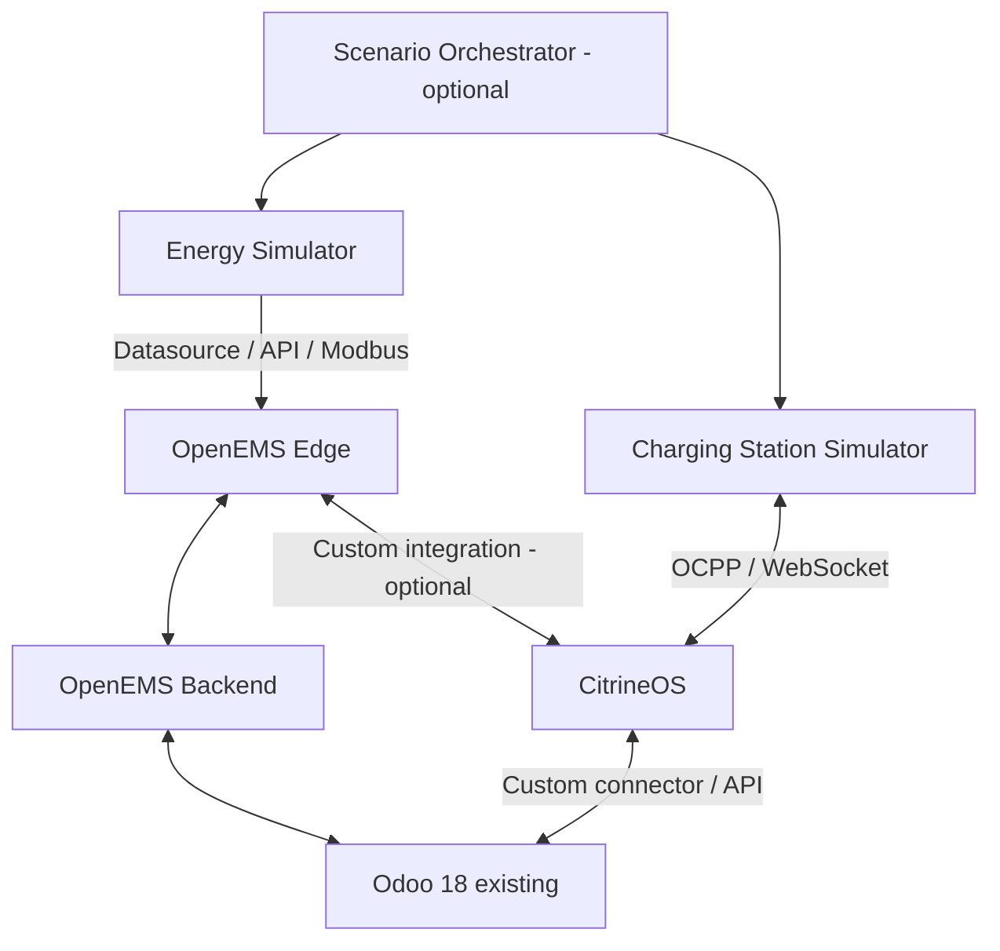

# Repository giả lập EMS, CSMS và OCPP — tài liệu để Agent review

Ngày tổng hợp: 26/11/2026. Đây là danh sách ứng viên, không phải quyết định chọn stack cuối cùng. Thông tin dựa trên README/tài liệu công khai; chưa build, chạy container hoặc kiểm thử tương thích thực tế.

## 1. Bối cảnh và mục tiêu

Đang xây dựng môi trường local để học nghiệp vụ quản lý năng lượng, điều độ năng lượng và vận hành trạm sạc xe điện, không có thiết bị vật lý.

- Đã có Docker và source OpenEMS, CitrineOS, OpenEMS Odoo Addon.
- Đã có Odoo 18 Community đang chạy; không triển khai thêm Odoo hay database Odoo trong stack mới.
- Ưu tiên tái sử dụng simulator mã nguồn mở, Docker Compose, cấu hình tự động và API/CLI để kích hoạt kịch bản. Hạn chế tự viết lại OCPP Client.
- Hệ thống phải sinh dữ liệu nghiệp vụ thực sự qua giao thức/API, thay vì chỉ sinh record giả trong database hoặc hiển thị dashboard minh họa.
- Ưu tiên chạy headless, liên tục, có thể tái lập kịch bản và tích hợp automation về sau.

### Hệ thống đích

| Hệ thống | Vai trò | Repository |
|---|---|---|
| OpenEMS Edge / Backend / UI | EMS: đo lường, điều độ, điều khiển công suất | https://github.com/OpenEMS/openems |
| CitrineOS | CSMS: quản lý trạm, kết nối OCPP, giao dịch sạc | https://github.com/citrineos/citrineos-core |
| OpenEMS Odoo Addon | Quản lý metadata, thiết bị, người dùng | https://github.com/OpenEMS/odoo-openems |
| Odoo 18 Community | ERP, Activity, automation, báo cáo | https://github.com/odoo/odoo/tree/18.0 |

Kiến trúc mục tiêu (không hàm ý các connector đã có sẵn):

## 2. Nhóm giả lập trạm sạc kết nối trực tiếp CSMS

### 2.1. SAP e-Mobility Charging Stations Simulator

- GitHub: https://github.com/SAP/e-mobility-charging-stations-simulator
- README: https://github.com/SAP/e-mobility-charging-stations-simulator/blob/main/README.md
- CLI: https://github.com/SAP/e-mobility-charging-stations-simulator/tree/main/ui/cli
- Loại: OCPP charge point simulator; Node.js/TypeScript.
- Hỗ trợ cấu hình nhiều trạm, các phiên bản OCPP 1.6 và 2.0.1, gửi dữ liệu đo và tự động sinh phiên sạc bằng Automatic Transaction Generator (ATG).
- Phù hợp để sinh lưu lượng nghiệp vụ nền: thời lượng phiên sạc, khoảng cách giữa các phiên, xác thực, dữ liệu điện năng và nhiều trạm hoạt động đồng thời.
- Cần review: URL WebSocket bên ngoài, cấu hình station/EVSE/connector, token, Docker image/Compose hiện hành, khả năng chạy ATG không cần UI, các lệnh điều khiển công suất và độ đầy đủ OCPP 2.0.1.
- Issue đáng kiểm tra: https://github.com/SAP/e-mobility-charging-stations-simulator/issues/2011 (theo dõi khoảng cách giữa triển khai OCPP 2.0.1 và đặc tả).
- Ưu tiên review: cao, cho mục tiêu tự động sinh phiên sạc liên tục. Chưa xác nhận chạy thành công với CitrineOS local.

### 2.2. OpenCPO Virtual Charger Farm

- GitHub: https://github.com/opencpo/opencpo-charger-farm
- README: https://github.com/opencpo/opencpo-charger-farm/blob/main/README.md
- Loại: virtual charger farm, mô phỏng nhiều trạm và stress test; hỗ trợ OCPP 1.6j/2.0.1 theo tài liệu dự án.
- Có API quản lý trạm và kích hoạt scenario (ví dụ `POST /api/scenarios/{name}`). README giới thiệu các bài kiểm thử tải, sự cố mạng, gián đoạn và khôi phục phiên sạc.
- Phù hợp cho peak load, disconnect/reconnect hàng loạt, endurance, phiên sạc hỗn hợp và chaos testing.
- Cần review: có chạy độc lập khỏi OpenCPO Core không; cấu hình endpoint OCPP bên ngoài; scenario nào phụ thuộc API OpenCPO; hỗ trợ `SetChargingProfile`; Docker dependencies; dữ liệu báo cáo có cần CPO API riêng không. Xác minh tên scenario và endpoint theo commit thực tế trước khi dùng.
- Ưu tiên review: cao, cho mô phỏng sự cố và kiểm thử tự động. Không mặc định tương thích CitrineOS chỉ vì cùng giao thức OCPP.

### 2.3. EVerest Demo / EVerest Core

- GitHub demo: https://github.com/EVerest/everest-demo
- GitHub core: https://github.com/EVerest/everest-core
- Hướng dẫn tích hợp CitrineOS: https://citrineos.github.io/latest/getting-started/testing-with-everest/
- Loại: software-in-the-loop (SIL) cho thiết bị sạc; demo Docker hóa.
- Có mô phỏng thiết bị và giao tiếp xe–trạm, hỗ trợ các bài thực hành OCPP/ISO 15118 tùy cấu hình. Có tài liệu upstream hướng dẫn chạy EVerest với CitrineOS, là bằng chứng tích hợp rõ nhất trong danh sách.
- Phù hợp để học trình tự vận hành thiết bị, cắm/rút xe, phiên sạc, xác thực và kiểm thử điều khiển.
- Cần review: dùng cấu hình EVerest có sẵn trong source CitrineOS hay demo riêng; khả năng chạy nhiều station/headless; API hoặc công cụ để tự động tạo vòng lặp nghiệp vụ; CPU/RAM và thời gian build.
- Ưu tiên review: cao nếu cần mô phỏng thiết bị sát thực tế; có thể không cần chạy đồng thời với simulator khác ở giai đoạn đầu.

### 2.4. Flowion Charge Point Simulator

- GitHub: https://github.com/flowionab/charge-point-simulator
- Loại: mô phỏng charge point qua OCPP phục vụ kiểm thử hệ thống sạc.
- Phù hợp để đánh giá hành vi của CSMS và điều khiển sạc.
- Cần review: phiên bản OCPP, hỗ trợ Smart Charging thực tế, tự động sinh phiên, API/CLI, Docker, cấu hình external CSMS, tên repo hiện hành.
- Ưu tiên review: ứng viên thay thế SAP/OpenCPO nếu dễ vận hành hơn.

### 2.5. Eveys Mobility Simulator

- GitHub: https://github.com/eveys-mobility/Simulator
- Loại: mô phỏng một hoặc nhiều trạm sạc với giao diện quản lý.
- README mô tả tạo thiết bị, phiên sạc, meter readings, reservation và firmware workflows.
- Cần review: mức độ phụ thuộc hệ sinh thái Eveys, phiên bản OCPP và tính năng theo từng phiên bản, chế độ headless, khả năng tự động chạy scenario và kết nối CitrineOS.
- Ưu tiên review: ứng viên bổ sung, đặc biệt nếu cần UI thao tác nghiệp vụ.

### 2.6. Docile Charge Point

- GitHub: https://github.com/ShellRechargeSolutionsEU/docile-charge-point
- Loại: OCPP charge point simulator/test tool có thể lập trình bằng script; Java/Scala.
- Có ví dụ chạy script heartbeat tới endpoint OCPP bên ngoài.
- Phù hợp với kịch bản kiểm thử giao thức có thể tái lập.
- Cần review: tình trạng bảo trì, JDK/Scala, phiên bản OCPP hỗ trợ, Docker, khả năng chạy liên tục và nhiều trạm.
- Ưu tiên review: bổ sung cho protocol testing, không phải lựa chọn mặc định cho sinh dữ liệu dài hạn.

### 2.7. OCPP CP Simulator (shiv3)

- GitHub: https://github.com/shiv3/ocpp-cp-simulator
- Loại: mô phỏng trạm sạc phục vụ AI-agent testing và CSMS development.
- Có browser UI, headless CLI và Socket.IO control API.
- Phù hợp để Agent hoặc script kích hoạt hành vi trạm sạc mà không cần tự triển khai OCPP Client.
- Cần review: phiên bản OCPP (đặc biệt khả năng OCPP 2.0.1; không mặc định hỗ trợ), khả năng kết nối CitrineOS, tự động tạo nhiều phiên, Docker và lifecycle.
- Ưu tiên review: cao nếu cần Agent điều khiển simulator; có thể không phù hợp nếu bắt buộc OCPP 2.0.1.

## 3. Nhóm giả lập năng lượng kết nối OpenEMS

### 3.1. OpenEMS Simulator — tích hợp sẵn trong Edge

- Source: https://github.com/OpenEMS/openems/tree/develop/io.openems.edge.simulator
- Tài liệu component: https://openems.github.io/openems.io/openems/latest/edge/core.d/io.openems.edge.simulator.html
- Real-time simulation: https://openems.github.io/openems.io/openems/latest/simulation/realtime.html
- Loại: các OSGi component giả lập trong OpenEMS Edge, không phải một service độc lập cần clone thêm.
- Có datasource CSV dựng sẵn (`Simulator.Datasource.CSV.Predefined`), CSV tùy chỉnh (`Simulator.Datasource.CSV.Direct`), chuỗi giá trị (`Simulator.Datasource.Single.Direct`) và các component mô phỏng thiết bị điện.
- Review thêm `Simulator.Datasource.Single.Channel` và `Simulator.App` theo đúng tag OpenEMS đang chạy. Kiểm tra điều kiện ghi channel qua REST API và quyền xác thực; không mặc định mọi channel đều writable.
- Phù hợp để giả lập Solar PV, phụ tải, grid meter, ESS/BESS và kiểm tra controller điều độ.
- Cần review: cách provision cấu hình tự động, time step, quy ước dấu công suất, đơn vị W/Wh, SoC, giới hạn pin, cấu hình scheduler, tương thích controller và InfluxDB. Dùng Edge riêng hoặc backup cấu hình trước khi bật các ứng dụng simulation có khả năng thay đổi component.
- Ưu tiên review: cao nhất cho EMS vì tích hợp native.

### 3.2. Facility-EMS

- GitHub: https://github.com/aurex-ke/Facility-EMS
- Loại: reference EMS theo hướng simulation-first, dùng OpenEMS Edge không sửa đổi và Docker Compose.
- README đề cập ví dụ hộ gia đình mô phỏng và công cụ Python tạo profile/fixture phụ tải cơ sở lưu trú.
- Phù hợp để tham khảo cấu hình triển khai và cách xây dựng dữ liệu năng lượng có tính nghiệp vụ thay vì random hoàn toàn.
- Cần review: phần nào đã triển khai so với roadmap, tương thích release OpenEMS, khả năng tái sử dụng load generator và cấu hình trong stack hiện có.
- Ưu tiên review: bổ sung cho OpenEMS Simulator; chưa coi là simulator đa hệ thống hoàn chỉnh.

## 4. Nhóm mô phỏng thuật toán và dữ liệu nghiên cứu (không mặc định kết nối trực tiếp)

### 4.1. EV2Gym

- GitHub: https://github.com/StavrosOrf/EV2Gym
- Loại: môi trường mô phỏng EV charging/V2G quy mô lớn.
- Phù hợp để nghiên cứu điều phối công suất, lịch sạc, nhu cầu EV và đánh giá thuật toán tối ưu hóa (heuristic, MPC, RL...).
- Không coi là OCPP Client hay connector OpenEMS/CitrineOS có sẵn. Cần adapter/replay để phát dữ liệu hoặc điều khiển thiết bị giả lập trong stack thực.
- Ưu tiên review: giai đoạn nâng cao khi học Smart Charging/V2G.

### 4.2. ACN-Sim (ACN Research Portal)

- GitHub: https://github.com/zach401/acnportal
- Tài liệu: https://acnportal.readthedocs.io/en/latest/acnsim/index.html
- Trang dự án: https://ev.caltech.edu/simulator
- Loại: mô phỏng thuật toán mạng sạc EV dựa trên dữ liệu; có hệ sinh thái ACN-Data.
- Phù hợp để xây dựng profile nhu cầu sạc, thời gian đến/rời trạm, điện năng yêu cầu và bài toán phân bổ công suất.
- Cần adapter để chuyển output thành OCPP transaction hoặc datasource OpenEMS. Không mặc định có kết nối CSMS trực tiếp.
- Ưu tiên review: nâng cao, khi cần dữ liệu có tính thực tế và đánh giá thuật toán.

### 4.3. Mobility House OCPP (thư viện lập trình)

- GitHub: https://github.com/mobilityhouse/ocpp
- Loại: Python library triển khai OCPP JSON; không phải simulator hoàn chỉnh.
- Phù hợp nếu cần bổ sung kịch bản đặc thù mà repo có sẵn không hỗ trợ, hoặc xây dựng adapter Python nhỏ.
- Cần tự viết lifecycle, scheduling, metering, trạng thái thiết bị và reconnect nếu dùng làm simulator từ đầu.
- Ưu tiên review: phương án dự phòng, không phải lựa chọn ưu tiên nếu có repo hoàn chỉnh.

## 5. Bảng so sánh sơ bộ

| Repo | Mục tiêu | Đường tích hợp dự kiến | Auto scenario | Ưu tiên |
|---|---|---|---|---|
| SAP Simulator | Tạo phiên sạc liên tục | OCPP → CitrineOS | ATG có sẵn | Cao |
| OpenCPO Farm | Sự cố, load/stress test | OCPP → CitrineOS (cần kiểm thử) | Scenario API có sẵn | Cao |
| EVerest Demo | Mô phỏng thiết bị | OCPP → CitrineOS (có hướng dẫn upstream) | Cần đánh giá automation | Cao |
| Flowion | Kiểm thử charge point | OCPP → CSMS | Cần xác minh | Bổ sung |
| Eveys | Quản lý trạm giả lập | OCPP → CSMS | Cần xác minh | Bổ sung |
| Docile | Script protocol test | OCPP → CSMS | Script | Bổ sung |
| shiv3 | Agent-driven testing | OCPP → CSMS | CLI/API; cần kiểm tra scheduling | Bổ sung |
| OpenEMS Simulator | Mô phỏng điện năng | Component native OpenEMS | Datasource/profile | Cao |
| Facility-EMS | Reference EMS và load profile | OpenEMS | Cần đánh giá | Bổ sung |
| EV2Gym | Tối ưu sạc/V2G | Adapter cần phát triển | Mô phỏng độc lập | Nâng cao |
| ACN-Sim | Dữ liệu/thuật toán sạc | Adapter cần phát triển | Mô phỏng độc lập | Nâng cao |
| Mobility House OCPP | Xây dựng client tùy chỉnh | OCPP → CSMS | Tự viết | Dự phòng |

## 6. Yêu cầu kịch bản nghiệp vụ

Các kịch bản dưới đây là yêu cầu của lab, không phải khẳng định mọi repo đều đã triển khai.

| ID | Kịch bản | Kết quả cần quan sát |
|---|---|---|
| CSMS-01 | Trạm kết nối và heartbeat | Trạm online, được nhận dạng đúng |
| CSMS-02 | Tự động sạc bình thường | Xác thực, bắt đầu, meter values, kết thúc, điện năng hợp lệ |
| CSMS-03 | Nhiều trạm sạc đồng thời | Nhiều transaction độc lập, tổng phụ tải tăng |
| CSMS-04 | Token không hợp lệ | Phiên bị từ chối hoặc xử lý theo cấu hình offline |
| CSMS-05 | Mất kết nối và reconnect | Trạng thái offline/online, xử lý giao dịch gián đoạn |
| CSMS-06 | Trạm báo lỗi | CSMS nhận và lưu sự kiện/trạng thái thích hợp |
| CSMS-07 | Remote start/stop | Simulator nhận lệnh và thay đổi phiên sạc |
| CSMS-08 | SetChargingProfile | Công suất thực tế mô phỏng tuân thủ giới hạn nhận được |
| EMS-01 | Điện mặt trời tăng/giảm | Đo đạc, cân bằng năng lượng và phản ứng controller |
| EMS-02 | Phụ tải cao điểm | Peak shaving/giới hạn công suất theo cấu hình |
| EMS-03 | BESS SoC thấp/cao | Sạc/xả trong giới hạn kỹ thuật |
| EMS-04 | Thiết bị mất dữ liệu/lỗi | EMS ghi nhận bất thường đúng trạng thái |
| INT-01 | Tổng phụ tải sạc tăng | Phụ tải từ CSMS được phản ánh vào mô hình EMS qua adapter |
| INT-02 | EMS giảm ngân sách công suất sạc | CSMS phát profile, simulator tuân thủ, EMS đo lại phản hồi |
| ERP-01 | Sự cố vận hành | Odoo connector nhận sự kiện và tạo Activity theo quy tắc |

## 7. Tiêu chí review cho Agent

Trước khi chọn repo, kiểm tra README, LICENSE, release/tag, commit mới nhất, issue tracker, Dockerfile/Compose, mã nguồn xử lý protocol và test. Không đánh đồng tính năng quảng cáo với tính năng đã kiểm thử.

### Điều kiện bắt buộc

- Có thể chạy local, không bắt buộc API cloud trả phí hay phần cứng vật lý.
- Với CSMS: có thể chỉ định OCPP endpoint bên ngoài và dùng phiên bản OCPP khớp với CitrineOS; ưu tiên 2.0.1, chấp nhận 1.6J nếu phiên bản backend và bài học phù hợp.
- Với EMS: tạo dữ liệu đầu vào thực sự cho OpenEMS; có thể dùng component native hoặc giao thức/API thích hợp.
- Có cách cấu hình/scripting để tự động sinh dữ liệu; không phụ thuộc hoàn toàn vào thao tác UI.
- Không tạo thêm Odoo 18 hoặc thay đổi database Odoo hiện có.

### Thang điểm đề xuất (100 điểm)

| Tiêu chí | Điểm |
|---|---:|
| Tích hợp và tương thích OpenEMS/CitrineOS thực tế | 30 |
| Tự động sinh dữ liệu/kịch bản, API/CLI, khả năng tái lập | 25 |
| Tính đúng nghiệp vụ và độ phủ giao thức/điều khiển | 20 |
| Docker, độ đơn giản cấu hình, CPU/RAM | 15 |
| Bảo trì, tài liệu, test, license | 10 |

Chấm theo nhóm EMS hoặc CSMS, không chấm một repo EMS thấp chỉ vì không hỗ trợ OCPP. Ghi rõ bằng chứng và trạng thái: đã xác nhận bằng mã nguồn/tài liệu, đã chạy thử, chưa xác minh, hoặc không hỗ trợ.

### Proof of concept tối thiểu

1. Chạy simulator và hệ thống đích bằng Docker; không làm thay đổi Odoo hiện tại.
2. Provision một station ID, EVSE, connector, token và cấu hình kết nối nếu dùng CSMS; kiểm tra OCPP handshake và một phiên sạc hoàn chỉnh.
3. Chạy nhiều phiên tự động; kiểm tra log, dữ liệu lưu trong CSMS và lệnh giới hạn công suất.
4. Với EMS, chạy profile phụ tải và PV; xác nhận channel thực sự thay đổi, controller phản ứng và dữ liệu lịch sử được lưu nếu cấu hình lưu trữ đã bật.
5. Kiểm tra shutdown/restart, reconnect và chạy headless. Đo tài nguyên, ghi lại tag/commit và cấu hình dùng được.
6. Với tích hợp EMS–CSMS, kiểm tra vòng phản hồi công suất bằng adapter riêng; không ghi thẳng database để giả lập thành công. Dùng ID trạm khác nhau giữa các simulator để tránh tranh chấp kết nối.

## 8. Yêu cầu đầu ra từ Agent review

- Danh sách repo nên chọn và repo loại bỏ, giải thích theo bằng chứng và mục tiêu học nghiệp vụ.
- Bảng phiên bản/tag, license, OCPP version, Docker support, tính năng thực tế và dependency bắt buộc.
- Đề xuất bộ stack tối giản (một simulator EMS + một simulator CSMS) và các repo nâng cao chỉ chạy khi cần.
- Lệnh clone, hướng dẫn cấu hình endpoint, provisioning và Compose tương thích với source đang có; tránh xung đột port với Odoo và các service khác.
- Danh sách scenario có sẵn, scenario cần bổ sung và cách kiểm chứng kết quả trên OpenEMS/CitrineOS.
- Chỉ rõ kết nối nào đã được upstream hỗ trợ, kết nối nào cần adapter/custom connector, các vấn đề chưa thử nghiệm.

## 9. Giả thuyết lựa chọn ban đầu (để review, không phải kết luận)

- EMS: dùng OpenEMS Simulator native; xem Facility-EMS nếu cần load profile và cấu hình tham khảo.
- CSMS: so sánh SAP Simulator và OpenCPO Farm cho dữ liệu liên tục/sự cố; dùng EVerest làm baseline vì CitrineOS có hướng dẫn tích hợp chính thức. Chọn một simulator chính trước, không mặc định cần chạy cả ba.
- Agent-driven: đánh giá thêm shiv3 nếu cần API/CLI điều khiển và phiên bản OCPP tương thích.
- Nâng cao: EV2Gym/ACN-Sim nếu cần mô hình tối ưu hóa hoặc profile sát thực tế.
- Chỉ tự phát triển phần orchestration/adapter và connector còn thiếu. Không có bằng chứng trong lần khảo sát này về một repo duy nhất đã tích hợp hoàn chỉnh cả OpenEMS, CitrineOS và Odoo, tự động chạy toàn bộ kịch bản end-to-end.
